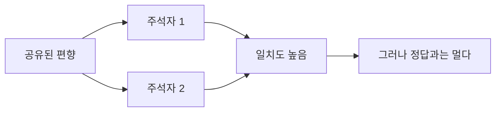
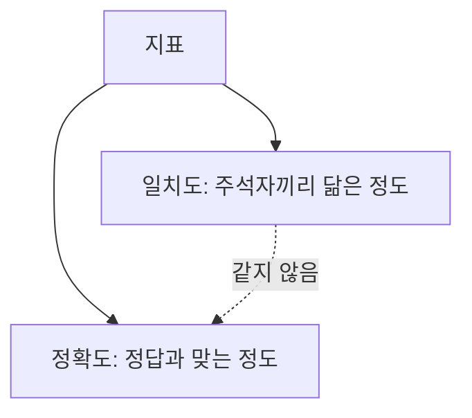

# 일관되지만 틀린 주석

> 주석자(사람이든 LLM이든)끼리 또는 반복 실행끼리 **결과가 잘 일치해도 정답과는 멀 수 있다.** 일치도는 정확도가 아니라 "서로 닮았는지"만 재기 때문에, 공통된 체계적 편향은 일치도에 잡히지 않는다.

## 쉽게 말하면
같은 잘못된 해설서로 공부한 두 학생은 답이 서로 거의 같지만 둘 다 틀린다. 둘의 답이 같다는 사실로 정답이라고 할 수는 없다. 오히려 해설서가 같은 탓에 일치도가 높다.

## 자세히
(직접 시뮬레이션: 5,000개 문서, 이진 라벨(교육적 여부), scikit-learn `cohen_kappa_score`, 실제 라벨은 시뮬레이션이 안다)
- **설정 A(공유된 편향)**: 두 주석자 모두 "격식 있어 보이는 문서(전체의 50%)"를 정답과 무관하게 긍정으로 표시하는 습관이 75% 확률로 작용하고 나머지는 진짜 라벨을 따르며 각자 3% 무작위 실수를 한다.
  - 두 주석자의 **일치율 76.9%, 코헨 카파 0.54**(중간 이상으로 보이는 일치)
  - 그러나 **정답 대비 정확도는 각각 61.2%, 61.5%**
- **설정 B(독립적이고 편향 없는 잡음)**: 각자 정답을 80% 맞히고 서로 독립적으로 틀린다.
  - 일치율 67.7%, 카파 0.35(낮아 보임)
  - **정확도 80%**
- 해석: A가 B보다 **일치도는 높지만 정확도는 훨씬 낮다.** 일치도(카파 등)는 주석자 사이의 신뢰성을 재는 지표이며, 같은 편향을 공유하면 높게 나온다. 일치도로 품질을 판단하면 안 되고 **외부 정답(사람 정답 세트)**으로 정확도를 따로 재야 한다. 이 수치는 임의로 정한 설정의 시뮬레이션이다.
- LLM에서 더 흔한 이유(제안): 같은 프롬프트·같은 모델로 여러 번 채점하면 일관성은 높지만 모델의 체계적 편향(길이 선호 등, [LLM 주석 편향](#llm-annotation-bias))이 매번 똑같이 반복된다. 온도를 낮출수록 반복 일치는 올라가도 정답과의 일치는 그대로다.
- 대응(제안): ① 소량이라도 전문가가 만든 정답 세트로 정확도·혼동 행렬 확인 ② 서로 다른 모델·프롬프트로 교차 채점해 불일치 사례를 사람이 검토 ③ 일치도와 정확도를 함께 보고 ④ 편향 의심 요인(길이·형식)과 점수의 상관 확인.

## 그림으로 보기

## 예시
- LLM 두 번 채점의 카파가 0.9여도, 사람 정답 100개와 비교하면 정확도가 60%일 수 있다.
- 교육: 신뢰성(reliability)과 타당성(validity)의 차이를 설명하는 사례.

## 헷갈리는 것과 비교
| 개념 | 차이 |
|---|---|
| 일치도([코헨 카파](#cohens-kappa)) | 주석자끼리의 합의 정도 |
| 정확도 | 정답 대비 맞힌 비율 |
| 신뢰성 | 반복해도 같은 결과 |
| 타당성 | 재려는 것을 제대로 재는가 |

## 더 읽을거리
- [scikit-learn cohen_kappa_score](https://scikit-learn.org/stable/modules/generated/sklearn.metrics.cohen_kappa_score.html) — 주석자 일치도 지표(시뮬레이션에 사용).
