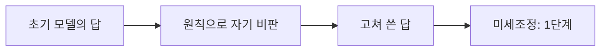
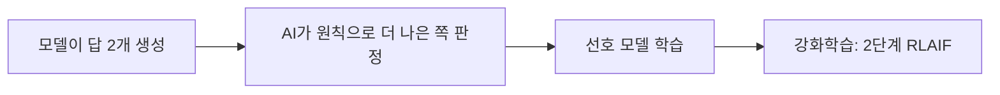

# Constitutional AI

> Constitutional AI(CAI)는 Anthropic이 2022-12-15 공개한 학습법(arXiv 2212.08073)으로, 사람이 일일이 유해성을 라벨링하는 대신 짧은 **원칙 목록(헌법)**을 주고 AI가 스스로 비판·수정·선호 판단을 하게 해 무해한 어시스턴트를 만든다.

## 쉽게 말하면
선생님이 모든 답안을 채점하는 대신 "거짓말하지 말 것, 위험한 방법은 알려 주지 말 것" 같은 학급 규칙을 적어 주고, 학생이 그 규칙으로 자기 답안을 고쳐 쓰고 서로의 답안을 비교 채점하게 하는 방식이다. 규칙이 글로 적혀 있어 무엇을 기준으로 삼는지 누구나 볼 수 있다.

## 자세히
- **1단계 지도학습(비판·수정)**: 초기 모델이 답을 내면 → 원칙에 비춰 스스로 비판 → 고쳐 쓴 답으로 모델을 미세조정.
- **2단계 RLAIF**(AI 피드백 강화학습): 미세조정된 모델이 답 두 개를 내면 → 모델이 원칙에 따라 더 나은 쪽을 판정 → 그 AI 선호 데이터로 선호 모델 학습 → 이를 보상으로 강화학습. 사람 피드백을 쓰는 [RLHF](#rlhf)와 달리 선호 라벨을 AI가 만든다.
- **효과**: 회피만 하는 답이 아니라, 유해한 요청에는 거절 이유를 설명하며 응하는 "무해하되 비회피적" 어시스턴트. 사람 라벨이 훨씬 적게 든다. 추론 과정(chain of thought)을 쓰면 판단 품질과 투명성이 올랐다고 보고(Anthropic 주장).
- **원칙의 출처**(Anthropic 공개 페이지): UN 세계인권선언, Apple 이용약관, DeepMind Sparrow 규칙, 비서구 관점을 반영한 원칙, 자체 연구에서 효과적이던 원칙. 원칙에 순위는 없고 학습 중 여러 번 무작위로 적용한다. Anthropic은 현재 버전이 "최종본도, 최선도 아니다"라 밝혔고, 2026-01-21자 안내에 새 헌법 버전이 공개되었다고 적혀 있다(내용은 직접 확인 못 함).
- 한계: 원칙을 누가 정하느냐의 문제가 남고, AI 판정이 편향을 이어받을 수 있다.

## 그림으로 보기

## 예시
- 원칙 예: "가장 해롭지 않고 윤리적인 응답을 고르라." 모델이 위험한 레시피 요청에 처음 답을 냈다가, 비판 단계에서 문제를 짚고 거절·대안 안내로 고쳐 쓴다.
- 업무 적용: 회사 AI 정책(개인정보·톤)을 원칙 문서로 쓰고, 평가용 LLM 판정기에 그 원칙을 주는 식으로 응용(비슷한 발상).

## 헷갈리는 것과 비교
| 개념 | 차이 |
| --- | --- |
| [RLHF](#rlhf) | 사람이 선호를 라벨링 |
| RLAIF | AI가 원칙에 따라 선호를 라벨링 |
| [가드레일](#guardrails) | 배포 후 입출력 필터, CAI는 학습 단계 |
| [정렬](#ai-alignment) | 큰 목표, CAI는 그 한 방법 |

## 더 읽을거리
- [Anthropic: Constitutional AI: Harmlessness from AI Feedback](https://www.anthropic.com/research/constitutional-ai-harmlessness-from-ai-feedback) — 논문 요약
- [Anthropic: Claude's Constitution](https://www.anthropic.com/news/claudes-constitution) — 원칙의 출처와 갱신
