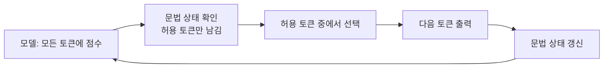
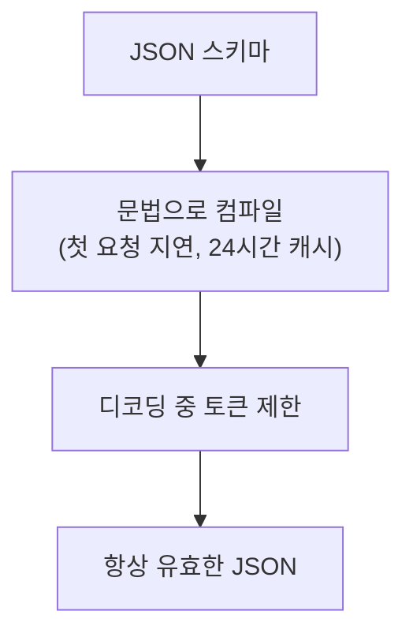

# 제한 디코딩(Constrained Decoding)

> 모델이 다음 토큰을 고를 때 규칙(JSON 스키마·정규식·문법)에 맞지 않는 토큰을 아예 후보에서 지워, 출력이 항상 정해진 형식을 지키도록 강제하는 기법.

## 쉽게 말하면
빈칸 채우기 시험지에서 "이 칸에는 숫자만 쓸 수 있다"고 정해 두면, 학생이 다른 글자를 쓸 방법이 없다. 모델에게 "형식을 지켜 줘"라고 부탁하는 대신, 형식에 어긋나는 글자 선택지를 처음부터 막아 버리는 것이다. 부탁은 가끔 어겨지지만 차단은 어길 수 없다.

## 자세히
- **작동 원리**: 모델은 매 단계 어휘 전체(수만 개 토큰)에 점수(로짓)를 매긴다. 제한 디코딩은 지금까지의 출력 상태에서 문법상 허용되는 토큰만 남기고 나머지의 확률을 0으로 만든 뒤 그 안에서 뽑는다. [로짓 편향](#logit-bias)을 극단적으로 쓴 것과 같은 계열이다.
- **Outlines 논문**(Willard·Louf, arXiv 2307.09702, 2023년 7월): 텍스트 생성을 **유한 상태 기계**의 상태 전이로 보고, 모델 어휘에 대한 색인을 만들어 정규식·문맥 자유 문법을 따르는 생성을 거의 추가 비용 없이 수행한다. 어떤 모델에도 적용되며 오픈소스 Outlines 라이브러리로 구현했다. Outlines는 선택지, 함수 서명, JSON/Pydantic 스키마, 정규식, 문맥 자유 문법을 제약으로 지원하고 vLLM·Ollama·transformers·llama.cpp·OpenAI·Gemini 등 백엔드를 갖는다.
- **상용 API의 구조화 출력(Claude 문서, 2026-11 기준)**: JSON 스키마를 `output_config.format`에 `type: "json_schema"`로 보내면 응답이 항상 유효한 JSON이 된다. 보장의 근거가 제한 디코딩이다. 스키마를 문법 산출물로 컴파일하고 토큰 샘플링을 스키마에 맞는 출력만 나오게 제한한다. Claude 5 계열과 4.x 계열 등에서 지원된다.
  - **첫 요청 지연**: 새 스키마를 처음 쓰면 문법 컴파일 시간이 추가된다. 컴파일된 문법은 마지막 사용 후 24시간 캐시된다. 스키마 구조를 바꾸면 캐시가 무효화되고, 이름·설명만 바꾸면 유지된다.
  - **제한**: 재귀 스키마, 숫자 범위(`minimum`·`maximum`), 문자열 길이 제한, 외부 `$ref` 등은 지원되지 않으며 400 오류가 난다. 객체는 `additionalProperties: false`가 필요하다. SDK 도우미(`parse()`)는 지원 안 되는 제약을 필드 설명으로 옮기고 응답을 원래 제약으로 검증한다.
  - **엄격한 도구 사용**(`strict: true`)은 도구 이름과 입력이 유효함을 보장한다.
- **장점**: 파싱 실패·재시도 제거, 후처리 단순화, 안정적인 파이프라인.
- **주의점**: 형식은 보장하지만 **내용의 정확성은 보장하지 않는다**(형식에 맞는 틀린 값이 나올 수 있음). 지나친 제약은 답의 질을 떨어뜨릴 수 있다. 스키마에서 필드 순서와 설명이 모델의 이해에 영향을 준다.

## 그림으로 보기




## 예시
이메일에서 정보를 추출할 때(Claude 문서 예시를 줄임):
```python
response = client.messages.create(
    model="claude-opus-5-5", max_tokens=1024,
    messages=[{"role": "user", "content": "이메일에서 핵심 정보 추출: ..."}],
    output_config={"format": {"type": "json_schema", "schema": {
        "type": "object",
        "properties": {"name": {"type": "string"},
                       "demo_requested": {"type": "boolean"}},
        "required": ["name", "demo_requested"],
        "additionalProperties": False}}},
)
```
오픈 모델에서는 Outlines나 llama.cpp 문법(GBNF)으로 같은 효과를 낸다.

## 헷갈리는 것과 비교
| 개념 | 차이 |
|---|---|
| "JSON으로 답해 줘"라는 프롬프트 | 부탁. 어길 수 있음 |
| 제한 디코딩 | 형식에 어긋난 토큰을 차단. 형식 보장 |
| [로짓 편향](#logit-bias) | 특정 토큰 점수를 가감. 제한 디코딩은 규칙 기반으로 자동 적용 |
| 검증 후 재시도 | 틀리면 다시 시킴. 비용·지연 발생 |
| [JSON 스키마 출력](#json-schema-output) | 제한 디코딩이 보장하는 사용자 쪽 기능 |

## 더 읽을거리
- [Structured outputs (Claude 문서)](https://platform.claude.com/docs/en/build-with-claude/structured-outputs) — 스키마·캐시·제한
- [Efficient Guided Generation for LLMs (arXiv 2307.09702)](https://arxiv.org/abs/2307.09702) — 유한 상태 기계 방식
- [Outlines (GitHub)](https://github.com/dottxt-ai/outlines) — 구현 라이브러리
