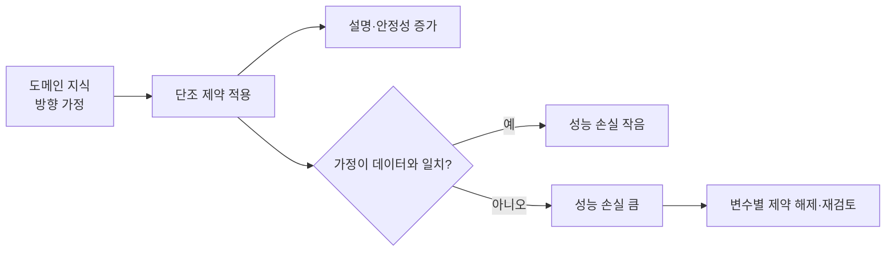

# 제약과 성능 트레이드오프

> 단조 제약처럼 모델에 방향 가정을 강제하면 설명·안정성은 얻지만, 데이터에 가정과 어긋나는 실제 패턴이 있을 때 정확도 일부를 잃을 수 있다.

## 쉽게 말하면
도로 위에서 "차선을 넘지 마라"라는 규칙을 주면 사고는 줄지만 급한 곡선 구간에서는 가장 빠른 길을 못 간다. 제약은 안전장치이면서 자유도 제한이다.

## 자세히
출처: XGBoost 단조 제약 튜토리얼(본문 확인, 2026-11-18)과 [단조 제약 설정법](#monotone-constraints) 노드가 정리한 LightGBM 문서 내용.
- **튜토리얼 관찰**: 추세 위에 사인 진동이 겹친 모의 데이터에서, 제약 없는 모델은 추세와 진동을 모두 맞췄고 제약 모델은 방향성은 유지하되 진동은 학습하지 않았다. 튜토리얼은 이를 사전 지식에 맞춘 함수 형태 제한으로 설명한다. 수치로 된 성능 차이는 읽은 페이지에 없다.
- **얻는 것**: 규제 대응·설명 용이성(변수 방향이 상식과 일치), 소표본·노이즈에서 과적합 완화 가능성(튜토리얼의 "잡음성 변동 미학습" 서술에 근거한 해석).
- **잃는 것**: 진짜 비단조 관계(예: 나이와 위험의 U자)를 가려 오차가 늘 수 있다.
- **구현상 주의**: `hist`·`approx` 트리 방식에서 제약으로 분할 후보가 모두 제거돼 트리가 얕아질 수 있고, 이때 `max_bin` 증가를 고려한다(튜토리얼). LightGBM은 `intermediate`·`advanced` 방식이 덜 제약한다고 문서가 설명한다.
- **측정 방법(제안)**: 같은 검증셋에서 AUC·로그손실을 제약/무제약으로 비교하고, 하락폭이 허용 범위인지 보고 변수별로 제약을 선택 적용한다.

## 그림으로 보기

## 예시
- 소득↑ → 연체 위험↓ 제약: 일치하는 가정이라 손실이 작을 가능성이 크다.
- 나이 변수에 증가 제약: U자 관계라면 손실이 크므로 제약을 풀거나 구간화한다.
- 비교 코드: `auc_free - auc_constrained`를 변수별로 표로 만든다.

## 헷갈리는 것과 비교
| 개념 | 차이 |
|---|---|
| 제약 트레이드오프 | 정확도와 설명성의 맞바꿈 |
| [부분 의존 곡선 점검](#partial-dependence-check) | 제약이 지켜졌는지 확인 |
| 정규화(L1·L2) | 계수 크기를 줄이는 규제, 방향 강제는 아님 |
| [단조 제약 설정법](#monotone-constraints) | 설정 파라미터 |

## 더 읽을거리
- [XGBoost 단조 제약 튜토리얼](https://xgboost.readthedocs.io/en/stable/tutorials/monotonic.html) — 제약 전후 비교와 max_bin 팁
- [scikit-learn 부분 의존](https://scikit-learn.org/stable/modules/partial_dependence.html) — 비교 곡선 그리기
