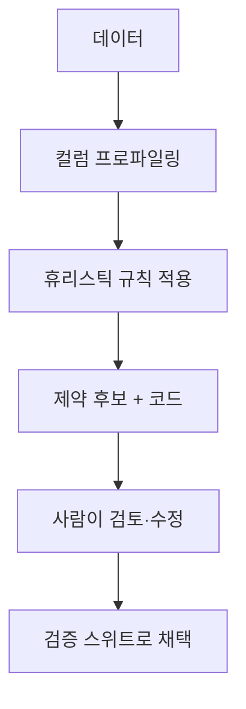
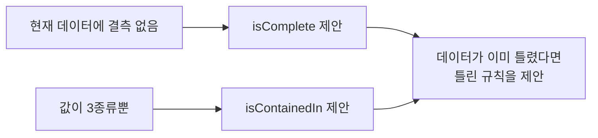

# 제약 자동 제안

> 제약 자동 제안은 데이터를 **프로파일링한 뒤 휴리스틱 규칙을 적용해 "이런 검증 규칙을 걸면 좋겠다"고 후보를 만들어 주는** 기능이다(Deequ의 `ConstraintSuggestionRunner`). 규칙을 처음부터 쓰는 부담을 줄이지만, 제안은 반드시 사람이 검토해야 한다.

## 쉽게 말하면
처음 보는 엑셀 파일을 훑고 "이 열은 빈 칸이 없으니 필수로, 이 열은 값이 세 종류뿐이니 허용 목록으로 하면 어떨까요?"라고 초안을 써 주는 조수다. 초안이 현재 데이터를 기준으로 하므로, 그 데이터가 이미 틀렸다면 틀린 규칙을 제안한다.

## 자세히
(Deequ 저장소의 제약 제안 예제 문서와 PyDeequ README를 직접 확인. 이번에 직접 실행은 하지 못했다. 환경에서 Maven 접근이 막혀 Spark·Deequ jar를 받을 수 없었다.)
- **동작(Deequ 예제 문서)**: `ConstraintSuggestionRunner`가 데이터를 **프로파일링**하고 휴리스틱 규칙을 적용해 제약을 제안한다. 기본 규칙 세트는 `Rules.DEFAULT`, 개별 규칙은 `.addConstraintRule(...)`로 추가한다(예: `RetainCompletenessRule`을 `WilsonScoreIntervalStrategy`와 함께). 각 제안에는 설명 텍스트와 해당 Scala 코드가 붙는다.
- **문서의 예시 결과**: `valuable` 컬럼은 문자열 "true"/"false"라서 Boolean 타입 검사와 완전성 0.38 이상, `totalNumber`는 Fractional 타입·완전성 0.53 이상·음수 값이 없으니 `isNonNegative`, `productName`·`status`는 결측이 없으니 `isComplete`와 소수의 관측 값에 대한 `isContainedIn`. 완전성 하한이 0.38·0.53처럼 관측 비율에 기반한 값임을 보여 준다. 어떤 규칙이 어떤 제안을 만들었는지는 문서에 명시돼 있지 않다.
- **PyDeequ(README)**: `ConstraintSuggestionRunner(spark).onData(df).addConstraintRule(DEFAULT()).run()`으로 실행하고 결과는 JSON으로 출력된다. README에 샘플 출력은 없어 필드 구성은 직접 실행해 확인해야 한다.
- **문서의 주의**: 제안은 데이터가 정적이고 올바르다고 가정하는데 실제로는 그렇지 않은 경우가 많으니 **배포 전에 사람이 검토**해야 한다. 대규모 데이터는 `.useTrainTestSplitWithTestsetRatio(0.1)`로 90%에서 제안을 만들고 나머지 10%로 평가할 수 있다. 컬럼 프로파일은 `suggestionResult.columnProfiles`로 얻는다.
- **사용 순서(제안)**: ① 대표 기간 데이터로 제안 생성 ② 도메인 지식으로 불필요한 규칙 삭제·완화(예: 완전성 하한은 현재 수치보다 느슨하게) ③ 검증 스위트에 채택 ④ 이후 [품질 지표 저장소](#data-quality-metrics-repository)로 추세 감시.

## 그림으로 보기

## 예시
- 새로 받은 고객 테이블에 `ConstraintSuggestionRunner`를 돌려 초안 15개를 얻고, 담당자가 8개만 채택·2개는 하한을 완화.
- 교육 소재: 자동 제안 결과를 그대로 쓰면 왜 위험한지(오염된 데이터 기준) 토론.

## 헷갈리는 것과 비교
| 개념 | 차이 |
|---|---|
| 제약 자동 제안 | 현재 데이터에서 규칙 후보 생성 |
| 제약 검증 | 정해진 규칙으로 통과/실패 확인 |
| [PyDeequ](#pydeequ) | Python에서 이 기능을 쓰는 래퍼 |
| [TFDV 스키마 추론](#tfdv-infer-schema-review) | 통계에서 스키마를 추론(비슷한 아이디어) |

## 더 읽을거리
- [Deequ 제약 제안 예제](https://github.com/awslabs/deequ/blob/master/src/main/scala/com/amazon/deequ/examples/constraint_suggestion_example.md) — 규칙·예시·주의(raw 파일로 직접 확인).
- [awslabs/python-deequ README](https://github.com/awslabs/python-deequ) — PyDeequ 사용 코드(직접 확인).
