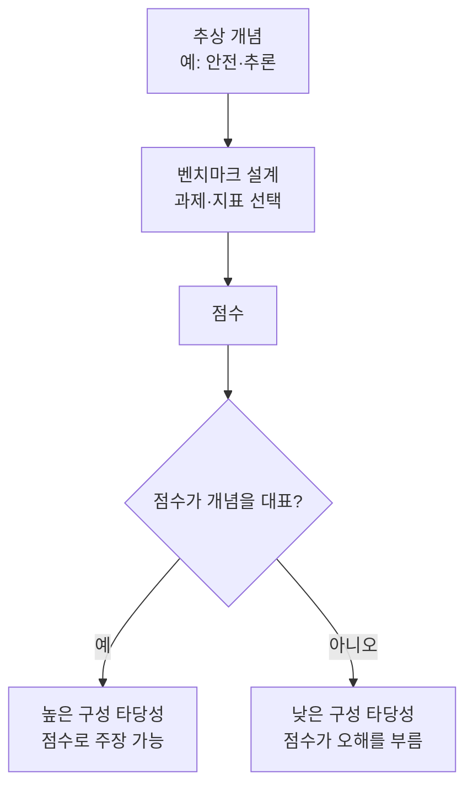

# 구성 타당성

> 시험 점수가 실제로 재려는 추상적 개념(예: "안전", "추론 능력", "상담 품질")을 정말 반영하는가를 묻는 타당성. 구성 타당성이 낮으면 점수가 높아도 그 개념과 무관하거나 오해를 부른다.

## 쉽게 말하면
"수학 능력"을 재겠다며 문제를 푸는 속도만 재면, 속도 점수가 높아도 수학 능력이 높다고 말할 수 없다. 재려는 개념(구성)과 실제 재는 것(지표)이 맞물려야 점수가 의미를 갖는다.

## 자세히
출처: Bean 외, "Measuring What Matters: Construct Validity in Large Language Model Benchmarks"(arXiv 2511.04703, 2025-11-03 제출, NeurIPS 2025 Datasets & Benchmarks 트랙). 이번에는 초록과 검색 요약만 읽었고 본문 PDF는 열지 못했다.
- **문제의식**: "안전", "강건성" 같은 추상 개념을 믿을 만하게 재려면 강한 구성 타당성이 필요하다.
- **조사 규모**: 29명의 전문가 리뷰어가 주요 NLP·ML 학회의 LLM 벤치마크 **445개**를 체계적으로 검토했다.
- **발견(초록 기준)**: 측정 대상 현상, 과제, 채점 지표의 정의·선택 방식에 타당성을 해치는 패턴이 있다. 구체 비율은 이번에 확인하지 못했다.
- **권고**: 8가지 권고와 점검표를 제시한다. 검색 요약에 따르면 현상을 정의하고, 그 현상만 재고, 모델 비교에 통계 기법을 쓰라는 항목이 포함된다. 8개 전체 목록은 확인하지 못했다.
- **NIST와의 연결**: [측정 타당성](#measurement-validity)의 4가지 구분 중 하나로, "지표가 개념을 제대로 대표하는가"에 해당한다(교육용 구분).
- **실무 질문**: 이 점수가 오르면 정말 그 능력이 오른 것인가? 대안 설명(데이터 오염, 형식 암기)은 없는가?

## 그림으로 보기

## 예시
- 안전성 벤치마크가 "금지 단어 포함 여부"만 센다면 위험한 조언을 담은 답이 통과할 수 있다 → 지표가 개념을 대표하지 못함.
- 점검 절차: 재려는 개념을 한 문장으로 정의 → 과제가 그 개념만 건드리는지 확인 → 사람 판단과 점수 대조.

## 헷갈리는 것과 비교
| 개념 | 차이 |
|---|---|
| [측정 타당성](#measurement-validity) | 상위 개념, 구성 타당성은 그 한 종류 |
| [대리 지표](#proxy-metric) | 어려운 목표를 다른 값으로 대체하는 위험, 구성 타당성을 해치는 흔한 원인 |
| 신뢰성 | 반복해도 같은 값이 나오는가, 타당성과 별개 |
| [AI 평가·벤치마크](#ai-evaluation) | 이 문제가 나타나는 영역 |

## 더 읽을거리
- [Measuring What Matters (NeurIPS 2025 proceedings)](https://proceedings.neurips.cc/paper_files/paper/2025/hash/1967e0fc3aa6cbbace562f5cb8e3954e-Abstract-Datasets_and_Benchmarks_Track.html) — 논문 초록(검색으로 확인)
- [arXiv 2511.04703](https://arxiv.org/abs/2511.04703) — 저자·날짜·초록(열어서 확인, 본문 미확인)
