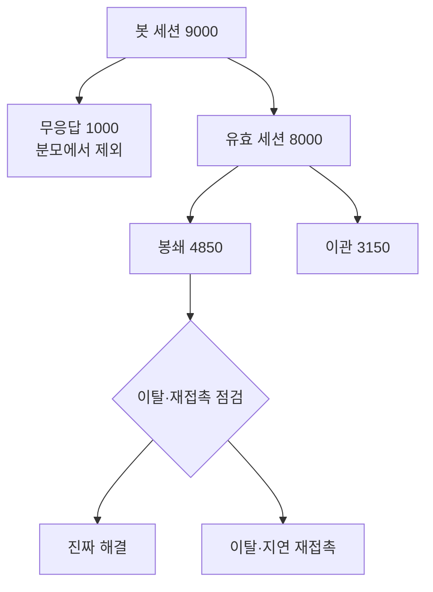
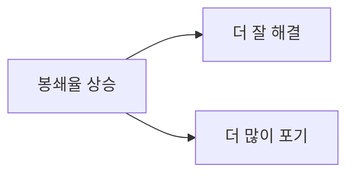

# 봉쇄율의 함정

> 봉쇄율(containment)은 사람 이관 없이 봇 안에서 끝난 대화의 비율이다. 고객이 말없이 떠나도 "봉쇄"로 잡히기 때문에, 경험이 나빠질수록 숫자가 오르는 역설이 생길 수 있다.

## 쉽게 말하면
식당이 "주방까지 들어온 불만 건수"로 서비스를 평가하는 것과 같다. 불만이 있는 손님이 말 없이 나가 버리면 불만 건수는 줄어든다. 점수는 좋아졌지만 손님은 줄었다.

## 자세히
- **식(Fini 용어집)**: (봉쇄된 대화 ÷ 접수된 전체 봇 대화) × 100. 예: 9,000세션 중 5,850이 봉쇄 → 65%.
- **분모 문제**: 고객이 한 마디도 안 한 무응답 세션을 분모에 넣으면 부풀려진다. 예시에서 무응답 1,000건을 빼면 65% → 약 61%(4,850/8,000).
- **무언의 이탈**: 대화 중간에 답도 못 얻고 떠난 고객이 기본값으로 봉쇄 처리되는 경우가 많아, 경험이 나빠질수록 율이 오른다.
- **지연 재접촉**: 며칠 뒤 같은 문제로 이메일·전화를 하면 봉쇄로 남는다. 반복 접촉 창은 며칠 뒤에야 닫히므로 이번 달 수치는 잠정값이다.
- **흔한 함정**: 이탈을 봉쇄로 세기 / 모든 문의 사유를 한 숫자로 합치기 / 품질 지표 없이 봉쇄 목표만 두어 이관을 어렵게 만들기 / 봉쇄를 고객 가치의 증거로 해석.
- **짝지을 지표**: 봉쇄 세션의 CSAT, 1주 내 재접촉, 해결률, 이관율(같은 분모에서 거의 역수), 문의 사유별 분리.
- 코딩 규칙과 세션 경계는 목표를 정하기 전에 고정한다.
- 출처는 모두 벤더 자료. Meya 글도 deflection이 고객 경험 측면을 무시한다고 같은 취지를 말한다.

## 그림으로 보기

## 예시
- 봉쇄율이 65% → 72%로 올랐는데 1주 내 재접촉도 같이 올랐다면 개선이 아니라 이탈일 수 있다.
- 교육 실습: 세션 로그 30건을 "해결 / 이관 / 이탈 / 무응답"으로 직접 분류해 봉쇄율을 다시 계산해 본다.

## 헷갈리는 것과 비교
| 개념 | 차이 |
|---|---|
| 봉쇄율 | 봇 안에서 끝난 비율(접수된 봇 대화 기준) |
| [응대 전환율 deflection](#deflection-rate) | 분모가 더 넓고 봇을 안 연 접촉도 포함 |
| 이관율 | 같은 분모에서 거의 역수 |
| [에스컬레이션율 목표](#escalation-rate-target) | 이관율을 어떻게 해석할지 |

## 더 읽을거리
- [Fini: Chatbot containment rate](https://www.usefini.com/glossary/what-is-chatbot-containment-rate) — 식, 분모, 이탈 처리(벤더)
- [Meya: Deflection rates in chatbots](https://www.meya.ai/blog/deflection-rates-chatbots) — 보완 지표(벤더)
