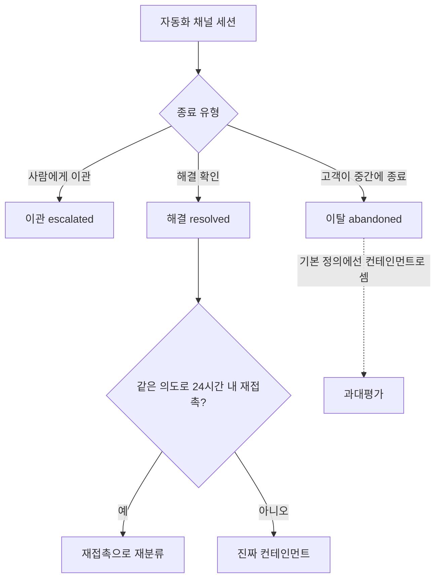

# 컨테인먼트율 (Containment Rate)

> 자동화 채널(챗봇·IVR·AI 상담원)에 들어온 세션 중 **사람에게 넘어가지 않고 그 안에서 끝난 비율**. 공식은 `컨테인먼트 세션 ÷ 전체 세션`. "문제가 풀렸는가"가 아니라 "대화가 자동화 채널 안에 머물렀는가"만 잰다.

## 쉽게 말하면
식당 입구의 무인 주문기에서 "직원을 부르지 않고 끝난 주문 비율"이다. 주문이 끝난 것과 손님이 만족하고 간 것은 다르다. 화가 나서 그냥 나간 손님도 "직원을 안 불렀다"로 센다.

## 자세히
출처: Cekura 블로그와 Alhena 블로그(둘 다 본문 확인, 2026-11-18). 둘 다 벤더 글이고, 벤치마크 수치는 대부분 출처가 없다.
- **정의와 예**: 컨테인먼트 = 사람 이전 없이 끝난 세션 ÷ 전체 세션 × 100. 예: 월 1,000건 중 750건이 자동화로 종료 → 75%.
- **세 지표의 차이(벤더 설명)**: 컨테인먼트는 대화가 어디에 **머물렀는지**, deflection은 사람에게 **닿지 않은** 모든 문의(셀프서비스 포함), 해결률은 문제가 **풀렸는지**를 본다([응대 전환율 deflection](#deflection-rate), [해결률](#resolution-rate)).
- **이탈 문제(Cekura)**: 기본 정의에서는 포기하고 끊은 호출도 "컨테인먼트"가 된다. 미국 우체국(USPS) IVR 사례에서 컨테인먼트가 FY2018 62% → 2020-10~2021-05 78%(목표 80%)로 올랐으나 컨테인먼트 호출 다수가 고객이 끊은 것이었고, 감찰관실이 완결 호출과 이탈 호출을 분리 보고하라고 권고했다고 글은 전한다. 의도별 컨테인먼트는 93%부터 56%까지 편차.
- **조용함을 보상한다**: 포기한 사람, 틀린 답을 받아들인 사람, 완벽한 답을 받은 사람이 같은 로그 신호를 만든다는 비판. Gartner 데이터(2023-12, 고객 5,728명)로 자가 서비스에서 완전히 해결되는 문의는 14%, 고객이 단순하다고 본 문의는 36%라는 수치를 인용한다(재인용, 원 자료 미확인). 흔히 쓰는 70~90% 범위는 벤더 블로그끼리 서로 인용한 것이라고 글이 주장한다.
- **엄격한 정의(제안, Cekura)**: 결과를 평문 성공 조건으로 직접 채점, 세션을 해결·이관·이탈·재접촉 네 결말로 나누고 해결만 성과로 센다. 같은 의도로 창(예: 24시간) 안에 다시 연락한 컨테인먼트 세션은 재분류. 원시값과 보정값을 한 분기 병행 보고. 정의를 기록·버전 관리하고 의도별로 보고.
- **벤치마크 주의(Alhena)**: 성숙도 20~40/40~70/70~90%, 업종별 범위가 나오지만 출처가 없다고 명시돼 있다. 고객사 "80~90% deflection" 주장도 자사 사례다.
- **실무 규칙(제안)**: 컨테인먼트 단독으로 성과를 보고하지 말고 해결률·재문의율·CSAT와 함께 보고, 이탈은 따로 센다.

## 그림으로 보기

## 예시
- 월 10,000세션, 이관 2,500 → 단순 컨테인먼트 75%. 그런데 7,500건 중 이탈 2,000, 24시간 내 재접촉 500이라면 엄격 정의 컨테인먼트는 (7,500−2,000−500)/10,000 = 50%(가상 값).
- 교육 활용: 벤더 제안서의 "컨테인먼트 85%"가 이탈을 포함하는지 질문하는 체크리스트.

## 헷갈리는 것과 비교
| 개념 | 차이 |
|---|---|
| 컨테인먼트율 | 자동화 채널 안에서 끝난 비율 |
| [응대 전환율 deflection](#deflection-rate) | 사람에게 닿지 않은 모든 문의 |
| [해결률](#resolution-rate) | 해결 신호로 센 비율 |
| 이탈률 | 도중에 포기하고 끝낸 비율 |

## 더 읽을거리
- [Cekura: Containment rate](https://www.cekura.ai/blogs/containment-rate) — USPS 사례, 이탈 문제, 엄격한 정의(벤더)
- [Alhena: Containment vs deflection](https://alhena.ai/blog/ai-chatbot-containment-vs-deflection-rate/) — 정의·벤치마크(출처 없음 주의)
