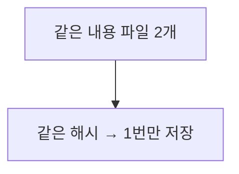

# 내용 주소 저장소

> 파일을 이름이 아니라 내용의 해시로 저장하는 방식이다. 같은 내용은 해시가 같아 한 번만 저장되고(중복 제거), 해시가 같으면 내용도 같다고 본다. DVC 캐시가 이 구조다.

## 쉽게 말하면
사물함 번호를 물건의 지문으로 정하는 것이다. 같은 물건은 같은 번호라 두 번 넣지 않는다.

## 자세히
(DVC 문서 원문을 하위 에이전트가 읽은 노트 기준. 구버전 2.x의 캐시 구조는 미확인.)
- **캐시 경로**: `.dvc/cache/files/md5/<앞 2글자>/<나머지 30글자>` (예: `ec/1d2935f8...`).
- **중복 제거**: 같은 내용의 파일은 같은 해시라 한 번만 저장.
- **디렉터리**: `<해시>.dir` JSON 배열 `[{md5, relpath}]`로 저장.
- **실행 캐시**: 단계 실행 결과는 `.dvc/cache/runs`에 저장.
- **의미(제안)**: 데이터 버전은 해시로 정확히 식별되고 무결성 검증이 쉽다. 단점은 사람이 파일명으로 찾기 어렵다는 점이라 `.dvc` 포인터가 이름과 해시를 연결한다([DVC 포인터](#dvc-pointer-files)).

## 그림으로 보기

## 예시
- 같은 CSV를 두 폴더에 복사해도 DVC 캐시에는 한 번만 저장됨을 확인.
- 교육 활용: 해시를 지문에 비유해 설명.

## 헷갈리는 것과 비교
| 개념 | 차이 |
|---|---|
| 내용 주소 저장 | 내용 해시가 주소 |
| 이름 기반 저장 | 파일명이 주소 |
| Git 객체 저장 | 비슷한 원리(내용 해시) |

## 더 읽을거리
- [DVC 문서 저장소](https://github.com/iterative/dvc.org) — 캐시 구조 문서(원문 마크다운).
