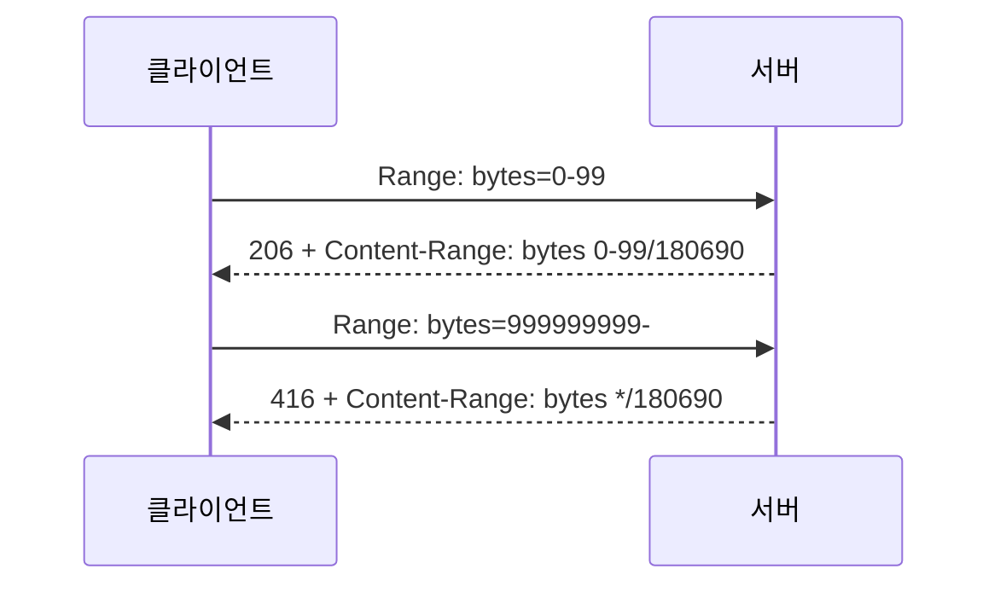
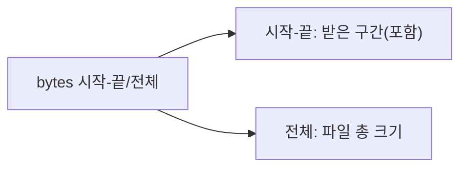

# Content-Range 헤더

> 서버가 Range 요청에 `206`으로 답할 때 붙이는 응답 헤더로, **돌려준 바이트 구간과 파일 전체 크기**를 알려 준다. 형식은 `Content-Range: bytes 시작-끝/전체`이다.

## 쉽게 말하면
복사본 첫 장에 "이 복사본은 180,690쪽 중 0~99쪽입니다"라고 적힌 라벨이다. 몇 쪽을 받았는지, 책이 모두 몇 쪽인지 한눈에 안다.

## 자세히
- 직접 실행(2026-11-27, `wet.paths.gz` 전체 180,690바이트):
  | 요청 `-r` | 응답 | `content-range` | `content-length` |
  |---|---|---|---|
  | `0-99` | 206 | `bytes 0-99/180690` | 100 |
  | `-50` (마지막 50바이트) | 206 | `bytes 180640-180689/180690` | 50 |
  | `180000-999999999` (끝이 파일 크기 초과) | 206 | `bytes 180000-180689/180690` | 690 |
  | `999999999-` (시작이 파일 밖) | **416** | `bytes */180690` | 49 |
- 읽는 법: 끝 숫자는 **포함**(0-99는 100바이트). `/` 뒤가 전체 크기이므로 첫 요청 하나(예: `-r 0-0`)로 파일 크기를 알아낼 수 있다(제안). 끝이 파일 크기를 넘으면 서버가 **끝까지로 줄여서** 돌려준다(세 번째 줄).
- 416(Range Not Satisfiable): 시작 위치가 파일 밖이면 본문 없이 `content-range: bytes */전체크기`만 준다. 이 헤더로 실제 크기를 확인해 구간을 고친다.
- 관찰: 같은 요청이 처음엔 **503**이 나왔다가 2초 뒤 재시도에서 206이 되었다(원인은 확인하지 못함, 일시적 서버·경유 오류로 추정). Range 다운로드는 503 같은 일시 오류에 재시도 로직을 둔다.
- 병렬 다운로드: 전체 크기를 알면 구간을 나눠 동시에 받을 수 있다(일반적 기법). 이때 응답의 `content-range`가 요청과 같은지 검증한다.
- 주의: Range를 무시하는 서버는 `200`과 전체 본문을 준다. `content-range`가 없으면 구간 응답이 아니다.

## 그림으로 보기



## 예시
```bash
curl -s -D - -o /dev/null -r 0-0 https://data.commoncrawl.org/crawl-data/CC-MAIN-2024-10/wet.paths.gz | grep -i content-range
```
- 교육: HTTP 헤더를 직접 보며 서버와 대화하는 감각을 익히는 실습.

## 헷갈리는 것과 비교
| 개념 | 차이 |
|---|---|
| `Range`(요청) | 클라이언트가 원하는 구간 |
| `Content-Range`(응답) | 서버가 실제로 준 구간과 전체 크기 |
| `Content-Length` | 이번 응답 본문 길이(전체 크기가 아님) |

## 더 읽을거리
- [MDN: Content-Range](https://developer.mozilla.org/en-US/docs/Web/HTTP/Headers/Content-Range) — 헤더 설명.
- [HTTP Range 요청](#http-range-request) — 이 지도의 상위 개념.
- 직접 실행: curl로 4가지 구간 요청.
