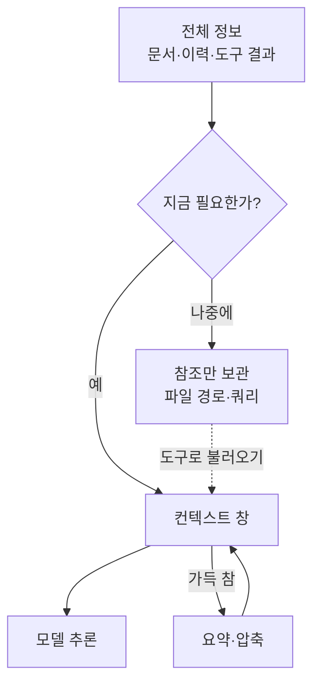

# 컨텍스트 엔지니어링

> 모델이 추론할 때 컨텍스트 창에 들어가는 모든 것(지시문·도구·대화 이력·외부 데이터)을 골라 담고 관리하는 기술.

## 쉽게 말하면
시험장 책상 위 공간이다. 책상이 좁은데 자료를 전부 올리면 정작 필요한 페이지를 못 찾는다. 지금 푸는 문제에 필요한 자료만 올리고, 나머지는 서랍(파일·검색)에 두고 필요할 때 꺼내는 요령이 핵심이다.

## 자세히
Anthropic "Effective context engineering for AI agents" 기준:
- [프롬프트 엔지니어링](#prompt-engineering)은 지시문을 잘 쓰는 일, 컨텍스트 엔지니어링은 **추론 시점에 컨텍스트에 들어가는 전부**를 큐레이션하는 일(도구 정의, 메시지 이력, 외부 데이터 포함).
- **컨텍스트 부패(context rot)**: 토큰이 늘수록 모델의 정확한 회상 능력이 떨어진다. 컨텍스트는 유한한 "주의력 예산"이다.
- 기법 4가지:
  1. **Just-in-time 검색**: 파일 경로·쿼리 같은 가벼운 참조만 두고 필요할 때 도구로 불러온다.
  2. **압축(compaction)**: 한도에 가까워지면 요약해 새 창에서 이어 간다. 먼저 재현율, 다음에 불필요한 도구 결과 제거로 정밀도를 올린다.
  3. **구조적 메모**: NOTES.md·할 일 목록처럼 창 밖에 적어 두고 다시 읽는다([에이전트 메모리](#agent-memory)).
  4. **서브에이전트**: 깨끗한 창에서 탐색하고 1,000~2,000토큰 정도의 요약만 돌려준다([서브에이전트](#subagents)).
- 고르는 기준: 오가는 대화가 많으면 압축, 마일스톤이 있으면 메모, 병렬 탐색이 이득이면 멀티 에이전트.

## 그림으로 보기

## 예시
- 긴 코딩 세션에서 완료한 단계는 NOTES.md에 한 줄로 남기고 대화는 압축한다.
- 도구가 50개면 정의만으로 창이 찬다. 관련 도구만 노출한다.

## 헷갈리는 것과 비교
| 개념 | 차이 |
| --- | --- |
| 프롬프트 엔지니어링 | 지시문 작성 |
| 컨텍스트 엔지니어링 | 창에 들어가는 전체 설계 |
| [RAG](#knowledge-retrieval) | 외부 지식을 가져오는 한 가지 수단 |

## 더 읽을거리
- [Effective context engineering for AI agents (Anthropic)](https://www.anthropic.com/engineering/effective-context-engineering-for-ai-agents) — 부패·압축·메모·서브에이전트
