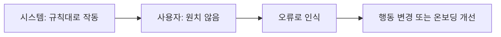

# 컨텍스트 오류

> AI 시스템은 **의도대로 작동했는데도 사용자가 "틀렸다"고 느끼는 오류**다. 설명이 부족하거나, 사용자의 머릿속 모델과 어긋나거나, 시스템의 가정이 부실할 때 생긴다.

## 쉽게 말하면
친구가 보내 준 항공권 확인 메일 때문에 내 달력에 일정이 자동으로 생겼다. 시스템은 "메일 속 일정을 등록"이라는 규칙대로 했지만, 나는 원하지 않았다. 기계는 맞았고 내 기대는 달랐다.

## 자세히
(Google PAIR People + AI Guidebook의 "Errors + Graceful Failure" 챕터를 직접 읽었다.)
- **정의(PAIR)**: 사용자가 인지하는 오류 중 **대체로 참양성**(시스템이 한 일은 의도에 맞음)인 유형. 이유는 행동 설명 부족, 사용자 멘탈 모델 위반, 부실한 가정.
- **예 1**: 친구의 항공권 확인 메일이 원치 않는 일정을 만든다.
- **예 2**: 레시피 앱에서 저녁 추천을 계속 거부하는 사용자는 야간 근무자라 아침 메뉴를 원하는 것일 수 있다. 특정 시기에 집단 전체가 고기 추천을 거부한다면 팀이 놓친 **문화적 가치**를 반영하는 것일 수 있다.
- **대응(PAIR)**: 시스템 행동을 바꾸거나, **온보딩을 개선**해 그 행동을 사용자가 예상 가능하게 한다. 우선순위는 **빈도와 심각도**로 정한다.
- 다른 유형: 시스템 한계(failstate), [백그라운드 오류](#background-error), [행운의 사고](#happy-accident).

## 그림으로 보기

## 예시
- 회의 요약 AI가 모든 메일에서 일정 후보를 뽑아 캘린더에 넣는다 → 자동 등록 전에 확인을 거는 설정을 제공(제안).
- 교육 소재: "AI가 맞게 동작했는데도 오류로 느껴진 경험" 사례 수집.

## 헷갈리는 것과 비교
| 유형 | 사용자 인식 | 시스템 상태 |
|---|---|---|
| 컨텍스트 오류 | 오류로 인식 | 의도대로 작동 |
| 시스템 한계 | 오류로 인식 | 답이 없음 |
| [백그라운드 오류](#background-error) | 아무도 모름 | 틀림 |
| [행운의 사고](#happy-accident) | 오류로 안 느낌 | 오류로 표시됨 |

## 더 읽을거리
- [Google PAIR — Errors + Graceful Failure](https://pair.withgoogle.com/chapter/errors-failing/) — 직접 읽음.
