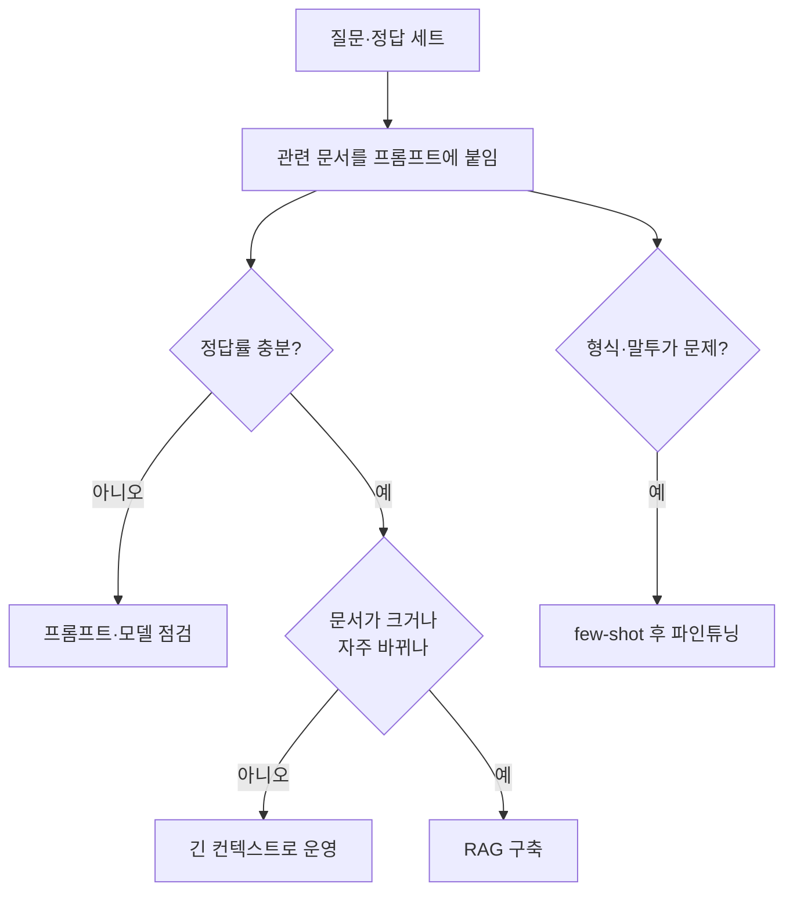

# 문서 붙여넣기 진단

> RAG를 만들기 전에, 관련 문서를 통째로 프롬프트에 붙여 넣고 모델이 맞히는지 보는 값싼 사전 실험. 결과로 "지식 부족"인지 "검색·규모 문제"인지 가른다.

## 쉽게 말하면
책장을 통째로 사기 전에, 필요한 책 한 권을 책상에 펼쳐 놓고 질문에 답이 나오는지 먼저 본다. 펼쳐 놓아도 못 풀면 책장을 늘려도 소용없다.

## 자세히
- **절차**: ① 대표 질문 10~30개와 정답 준비 ② 정답이 있는 문서 몇 개를 프롬프트에 붙임 ③ 정답률 확인 ④ 결과 해석.
- **해석**
  - 붙이면 잘 맞힌다 + 문서량이 작고 안 바뀜 → 긴 컨텍스트로 충분.
  - 잘 맞히지만 문서가 많거나 자주 바뀜·출처 인용 필요 → [RAG](#rag).
  - 붙여도 형식·말투·절차가 틀림 → 지식이 아니라 행동 문제, 파인튜닝 검토([프롬프트·RAG·파인튜닝 선택](#prompt-rag-finetune-choice)).
  - 붙여도 틀림 → 모델 한계나 프롬프트 문제. 인프라를 늘리기 전에 고친다.
- **주의**: 토큰을 많이 넣는다고 모델이 다 잘 쓰는 것은 아니다. 적은 분량 통과가 큰 규모 통과를 보증하지 않는다.
- 단계적 확대 원칙: 프롬프팅 → RAG → 파인튜닝 → 하이브리드, 앞 단계가 실패할 때만 올린다(denser.ai 가이드). 비용 예시로 같은 글은 RAG 중간 규모 월 $220~2,650, 파인튜닝 첫해 $4,150~27,600을 든다(업체 추정치).
- "붙여넣기 먼저"라는 표현은 출처들이 명시하진 않으며, 위 권고를 따른 실무 요약이다.

## 그림으로 보기

## 예시
- 사내 휴가 규정 20쪽을 붙이고 질문 20개 → 19개 정답: 규정이 작고 안 바뀌므로 RAG 없이 시스템 프롬프트에 넣어 운영.
- 제품 매뉴얼 5천 쪽: 붙일 수 없으니 바로 RAG, 대신 대표 장 몇 개로 정답 형태만 시험.

## 헷갈리는 것과 비교
| 개념 | 차이 |
|---|---|
| 붙여넣기 진단 | 방식을 고르기 전 실험 |
| [RAG](#rag) | 필요한 조각만 검색해 주입 |
| [few-shot](#few-shot-prompting) | 예시로 형식을 맞춤 |

## 더 읽을거리
- [RAG vs Fine-Tuning 2026 가이드(Denser)](https://denser.ai/blog/rag-vs-fine-tuning/) — 단계별 선택 기준·비용 추정(업체 글)
