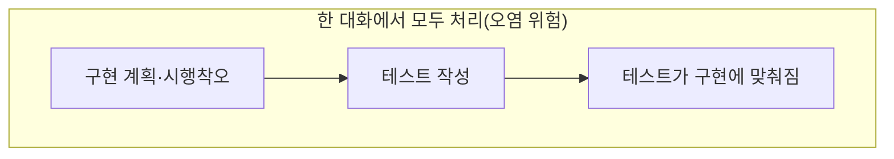
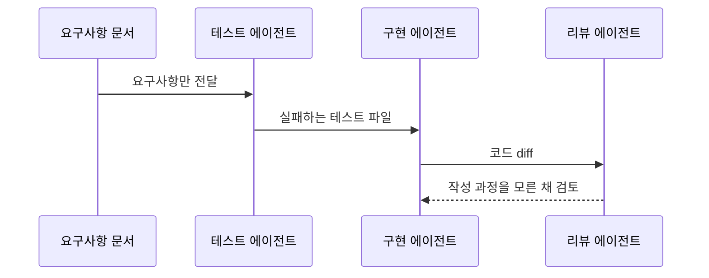

# 컨텍스트 오염

> 같은 대화 안에 구현 계획·시행착오·결론이 쌓여, 그 정보가 다음 작업(예: 테스트 설계, 코드 리뷰)에 스며들어 판단이 구현 쪽으로 기우는 현상. 해법은 작업별로 깨끗한 컨텍스트(서브에이전트)에서 하는 것이다.

## 쉽게 말하면
같은 사람이 문제를 내고, 풀고, 채점까지 하면 자기 풀이에 유리하게 채점하기 쉽다. 출제자는 정답을 알고 있기 때문이다. 채점은 정답지만 받은 다른 사람이 하는 편이 공정하다. AI도 한 대화에서 코드를 짠 직후 같은 대화에서 테스트를 쓰면 "자기가 짠 코드에 맞는 테스트"를 쓰기 쉽다.

## 자세히
- **무슨 일이 생기나**: 구현 계획을 알고 있는 컨텍스트에서 테스트를 쓰면 테스트가 요구사항이 아니라 구현 방식에 맞춰진다(구현의 우연한 동작을 정답으로 못 박음). 결과적으로 테스트가 버그를 못 잡는다. 코드 리뷰도 작성 과정의 논리에 설득당한다.
- **Claude Code 가이드의 관련 권고(2026-11 확인)**
  - 완료 판단을 위한 **검증 수단**(테스트, 타입체크, 훅, CI)을 줘야 한다. 없으면 "다 된 것 같다"에 의존하고 사람이 테스트 스위트 역할을 하게 된다. 프롬프트에 "인증 테스트를 돌리고 통과할 때까지 계속해"라고 쓰는 방법이 있다.
  - **작성자가 아닌 쪽의 검토**: 터미널의 `/code-review`는 대화를 본 적 없는 **새 서브에이전트**가 diff를 검토한다. 코드를 만든 추론에 설득되지 않는다.
  - 증거를 요구한다: 실행한 명령과 출력. "전부 통과"라는 말만으로는 거의 알 수 없다.
  - 주의: 리뷰어에게 "스타일은 건너뛰라"고 지시한다. 문제를 찾으라고 하면 항상 무언가를 찾아 내고, 전부 고치면 불필요한 추상화와 불가능한 경우의 테스트가 늘어난다.
- **서브에이전트가 이득인 상황(같은 문서)**: ①독립 작업 병렬 실행 ②긴 출력(전체 테스트 실행, 넓은 검색)을 메인 대화 밖에 두기 ③작성 과정을 보지 않은 리뷰어 ④읽기만 가능한 제한된 도구. 비용은 대부분 토큰이고, 새 서브에이전트가 이미 있던 맥락을 다시 모아야 해서 직접 하는 것보다 **더 느릴 수도** 있다. 기본적으로 같거나 더 작은 모델이라 "더 똑똑한 답"이 아니라 병렬성과 새로운 시각을 얻는 것이다. 단순 작업엔 `model: haiku`로 비용을 줄인다.
- **TDD 맥락의 분리 패턴**: ①테스트 작성 에이전트는 **요구사항만** 보고 실패하는 테스트를 쓴다 ②구현 에이전트는 테스트를 받아 통과시키되 테스트 수정은 금지 ③리팩터 에이전트가 정리. 요구사항 → 테스트 → 구현 사이에 파일로만 정보를 넘기는 것이 핵심이다([레드-그린-리팩터](#red-green-refactor)).
- **관련 개념**: 긴 컨텍스트에서의 성능 저하는 [컨텍스트 부패](#context-rot)와 관련이 있으나, 오염은 "내용이 판단을 편향시킨다"는 점이 다르다.

## 그림으로 보기

## 예시
- 코드 리뷰: "서브에이전트로 속도 제한기 diff를 SPEC.md 기준으로 검토해. 요구사항 구현 여부와 엣지 케이스 테스트 유무를 확인하고 정확성에 영향을 주는 빈틈만 보고해. 스타일은 제외."(Claude Code 가이드 예시를 줄임)
- 교육 활용: 수강생이 "같은 AI에게 연달아 시킬 때 vs 새 대화에서 시킬 때" 결과의 차이를 비교한다.

## 헷갈리는 것과 비교
| 개념 | 차이 |
|---|---|
| 컨텍스트 오염 | 쌓인 내용이 판단을 한쪽으로 기울임 |
| [컨텍스트 부패](#context-rot) | 길어질수록 성능이 떨어지는 현상 |
| 서브에이전트 | 오염을 줄이는 도구(새 컨텍스트). 비용·시간 대가가 있음 |
| [TDD](#tdd) | 오염을 피하려 단계별로 에이전트를 분리해 쓰기도 함 |

## 더 읽을거리
- [Best practices for Claude Code](https://code.claude.com/docs/en/best-practices) — 검증 수단, 새 서브에이전트 리뷰, 서브에이전트 비용
