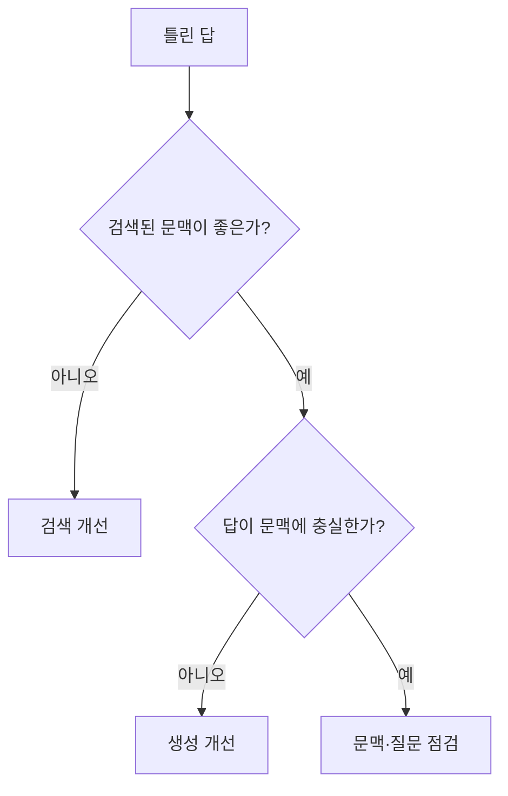

# 문맥 품질 vs 충실도

> RAG 평가에서 **검색된 문맥이 좋은가**(검색 품질)와 **답이 그 문맥에 충실한가**(충실도)는 서로 다른 질문이다. 둘을 나눠 재야 어디를 고칠지 안다.

## 쉽게 말하면
도서관 사서가 가져온 책이 엉뚱한가(검색 문제), 책은 맞는데 학생이 책에 없는 말을 지어냈는가(생성 문제). 증상은 둘 다 "틀린 답"이지만 고치는 곳이 다르다.

## 자세히
(RAGAS faithfulness 문서를 직접 읽었다. **이 문서는 context precision·recall을 다루지 않는다.** 아래 구분은 문서의 정의에서 이끌어낸 해석이다.)
- **충실도(RAGAS)**: 응답의 주장이 검색 문맥에서 추론 가능한 정도(0~1). 문맥이 무엇인지는 입력으로 받을 뿐 좋은지 따지지 않는다.
- **검색 품질**: 무엇을 가져왔는지의 평가이며 RAGAS의 다른 지표가 담당하지만 이 글에서 그 정의는 읽지 않았다.
- **ALCE의 관점**: ALCE 논문은 최종 성능에 **검색 품질이 결정적**이라고 말한다. 같은 모델도 검색이 나쁘면 인용 품질이 낮다.
- **진단 표(해석)**: ① 충실도 낮음 + 문맥 좋음 → 생성 단계가 문맥을 벗어남(프롬프트·모델 문제) ② 충실도 높음 + 틀린 답 → 문맥이 틀림 또는 질문에 안 맞음([충실하지만 틀린 답](#faithful-but-wrong)) ③ 충실도 낮음 + 문맥 나쁨 → 검색부터 고친다.

## 그림으로 보기

## 예시
- 사내 FAQ 봇의 오답 20건을 위 표로 분류해 검색 문제와 생성 문제의 비율을 본다(제안).

## 헷갈리는 것과 비교
| 개념 | 대상 |
|---|---|
| 문맥 품질 | 검색 단계 |
| 충실도 | 생성 단계 |
| [ALCE](#alce-benchmark) | 둘을 합친 end-to-end 평가 |

## 더 읽을거리
- [RAGAS — Faithfulness](https://docs.ragas.io/en/stable/concepts/metrics/available_metrics/faithfulness/index.md) — 충실도 정의(직접 읽음).
- [Gao et al. (2023) — ALCE](https://arxiv.org/abs/2305.14627) — 검색 품질의 중요성(직접 읽음).
