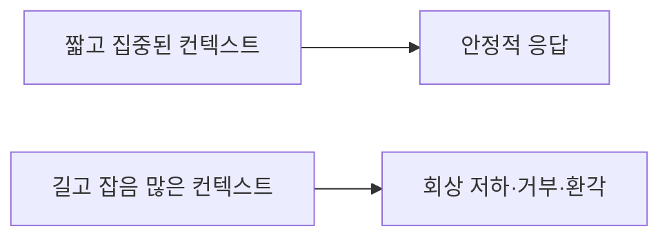
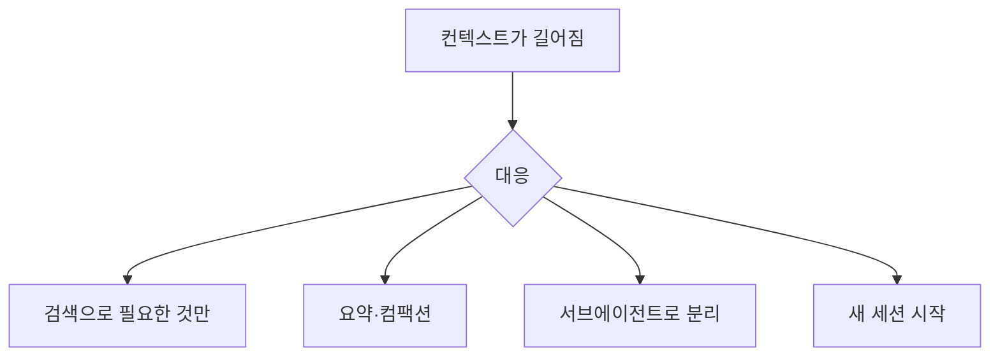

# 컨텍스트 부패

> 입력(컨텍스트)이 길어질수록, 창에 다 들어가 있어도 모델이 정보를 점점 덜 안정적으로 쓰는 현상. 2025년 Chroma의 연구가 이 이름을 대중화했다.

## 쉽게 말하면
책상 위에 서류를 계속 쌓으면, 책상이 아무리 커도 필요한 서류 한 장을 찾아 쓰는 정확도가 떨어진다. 창고가 커졌다고 정리가 필요 없어지는 게 아니다. 모델도 "들어간다"와 "잘 쓴다"가 다르다.

## 자세히
Chroma "Context Rot" 보고서(18개 모델 평가: Claude Opus 4·Sonnet 4 등, GPT-4.1·o3, Gemini 2.5, Qwen3 계열) 요지:
- **입력이 길수록 신뢰도 하락**: 단순한 과제에서도 모델은 컨텍스트를 균일하게 쓰지 않는다.
- **질문과 정답 조각의 유사도가 낮을수록** 길이에 따른 하락이 더 빠르다.
- **방해 정보(distractor)** 한 개만 있어도 정확도가 떨어지고, 네 개면 더 떨어진다. 모델별 양상이 달라 Claude는 답을 거부(abstain)하는 경향, GPT는 지어내는(hallucinate) 경향이 더 컸다고 보고했다.
- **현실적 과제가 더 어렵다**: LongMemEval에서 약 300토큰의 집중된 프롬프트가 약 11만 3천 토큰 전체보다 크게 좋았다.
- **복사 같은 쉬운 작업도** 길이가 늘면 품질이 무너질 수 있다(Qwen3-8B는 약 5,000단어부터 무작위 출력).
- **한계**: 2025년 모델 기준이다. 이후 모델은 개선됐을 수 있으니 직접 측정하는 습관이 필요하다. 이 현상 자체의 원인은 단정하지 않는다.
- **대응**: 필요한 것만 넣기(검색으로 압축), 요약·[컴팩션](#compaction), 중요한 지시는 끝/처음에 두기, 긴 작업은 서브에이전트로 컨텍스트 분리, 세션을 새로 시작. 이 모두가 [컨텍스트 엔지니어링](#context-engineering)의 일이다.

## 그림으로 보기

## 예시
- 긴 코딩 세션 후 같은 실수를 반복하면: 지금까지의 결정·남은 할 일을 요약시키고 새 세션에 그 요약만 넣는다.
- RAG: 문서 50쪽을 통째로 넣기보다 관련 문단 5개를 골라 넣고 정확도를 비교한다.

## 헷갈리는 것과 비교
| 개념 | 차이 |
| --- | --- |
| [컨텍스트 윈도우](#context-window) | 한 번에 넣을 수 있는 최대 길이 — 용량 |
| 컨텍스트 부패 | 용량 안에서도 길이에 따라 성능이 떨어지는 현상 — 품질 |
| [건초더미 속 바늘](#needle-in-haystack) | 단순 검색 벤치마크. 부패 연구는 유사도·방해 정보를 더해 측정 |
| [컴팩션](#compaction) | 부패를 줄이려는 대응 기법 |

## 더 읽을거리
- [Chroma Research: Context Rot](https://www.trychroma.com/research/context-rot) — 18개 모델 평가와 결론
