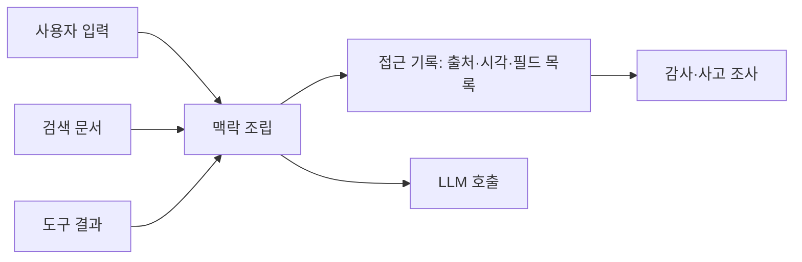
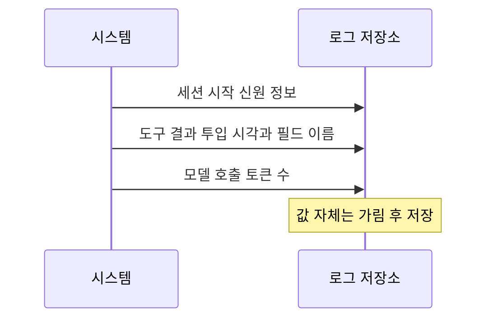

# 맥락 창 접근 기록

> LLM이 한 번 답하기 위해 받은 **전체 입력(맥락 창)** 에 어떤 데이터가 언제, 어느 경로(사용자 입력·검색·도구 결과)로 들어왔는지를 남기는 기록이다. 개인정보 사고나 감사에서 "모델이 무엇을 봤나"에 답하는 근거가 된다.

## 쉽게 말하면
회의실 출입 명부와 같다. 누가 나갔는지가 아니라 "그 회의 때 책상 위에 어떤 서류가 올라와 있었는지"를 기록해 둔 명부다. 나중에 서류 하나가 새어 나가면 그 회의에 올라온 적이 있는지부터 확인한다.

## 자세히
- **표준이 기록하는 것(Kovrr 분석 확인)**: OpenTelemetry GenAI 규약은 에이전트 세션 루트 스팬, 모델 호출 자식 스팬, 도구 실행 스팬(2026년에 MCP 호출까지 확장), 모델·제공자·입출력 토큰 수·중단 사유 같은 속성을 담는다.
- **표준이 기록하지 않는 것**: 판정(환각·개인정보 유출 여부 등), 에이전트가 누구를 대신해 행동했는지·권한이 있었는지, 데이터 민감도 분류. 프롬프트·응답 내용은 캡처할 수 있으나 그것이 규제 대상이었는지는 사후에 따로 판단해야 한다.
- **프롬프트 내용 기록은 선택(opt-in)**: 민감 정보가 들어 있을 수 있으므로 설정 플래그로 켠다고 검색 결과의 여러 글이 말한다.
- **감사 추적 구성(주장)**: 스팬만으로는 부족해 신원·콘텐츠 분류·정책 평가를 트레이스와 결합해야 한다(Kovrr). 게이트웨이가 자체 정책 스팬과 결정 기록을 갖고, OTel 트레이스 ID는 연결용 키로만 쓰라는 권고도 있다(검색 결과 요약).
- **보관·가림**: 프롬프트 텍스트·검색된 문서·도구 인자는 필드별 보관 기간과 가림 규칙을 정해야 하며, 얼마나 남길지에 대한 보편 표준은 아직 없다(검색 결과 요약).
- **안정성**: GenAI 규약은 아직 Development 단계이고 속성 이름이 바뀔 수 있으니 버전을 고정하라는 권고가 있다(rubinlake 테크 레이더, 검색 결과 기준).
- **빈틈**: "조립된 전체 맥락"(검색 문서·도구 출력 포함)을 그대로 남기는 방법은 직접 다룬 출처를 찾지 못했다. 설계자가 정해야 한다.

## 그림으로 보기

## 예시
- 개인정보 열람 요청: "이 고객 정보가 외부 LLM에 전달된 적 있나?" → 접근 기록에서 고객 ID가 든 호출을 조회.
- 설계 선택: 값 전체 대신 "필드 이름·민감도 등급·출처 도구"만 남기면 로그 자체가 새 개인정보 저장소가 되는 것을 피한다(제안).

## 헷갈리는 것과 비교
| 개념 | 차이 |
|---|---|
| 맥락 창 접근 기록 | 모델 입력에 무엇이 들어왔는지 |
| 트레이스·스팬 | 호출 흐름·시간·토큰 기록 |
| 감사 추적 | 신원·정책 판단까지 결합한 증거 |
| [추론 전·후 가림](#pre-vs-post-inference-redaction) | 로그에 남기기 전 가리는 단계 |

## 더 읽을거리
- [Kovrr: OpenTelemetry와 AI 거버넌스, 표준이 멈추는 곳](https://www.kovrr.com/blog-post/opentelemetry-ai-governance-where-the-standard-stops) — 표준이 기록하는 것·못 하는 것(직접 열어 확인, 보안 업체 글).
- [Fiddler: AI 관측성에서 OpenTelemetry의 범위](https://www.fiddler.ai/blog/opentelemetry-ai-observability-guide) — 범위와 한계(검색 결과 기준, 벤더 글).
