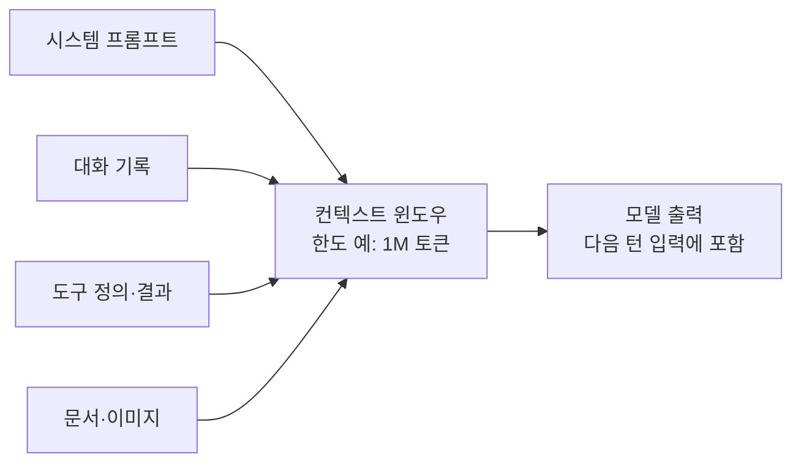
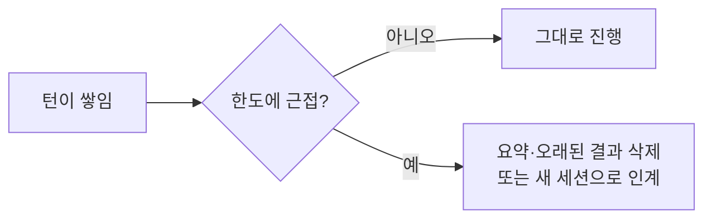

# 컨텍스트 윈도우

> 컨텍스트 윈도우는 모델이 답을 만들 때 한 번에 참조할 수 있는 전체 텍스트(시스템 프롬프트·대화 기록·도구 결과·문서·모델 자신의 출력 포함)의 한도다. 모델의 "작업 기억"에 해당한다.

## 쉽게 말하면
책상 크기와 같다. 책상이 클수록 자료를 많이 펼쳐 놓을 수 있지만, 너무 어지럽게 쌓으면 정작 필요한 문서를 못 찾는다. 학습 때 읽은 방대한 지식(서재)과는 별개로, 지금 이 대화에서 펼쳐 둔 것만 책상 위에 있다.

## 자세히
- 단위는 글자가 아니라 [토큰](#tokenization). 요청에 들어가는 모든 것(시스템 프롬프트, 메시지, 도구 정의, 이미지·문서, 모델이 생성하는 출력과 사고 토큰)이 윈도우를 소비한다(Anthropic 문서, 2026-11 확인).
- 크기: Anthropic 문서 기준 Claude Opus 5.5·Sonnet 5.5·Haiku 5.5 등 최신 모델은 **1M 토큰**, 한 요청 최대 출력 128k. 구형 모델은 200k. 모델마다 달라 비교표를 확인한다.
- **더 크다고 항상 좋지 않다.** 토큰이 늘수록 정확도·회상이 떨어지는 현상을 **context rot**라 부른다. 트랜스포머는 모든 토큰이 서로를 보므로(n²) 주의력 예산이 유한하고, 긴 시퀀스 학습 경험이 적기 때문(Anthropic 엔지니어링 블로그). 논문 "Lost in the Middle"(2023)은 관련 정보가 입력 중간에 있을 때 성능이 떨어지고 처음·끝에서 가장 좋다고 보고했다.
- 대화형 API는 매 턴 이전 기록 전체를 다시 보낸다. 가득 차면 오류가 나거나, **compaction**(오래된 부분을 요약)·context editing(오래된 도구 결과 지우기)·[RAG](#knowledge-retrieval)로 관리한다. 프롬프트 캐싱은 비용만 줄일 뿐 윈도우를 줄이지 않는다.
- 목표는 "원하는 결과가 나올 가능성을 높이는 가장 작은 고신호 토큰 집합"을 넣는 것(컨텍스트 엔지니어링).

## 그림으로 보기

## 예시
- 100쪽 PDF를 통째로 넣고 질문했는데 중간 쪽 내용을 놓친다면: 질문을 문서 끝에 두거나 관련 쪽만 발췌해 넣는다.
- 에이전트가 오래 일하다 이전 결정을 잊는다면: 중간 요약을 파일에 남기고 새 세션에서 그 파일부터 읽게 한다.

## 헷갈리는 것과 비교
| 개념 | 차이 |
| --- | --- |
| 컨텍스트 윈도우 | 지금 요청에서 볼 수 있는 입력+출력의 한도 |
| 학습 데이터 | 가중치에 녹은 과거 지식, 윈도우와 무관 |
| [KV 캐시](#kv-cache) | 긴 윈도우가 GPU 메모리를 먹는 이유 |
| [긴 컨텍스트 vs RAG](#long-context-vs-rag) | 통째로 넣기 vs 검색해 일부만 넣기 |

## 더 읽을거리
- [Anthropic: Context windows](https://platform.claude.com/docs/en/build-with-claude/context-windows) — 크기·compaction·사고 토큰 처리
- [Anthropic: Effective context engineering for AI agents](https://www.anthropic.com/engineering/effective-context-engineering-for-ai-agents) — context rot와 주의력 예산
- [Lost in the Middle (arXiv 2307.03172)](https://arxiv.org/abs/2307.03172) — 위치에 따른 성능 저하 실험
