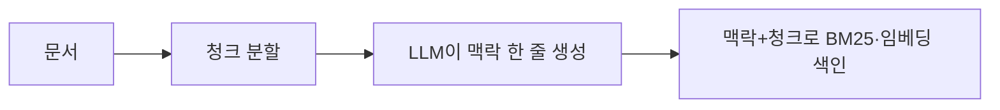
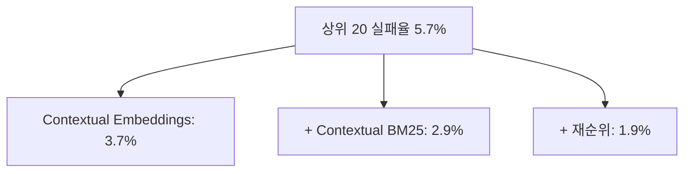

# Contextual BM25

> 키워드 검색(BM25)의 색인에도 **청크에 "이 조각이 문서 어디에 속하는지"를 설명하는 짧은 맥락을 앞에 붙여** 넣는 방식. 벡터 임베딩에 맥락을 붙이는 Contextual Embeddings와 짝을 이룬다. (Anthropic Contextual Retrieval 글 열람 2026-11-28)

## 쉽게 말하면
책을 낱장으로 찢어 색인하면 "그 회사의 매출은 3% 늘었다"가 어느 회사 얘기인지 사라진다. 낱장마다 "이 장은 ACME사 2023년 2분기 보고서 중 매출 부분"이라는 한 줄 메모를 붙여 두면 검색이 정확해진다.

## 자세히
- 방법: 각 청크 앞에 **청크 고유의 설명**을 붙인 뒤 임베딩하고 **BM25 색인**도 만든다. 청크가 원문에서 떨어지며 잃은 맥락을 되돌려 준다.
- 맥락 생성: Claude 3 Haiku에게 **전체 문서와 청크 하나**를 주고 "검색 개선을 위해 이 청크를 문서 안에 위치시키는 간단한 맥락"만 출력하게 한다.
- 효과(글의 수치, 상위 20 검색 실패율 5.7% 기준): Contextual Embeddings만 **35%↓**(3.7%), Contextual Embeddings+Contextual BM25 **49%↓**(2.9%), 여기에 재순위(reranking)까지 **67%↓**(1.9%).
- 청크 크기: 보통 수백 토큰 이하. 비용 예시는 800토큰 청크를 가정. 청크 크기·경계·겹침이 성능에 영향을 주므로 사례별로 시험하라고 글이 말한다.
- BM25의 역할: 의미 임베딩이 놓치는 **정확한 용어·식별자**(오류 코드 등) 일치에 강하다(일반 설명, 이 글에서 직접 다룬 것은 아님). 두 검색 결과는 [RRF](#reciprocal-rank-fusion) 같은 방식으로 합칠 수 있다(내 연결).
- 한계: 청크마다 LLM 호출이 필요해 색인 비용이 든다([맥락 생성 비용](#chunk-context-cost)).

## 그림으로 보기

## 예시
- 원문 청크 "매출은 전 분기 대비 3% 증가했다." → "ACME사 2023년 2분기 보고서의 매출 절. 매출은 전 분기 대비 3% 증가했다."
- 교육: 같은 질문에 맥락 없는 청크와 맥락 붙인 청크의 검색 결과를 비교.

## 헷갈리는 것과 비교
| 개념 | 차이 |
|---|---|
| Contextual BM25 | 키워드 색인에 맥락 추가 |
| Contextual Embeddings | 임베딩에 맥락 추가 |
| [TF-IDF](#tf-idf) | BM25의 전신 격인 단어 가중치 |

## 더 읽을거리
- [Introducing Contextual Retrieval (Anthropic)](https://www.anthropic.com/news/contextual-retrieval) — 방법과 수치(읽음, 회사 발표).
