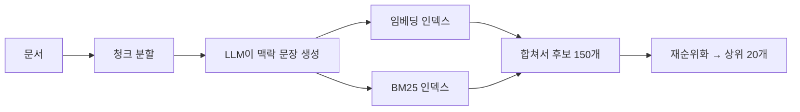
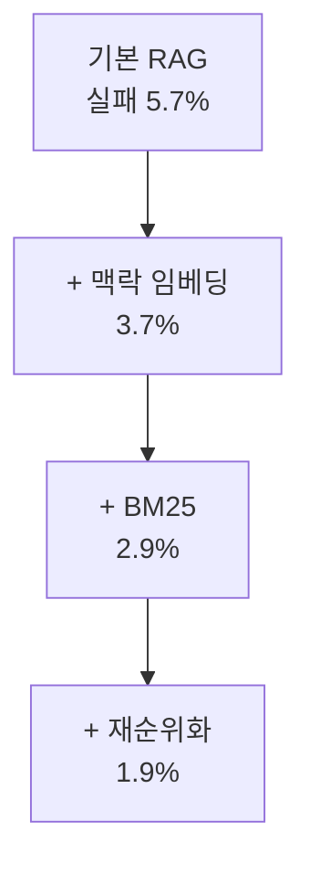

# Contextual Retrieval

> 문서를 청크로 나눌 때 각 청크 앞에 "이 조각이 문서 전체에서 어떤 맥락인지"를 설명하는 짧은 문장을 붙여 검색 정확도를 높이는 기법이다. Anthropic이 2024년 9월 공개했다.

## 쉽게 말하면
책에서 한 문단만 찢어 놓으면 "그 회사의 매출은 3% 늘었다"처럼 어느 회사·언제인지 알 수 없다. 찢은 조각 위에 "이것은 ACME사 2023년 2분기 보고서 내용"이라는 포스트잇을 붙이면 검색이 훨씬 정확해진다.

## 자세히
Anthropic 글(2026-11 확인):
- **방법**: 청크마다 문서 전체 맥락을 반영한 **50~100 토큰** 설명을 LLM(Claude 3 Haiku)으로 생성해 앞에 붙인다. 이 청크로 임베딩(Contextual Embeddings)과 BM25(Contextual BM25) 인덱스를 둘 다 만든다.
- **비용**: 프롬프트 캐싱을 쓰면 문서를 한 번만 올려 생성 비용을 줄인다. 글의 가정 기준 약 **$1.02 / 백만 문서 토큰**.
- **결과(상위 20개 청크 검색 실패율, 기본 RAG 5.7%)**: Contextual Embeddings 3.7%(35% 감소), + Contextual BM25 2.9%(49% 감소), + 재순위화 1.9%(**67% 감소**). 재순위화는 초기 150개 중 상위 20개를 고른다.
- 수치는 Anthropic이 자체 데이터셋으로 낸 결과이므로 내 데이터에서는 직접 평가해야 한다(일반 주의).

## 그림으로 보기

## 예시
원래 청크: "매출은 전 분기 대비 3% 증가했다."
맥락 붙인 청크: "ACME Corp 2023년 2분기 SEC 보고서 중 실적 설명. 매출은 전 분기 대비 3% 증가했다."

## 헷갈리는 것과 비교
| 개념 | 차이 |
|---|---|
| Contextual Retrieval | 청크 앞에 맥락을 붙여 색인 |
| [재순위화](#reranking) | 검색 뒤 순서를 다시 매김, 함께 쓰면 효과↑ |
| [청킹](#chunking) | 문서를 나누는 일, 그 전처리 |
| [RAG](#rag) | 이 기법이 개선하는 전체 파이프라인 |

## 더 읽을거리
- [Introducing Contextual Retrieval](https://www.anthropic.com/news/contextual-retrieval) — 방법과 실패율 표.
