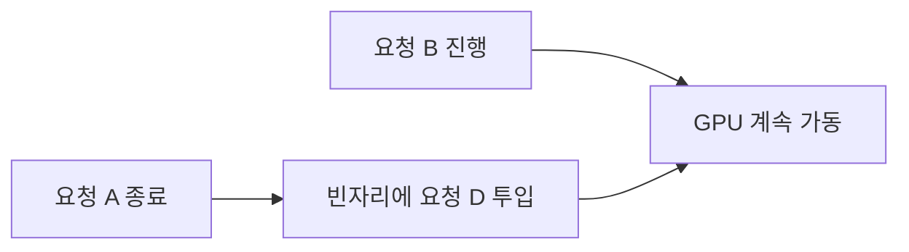
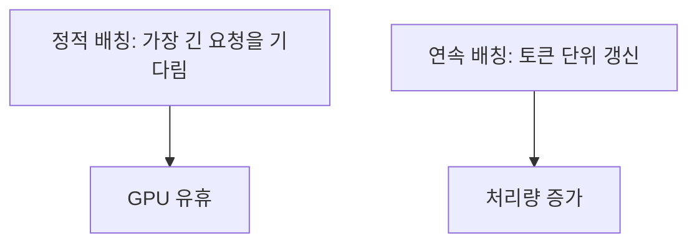

# 연속 배칭

> **연속 배칭(continuous batching)** 은 요청이 끝나는 대로 **그 자리에 새 요청을 바로 끼워 넣어** GPU를 쉬지 않고 돌리는 LLM 서빙 스케줄링이다. vLLM 등 서빙 엔진의 핵심 기능이다.

## 쉽게 말하면
버스가 정류장마다 내리는 사람이 생기면 그 자리에 바로 새 승객을 태우는 방식이다. 전원이 목적지에 도착할 때까지 기다렸다가 한꺼번에 태우는 방식보다 좌석이 덜 낭비된다.

## 자세히
- **vLLM 문서**: 지원 기능으로 연속 배칭을 나열하고, 외부 글(제목: "연속 배칭이 지연을 줄이면서 처리량 23배를 가능하게 하는 방법")을 링크한다. 이 수치는 링크된 글의 제목일 뿐 vLLM 페이지가 직접 주장한 값이 아니다.
- **논문**(vLLM, arXiv 2309.06180 초록): KV 캐시 낭비를 거의 없애고 같은 지연에서 이전 시스템(FasterTransformer, Orca) 대비 처리량 2~4배를 주장한다. 두 기법은 함께 쓰인다.
- **개념**(일반 지식): LLM은 토큰을 하나씩 생성하며 요청마다 길이가 달라, 한 묶음(배치)이 가장 긴 요청을 기다리면 GPU가 놀게 된다. 연속 배칭은 **토큰 단계마다** 배치 구성을 갱신해 끝난 요청을 빼고 새 요청을 넣는다.
- 관련: 프리필(입력 처리)과 디코딩(생성)을 나누는 청크 프리필이 지연을 안정시키는 데 쓰인다는 점은 vLLM 문서에 기능으로 나열돼 있다.

## 그림으로 보기

## 예시
- 챗봇 서버에 짧은 질문과 긴 질문이 섞여 들어올 때, 짧은 요청이 끝나자마자 대기 중인 요청이 그 자리를 채운다.

## 헷갈리는 것과 비교
| 개념 | 차이 |
|---|---|
| 정적 배칭 | 묶음 전체가 끝나야 다음 묶음 |
| 연속 배칭 | 끝난 요청 자리에 즉시 새 요청 |
| [PagedAttention](#paged-attention) | KV 캐시 메모리 관리 |
| [vLLM](#vllm) | 두 기법을 쓰는 엔진 |

## 더 읽을거리
- [vLLM 문서](https://docs.vllm.ai/en/latest/)
- [PagedAttention 논문](https://arxiv.org/abs/2309.06180)
