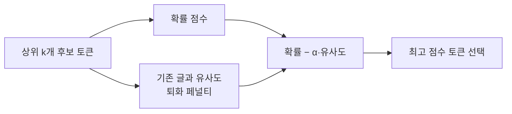

# 대조 탐색 (Contrastive Search)

> 대조 탐색은 다음 토큰을 고를 때 "모델 확신도"와 "이미 쓴 글과 비슷한 정도(퇴화 페널티)"를 함께 따져, 반복을 줄이면서 일관성을 유지하는 결정적 디코딩이다.

## 쉽게 말하면
말할 때 "다음에 할 말로 가장 그럴듯한 것"을 고르되, 방금 한 말과 너무 비슷하면 감점하는 습관이다. 그래서 같은 소리를 되풀이하지 않는다.

## 자세히
Hugging Face 블로그(2026-11 확인):
- 점수 = 모델 확신도(확률) − α × 퇴화 페널티. 퇴화 페널티는 후보 토큰의 은닉 표현과 이전 모든 토큰의 은닉 표현 사이 **최대 코사인 유사도**다.
- **k(`top_k`)**: 고려할 후보 수. **α(`penalty_alpha`)**: 균형 계수. α=0이면 greedy와 같다.
- 호출: `model.generate(input_ids, penalty_alpha=0.6, top_k=4, max_length=512)`(transformers 4.24.0 이상 안내, 예시값 α=0.6·k=4).
- 효과: 글 안에서 비슷한 표현이 이어지는 후보를 감점하므로 loop가 줄어든다. 글의 유사도 행렬 시각화에서 greedy는 비대각선 유사도가 높아(반복) 대조 탐색과 대비된다.
- 비용: 후보마다 은닉 표현을 비교하므로 단순 greedy보다 계산이 더 든다(구조상 추정).

## 그림으로 보기

## 예시
오픈소스 모델이 같은 문장을 반복한다 → greedy 대신 `penalty_alpha=0.6, top_k=4`로 생성해 비교.

## 헷갈리는 것과 비교
| 개념 | 차이 |
|---|---|
| 대조 탐색 | 은닉 표현 유사도로 반복을 직접 감점 |
| [반복 페널티](#repetition-penalty) | 이미 나온 토큰의 확률을 낮춤 |
| [샘플링(temperature)](#sampling-temperature-topp) | 무작위성을 넣어 다양화 |
| [생성 루프](#degeneration-loop) | 이 기법이 막으려는 현상 |

## 더 읽을거리
- [Generating Human-level Text with Contrastive Search in Transformers (HF)](https://huggingface.co/blog/introducing-csearch) — 원리·인자·예시.
