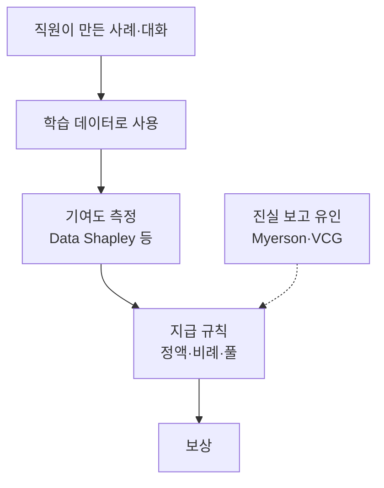

# 데이터 기여 인센티브

> 직원·고객·환자가 AI 학습 데이터를 제공할 때 그 기여를 어떻게 측정하고 보상할지 설계하는 문제. 후보 방법은 데이터 가치 평가(Data Shapley)에 기반한 정산부터 고정 수당, 지분형 분배까지 다양하며, "공정한 가치 평가"가 곧 "좋은 지급 규칙"은 아니라는 반론이 있다.

## 쉽게 말하면
요리 경연 우승자의 레시피 노트를 모아 신입 교육용 AI를 만들었다고 하자. 우승자에게 얼마를 줘야 할까? 노트가 AI 실력에 얼마나 기여했는지 재서 비례해 주는 방법이 가장 먼저 떠오른다. 하지만 노트 주인이 "내 노트는 가치가 크다"고 부풀려 말할 수 있고, 같은 노트를 복사해 여러 번 내면 보상이 부풀 수 있다. 측정과 지급은 따로 설계해야 한다.

## 자세히
출처: Ghorbani & Zou "Data Shapley" 초록(arXiv 1904.02868, ICML 2019, 직접 읽음), "Do Data Valuations Make Good Data Prices?" 초록(arXiv 2504.05563, 직접 읽음), 그 밖의 후속 논문은 검색 결과 요약만 확인. 모두 일반 데이터 마켓 연구이며 사내 직원 보상 제도를 직접 검증한 것은 아니다.
- **문제 배경**: 고객지원 연구(NBER 31161)는 최고 성과자가 AI 학습 사례를 많이 제공하지만 자신의 성과는 오르지 않고 보상이 없다고 지적했다([숙련자 기여 보상](#knowledge-capture-credit)).
- **Data Shapley(2019)**: 각 학습 데이터 점을 협력 게임의 참가자로 보고 모델 성능에 대한 기여를 Shapley 값으로 측정. 저자들은 이 방식이 몇 가지 자연스러운 공정성 성질을 **유일하게** 만족한다고 주장한다. 정확 계산은 지수적이라 몬테카를로·경사 기반 근사를 쓴다. 실험(생의학·이미지·합성 데이터)에서 leave-one-out보다 가치를 잘 가려냈고, 값이 낮은 데이터는 이상치·오염 데이터를 잡는 경향, 값이 높은 데이터는 어떤 새 데이터를 더 모을지 알려 준다고 보고.
- **지급 규칙으로서의 한계(2025)**: 후속 논문은 Leave-One-Out과 Data Shapley가 지급 규칙으로는 "나쁘다"고 주장한다 — 판매자가 비용을 진실되게 보고하도록 보장하지 못해 시장 결과가 비효율적이라는 것. 대안으로 메커니즘 디자인의 Myerson·VCG 지급을 제안하고, Myerson이 최소 진실 보고 메커니즘이며 구매자 관점에서 최적이라고 주장한다. 의료 질의응답 RAG 마켓에서 기여자 보상 시뮬레이션으로 평가했다.
- **그 밖(검색 요약)**: 원자료 접근 없이 프라이버시를 지키며 값을 정하는 마켓 프로토타입(arXiv 2210.08723), 데이터 중복·단계적 의존이 있을 때 Shapley 분배가 어긋날 수 있다는 지적(arXiv 2511.12863).
- **조직 내 실무 설계 후보(이 글의 제안)**: ① 기여 기록(어떤 사례가 학습에 쓰였는지) ② 정액 수당·승진 가산 ③ 모델 성능 개선분에 비례한 보너스 풀 ④ 멘토·교육자 역할 인정 ⑤ 옵트아웃 권리. 측정은 Shapley 근사나 단순 지표로 하고 지급은 별도 규칙으로 정한다.

## 그림으로 보기

## 예시
- 콜센터가 상담 사례 200건으로 AI 코칭 모델을 만들고 성능 개선분의 일부를 기여 상담사 풀로 나눈다. 개인별 분배는 Shapley 근사 값을 참고하되 상한·하한을 둔다(제안).
- 우수 사례 제출 시 건당 고정 수당과 연 1회 모델 개선 보너스를 합친다(제안).

## 헷갈리는 것과 비교
| 개념 | 차이 |
|---|---|
| 데이터 가치 평가(Data Shapley) | 데이터가 모델에 기여한 정도를 재는 방법 |
| 데이터 가격·지급 규칙 | 실제 돈을 얼마 줄지 정하는 규칙. 진실 보고 유인 설계 필요 |
| [직원 생성 데이터 소유](#data-ownership-employee) | 법적 권리와 동의 |
| [상대 평가 보상 효과](#relative-pay-effects) | 순위 보너스가 AI로 흔들리는 문제 |

## 더 읽을거리
- [Data Shapley: Equitable Valuation of Data for Machine Learning (arXiv 1904.02868)](https://arxiv.org/abs/1904.02868) — 데이터 가치 평가 기준 논문(초록 직접 읽음)
- [Do Data Valuations Make Good Data Prices? (arXiv 2504.05563)](https://arxiv.org/abs/2504.05563) — 지급 규칙으로서의 한계(초록 직접 읽음)
