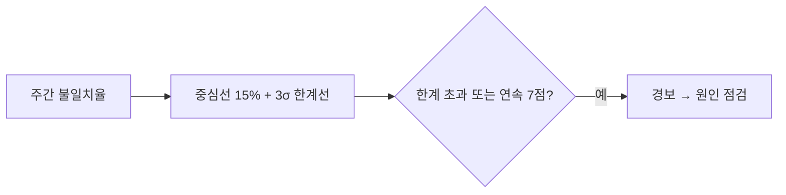
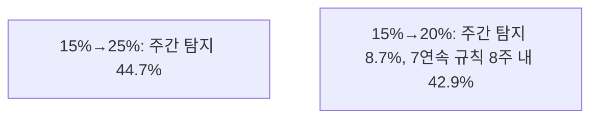

# 라벨링 관리도

> 라벨링 관리도는 주간 불일치율·kappa·골든 정답률 같은 품질 지표를 시간순으로 그리고, 기준선(중심선)과 관리 한계선을 함께 그려 평소 변동을 넘는 이탈을 자동으로 경보하게 하는 차트다.

## 쉽게 말하면
체온을 매일 재서 그래프에 그리고 "평소 범위"를 띠로 표시하면, 그 띠를 벗어났을 때만 병원에 간다. 평소 흔들리는 정도를 알아야 진짜 이상과 보통의 흔들림을 구분한다.

## 자세히
- **기본 구성(Wikipedia, Control chart)**: 중심선은 지표의 평균 또는 중앙값, 관리 한계선은 보통 중심선에서 3σ 떨어진 위/아래 선이며 정규 분포라면 관리 상태 점의 약 99.7%가 그 안에 든다. 2σ 경고선을 둘 수 있다. 신호 규칙은 한계선 밖의 점, 중심선 한쪽에 연속 7점(6~9로 제안이 갈림) 등 규칙 집합에 따르며 규칙은 데이터를 보기 전에 정해야 한다. 비율 데이터에는 p-관리도를 쓰고 큰 변화(약 1.5σ 이상)를 탐지하는 데 적합하다. 3σ 한계에서 관리 상태라도 약 370개 점마다 한 번은 우연히 신호가 난다.
- **직접 계산(주간 100개 이중 라벨, 기준 불일치율 15%)**: σ = √(0.15×0.85/100) = 0.036, 상한선 UCL = 0.257, 하한선 LCL = 0.043. 정상일 때 주간 점이 상한선을 넘을 확률은 0.3%다. 불일치율이 25%로 오르면 한 주에 UCL을 넘을 확률이 44.7%, 20%로 오르면 8.7%다. 한 번의 한계 초과만 기다리면 작은 악화(15→20%)는 거의 못 잡는다는 뜻이다.
- **연속 규칙으로 보완(직접 시뮬레이션, 불일치율이 20%로 올랐을 때 8주 안에 "중심선 위 연속 7점" 규칙으로 잡을 확률)**: 42.9%다. 규칙 7점 연속은 작은 이동에 민감하지만 8주 안에 절반도 못 잡았다. 표본 수를 늘리거나(주 200~300개) 두 규칙(한계 초과 + 연속 규칙)을 함께 쓴다. 이 값은 가정한 설정의 시뮬레이션이다.
- **라벨링 적용(해석)**: ① 기준선은 안정적이던 초기 8~10주 데이터로 설정 ② 지침 개정·인력 교체 시 기준선을 새로 잡는다 ③ 지표 선택: 불일치율(p-관리도), kappa, 골든 정답률, 판단 불가 비율 ④ 경보 시 [재보정 조건](#recalibration-trigger)을 발동, [불일치 샘플 토론](#disagreement-discussion)으로 원인 파악.

## 그림으로 보기

## 예시
- 주 100개 이중 라벨, UCL 25.7%. 어느 주 불일치율이 27%이면 경보. 또는 8주 연속 중심선 위이면 경보.
- 교육 활용: 위 계산 코드를 돌려 샘플 크기에 따른 탐지율 변화를 확인한다.

## 헷갈리는 것과 비교
| 개념 | 차이 |
| --- | --- |
| 관리도 | 평소 변동 대비 이탈을 규칙으로 감시 |
| [주간 일치도 대시보드](#weekly-agreement-dashboard) | 값을 보여 주는 화면 |
| [재보정 조건](#recalibration-trigger) | 경보 후 조치 |
| [자기 일관성 점검](#self-consistency-check) | 같은 사람의 시간 간 일치 |

## 더 읽을거리
- [Control chart (Wikipedia)](https://en.wikipedia.org/wiki/Control_chart) — 중심선·3σ 한계·p-관리도·신호 규칙
