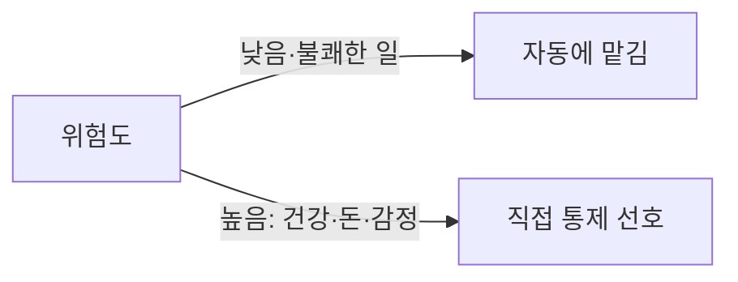

# 통제와 위험의 관계

> 사람들은 **걸린 것이 클수록** AI에게 맡기기보다 직접 통제하려 한다. 반대로 못 하거나 불쾌하거나 위험한 일은 기꺼이 맡긴다.

## 쉽게 말하면
자동 세차기는 맡기지만 자녀의 약 복용량은 직접 확인한다. 위험이 클수록 손을 떼기 불안하다.

## 자세히
(Google PAIR "Feedback + Control" 챕터를 직접 읽었다. 수치는 없다.)
- **높은 위험에서 통제 선호(PAIR)**: 신체적(안전·건강), 정서적(감정 표현), 금전적(은행 정보 공유) 위험, 그리고 건강·재산·관계 같은 민감 영역.
- **통제를 넘기는 경우(PAIR)**: 사용자가 할 수 없는 일, 불쾌하거나 안전하지 않은 일.
- **설계 시사(해석)**: 위험도가 높은 기능일수록 확인·수정·끄기 수단을 더 눈에 띄게 둔다. 이는 [사용성과 과의존의 거래](#usability-vs-overreliance-tradeoff)에서 마찰을 선택적으로 두는 아이디어와 연결된다.

## 그림으로 보기

## 예시
- 금융 앱: 잔액 요약은 자동, 이체 실행은 확인 단계 필수(제안).

## 헷갈리는 것과 비교
| 개념 | 차이 |
|---|---|
| 통제와 위험 | 위험이 클수록 통제 욕구 ↑ |
| [수동 대안](#manual-fallback) | 통제를 가능하게 하는 수단 |

## 더 읽을거리
- [Google PAIR — Feedback + Control](https://pair.withgoogle.com/chapter/feedback-controls/) — 직접 읽음.
