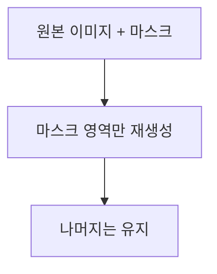

# ControlNet·인페인팅

> **ControlNet**은 Stable Diffusion 같은 이미지 생성 모델에 윤곽·깊이·포즈 같은 **공간 조건**을 추가로 지정하게 해 주는 기법이고, **인페인팅**은 이미지의 일부 영역만 다시 그리는 기능이다.

## 쉽게 말하면
화가에게 "이 스케치 선 그대로 색칠해 줘"라고 밑그림(조건)을 건네는 것이 ControlNet이다. 인페인팅은 완성된 그림에서 지우개로 한 부분만 지우고 그 자리를 새로 그리게 하는 것이다.

## 자세히
(ControlNet, Zhang 외, arXiv 2302.05543 초록 확인)
- 사전학습된 확산 모델을 **고정(locked)** 해 두고, 수십억 장으로 학습된 깊은 인코더 층을 새 제어를 배우는 **백본**으로 재사용한다.
- 새 층은 **제로 컨볼루션**(0으로 초기화되어 점차 가중치가 자라는 층)으로 연결해, 미세조정 초기에 해로운 노이즈를 주지 않는다.
- 시험한 조건: 엣지, 깊이, 분할, 사람 포즈 등을 하나 또는 여러 개, 텍스트 프롬프트 유무와 상관없이. 학습 데이터는 5만 미만~100만 초과에서 모두 견고했다고 보고한다.
- 인페인팅의 구체 방식(마스크와 함께 확산 등)은 이 글에서 직접 확인하지 않았다(일반 개념: 마스크 영역만 생성).

## 그림으로 보기

## 예시
- 사람 포즈 스켈레톤을 주고 "정장 입은 직원" 이미지를 같은 자세로 생성.
- 제품 사진에서 배경만 마스크로 지정해 다른 배경으로 교체.

## 헷갈리는 것과 비교
| 개념 | 차이 |
|---|---|
| ControlNet | 구조 조건으로 생성 제어 |
| 인페인팅 | 일부 영역 수정 |
| [LoRA 미세조정](#lora-finetune) | 화풍·인물 같은 스타일 학습 |
| 프롬프트만 | 구도·자세 통제가 어려움 |

## 더 읽을거리
- [Adding Conditional Control to Text-to-Image Diffusion Models](https://arxiv.org/abs/2302.05543) — ControlNet 논문.
