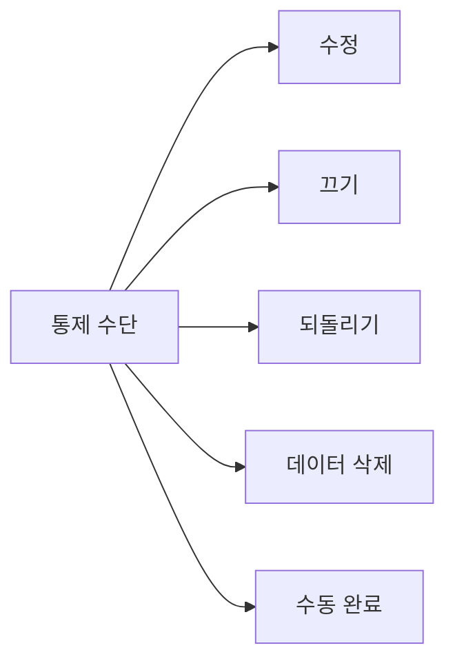

# 통제 감사

> AI 기능에서 사용자가 어디까지 조정·수정·끄기·되돌리기를 할 수 있는지, 그 수준이 위험과 사용자 욕구에 맞는지 점검하는 활동.

## 쉽게 말하면
자동차의 크루즈 컨트롤에는 언제든 브레이크로 끄는 장치가 있다. 어디서 끌 수 있고, 끄면 무엇이 대신 작동하는지 미리 점검해 둔다.

## 자세히
Google PAIR 가이드북의 Feedback + Control 챕터(열람)를 점검표로 옮긴 것이다.
- **통제 수준**: 사용자가 AI 출력을 조정·수정·끌 수 있게 한다. 전부 켜기/끄기만이 아니라 경험의 특정 측면별 통제를 준다.
- **통제 욕구는 상황에 따라**: 과제를 즐기거나, 결과에 개인적 책임이 있거나, 안전·건강·감정·재정 등 위험이 클 때, 말로 전하기 어려운 창작 구상이 있을 때 통제를 원한다. 할 수 없거나 불쾌하거나 위험한 일은 기꺼이 넘긴다.
- **수동 대안**: 자동이 아닌 완료 방법을 안전한 대비책으로 둔다. 오류가 잦은 초기에 특히 중요. 참여 요청은 최소화하고 쉽게 닫게 한다(운전 중 방해 같은 위험).
- **옵트아웃**: 도입 시 써 보거나 끌 수 있게 하고, 쓰지 않겠다는 결정을 존중하되 나중에 켜는 것도 허용한다. 행동 로깅 같은 암묵적 수집은 거부할 수 있게 하고 약관에 반영한다.
- **피드백·수정**: 데이터 수집 설정을 맥락 안에서 볼 수 있게, 이전 선택 삭제·수정, 개인화 해제(기본 모델로 초기화)를 지원한다. 피드백을 받았다면 무엇을 언제 바꿀지 알려 가치를 보이게 한다.
- 이 점검표는 가이드북의 실무 지침이며 각 항목의 효과를 입증한 실험은 아니다.

## 그림으로 보기
```mermaid
flowchart TD
S["기능 점검"] --> A{"위험 큰가?<br/>안전·건강·재정"}
A -- "예" --> H["통제 높게<br/>수동 대안·강한 승인"]
A -- "아니오" --> L["가벼운 통제<br/>쉬운 끄기"]
H --> O["옵트아웃·초기화 확인"]
L --> O
```



## 예시
- 자동 이메일 답장: 초안 편집 가능, 기능 끄기, 학습 데이터 삭제 설정이 모두 있는지 확인.
- 교육 실습: 자기 서비스의 통제 수단 5가지가 각각 어디에 있는지 화면 위치를 표로 정리.

## 헷갈리는 것과 비교
| 개념 | 차이 |
|---|---|
| 통제 감사 | 사용자가 조절·되돌릴 수 있는 정도 |
| [설명 가능성 감사](#explainability-audit) | 보여 주는 설명의 적합성 |
| [오류 감사](#errors-audit) | 오류 경로 점검 |
| [의도적 마찰 설계](#friction-by-design) | 일부러 멈칫하게 하는 통제 |

## 더 읽을거리
- [PAIR: Feedback + Control](https://pair.withgoogle.com/chapter/feedback-controls/) — 통제 수준·옵트아웃·피드백(열람)
