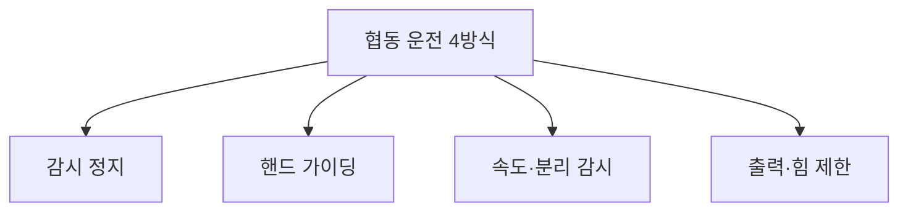
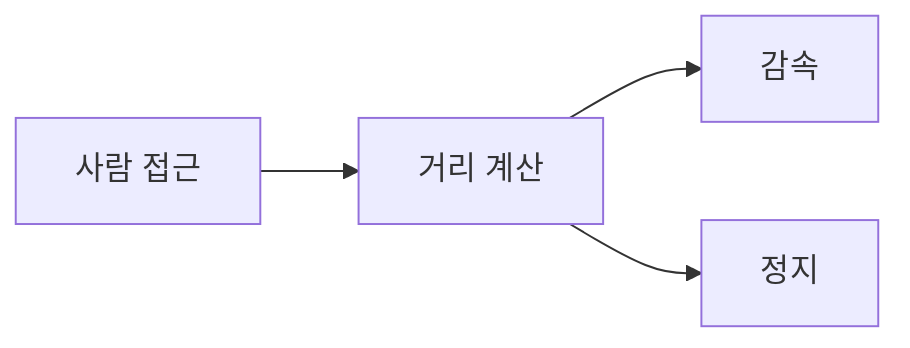

# 협동 안전 로봇

> 울타리 없이 **사람 곁에서 일하도록** 설계·평가된 로봇(협동 로봇, 코봇). ISO 10218과 보충 규격 ISO/TS 15066(2016)이 협동 운전의 4가지 방식을 정한다.

## 쉽게 말하면
요리사 두 명이 좁은 주방에서 부딪히지 않고 일하려면 규칙이 필요하다. 한 명이 멈추거나, 거리를 두거나, 부딪혀도 안 다칠 만큼 힘을 줄이는 식이다. 협동 로봇은 이 규칙을 기계에 넣은 것이다.

## 자세히
검색으로 확인한 ISO·ISA·Automate 자료 기준:
- **안전 등급 감시 정지**: 사람이 협동 작업 공간에 있으면 로봇이 멈추고, 사람이 나가면 다시 고속 작동.
- **핸드 가이딩**: 작업자가 장치로 로봇을 직접 움직인다.
- **속도·분리 감시(SSM)**: 사람과 로봇이 동시에 움직이되, 사람과 로봇 위험 부위 사이 **보호 분리 거리**를 유지한다. ISO/TS 15066이 계산식을 제시한다.
- **출력·힘 제한(PFL)**: 흔히 말하는 "코봇". 본질적으로 안전하게 설계하거나 안전 관련 제어로 힘을 제한한다. 규격의 **통증 임계값** 데이터를 활용한다.
- 네 방식은 한 시스템에서 섞어 쓸 수 있다.
- 핵심: **위험 평가 대상은 로봇이 아니라 응용(공구·작업물·환경 포함)**이다. 로봇이 협동 로봇이라도 날카로운 공구를 쥐면 위험하다.
- 휴머노이드는 이 규격 틀을 그대로 적용하기 어려워 별도 안전 기준이 논의 중이라는 점은 이 자료에선 확인하지 못했다.

## 그림으로 보기

## 예시
- 조립 라인에서 작업자가 부품을 건네면 로봇이 접촉 힘을 제한해 받아 간다.
- 교육: 사람-AI 협업 업무에 "언제 멈추고 언제 사람이 확인하나"를 정하는 규칙 설계.

## 헷갈리는 것과 비교
| 개념 | 차이 |
|---|---|
| 협동 로봇 | 사람 곁 작업용으로 설계 |
| 산업용 로봇 | 보통 울타리 안에서 작동 |
| [휴머노이드 단가](#humanoid-unit-economics) | 도입 경제성, 안전 비용 포함 |

## 더 읽을거리
- [ISO: Robots and humans can work together](https://www.iso.org/news/2016/03/Ref2057.html) — 규격 소개(검색 결과 확인).
- [Automate: ISO/TS 15066 Explained](https://www.automate.org/tech-papers/iso-ts-15066-explained) — 4방식 해설(검색 결과 확인).
