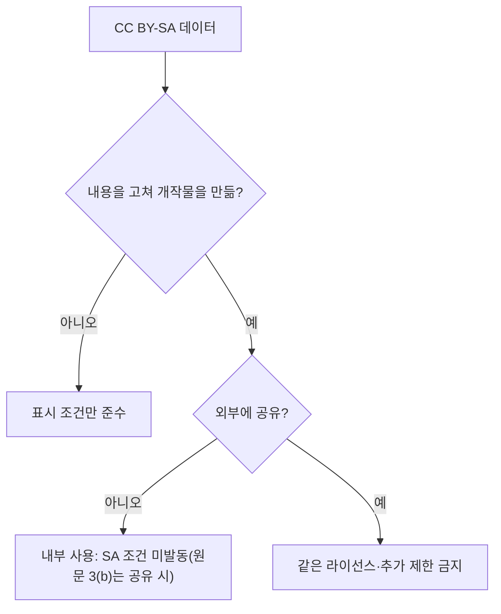
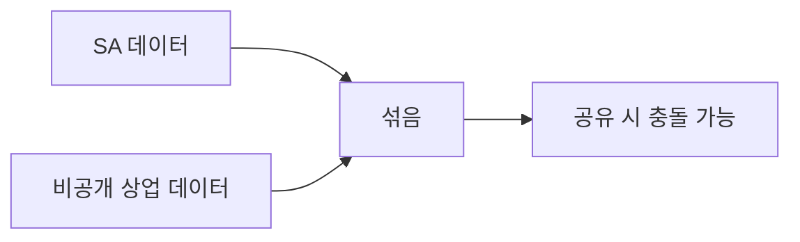

# 카피레프트 오픈 데이터

> 데이터를 자유롭게 쓰게 하되 **그것을 고쳐 공유할 때는 같은 조건으로 공개하라고 요구하는** 라이선스(CC BY-SA 등 ShareAlike 계열)로 풀린 공개 데이터다. 공개 생태계를 계속 열어 두는 대신, 닫힌 상업 데이터와 섞기가 어려워진다.

## 쉽게 말하면
공용 레시피 책에서 가져온 레시피를 고쳐 새 책에 실으면 "이 새 책도 같은 공용 조건으로 공개"해야 하는 규칙이다. 집에서 혼자 고쳐 먹는 것은 자유지만, 고친 것을 남에게 나눠 주는 순간 조건이 붙는다.

## 자세히
(CC BY-SA 4.0 법적 문서 원문(legalcode)의 3(b)항·4항과 CC FAQ의 AI 관련 항목을 직접 열어 확인. 법률 자문이 아니다.)
- **ShareAlike 조건(원문 3(b))**: 조건은 **"당신이 만든 개작물(Adapted Material)을 공유(Share)하는 경우"**에만 붙는다. 개작물에 적용하는 라이선스는 같은 요소의 CC 라이선스(같은 버전 이후 또는 BY-SA 호환 라이선스)여야 하고, 그 라이선스 문구나 링크를 포함해야 하며, **다른 조건이나 추가 조건을 붙일 수 없고, 라이선스가 주는 권리를 제한하는 기술적 조치(복사 차단 등)를 쓸 수 없다.**
- **데이터베이스 권리(원문 4항)**: 데이터베이스 내용의 상당 부분을 자신이 권리를 가진 데이터베이스에 포함하면 **그 데이터베이스(개별 내용이 아니라 데이터베이스 자체)가 개작물**이 되어 3(b)가 적용될 수 있다. 개별 내용에는 적용되지 않는다고 문서가 설명한다.
- **AI 학습과의 관계(CC FAQ)**: CC는 라이선스가 저작권상 허락이 필요한 모든 상황에서 재사용을 허락한다고 설명하고, AI 학습을 명시하지는 않는다. 개인정보·연구 윤리·데이터 보호는 라이선스가 다루지 않는다고 하고, 공개 데이터셋에 CC 이미지를 넣을 때의 표시 의무는 상황에 따라 다르다고 한다(미국에서 텍스트·데이터 마이닝이 일반적으로 공정 이용으로 여겨져 표시 요건이 적용되지 않을 수 있으나 표시를 권장한다는 설명). **학습된 모델이 개작물인지**, 모델 가중치에 ShareAlike가 미치는지는 이 문서들에서 확인하지 못했다(해석이 확정되지 않은 영역으로 보임).
- **장점(제안)**: 파생 데이터가 계속 공개되어 생태계가 선순환, 출처 표시와 조건이 명확, 위키백과 같은 대규모 자원을 쓸 수 있다.
- **단점·주의(제안)**: ① 개작한 데이터셋을 외부에 공유하면 같은 조건으로 공개해야 하므로 **비공개·상업 라이선스로 재배포 불가** ② 서로 다른 SA 라이선스(예: 호환되지 않는 라이선스)의 데이터를 섞기 어렵다 ③ 개작과 단순 모음의 경계가 모호할 수 있다 ④ 내부 사용은 조건이 붙지 않는 것으로 읽히지만(원문은 "공유하는 경우"에 한정) 외부 제공·판매 형태가 되는지 사전 점검 필요.
- **점검 절차(제안)**: 어떤 데이터가 SA인지 목록화 → 우리 제품·데이터에 **개작물로 포함되는가** → 외부에 공유(공개·판매·고객 납품)하는가 → 호환 라이선스인가 → 법무 확인. 결정과 근거는 [데이터 카드의 라이선스 기록](#data-card-license-record)에 남긴다.

## 그림으로 보기

## 예시
- 위키백과 텍스트(CC BY-SA)를 정제·분류 라벨을 붙인 데이터셋을 외부에 공개: 같은 SA 조건으로 공개하고 출처 표시. 자사 유료 데이터와 합쳐 판매하려면 호환·상속 범위를 법무 검토.
- 교육 소재: "공개 데이터를 쓰면 내 데이터도 공개해야 하나?"를 시나리오 4가지로 토론.

## 헷갈리는 것과 비교
| 개념 | 차이 |
|---|---|
| 카피레프트 오픈 데이터(SA) | 개작을 공유하면 같은 조건 유지 |
| [CC ShareAlike](#cc-sharealike) | 라이선스 조항 자체 |
| [비공개 개작의 회색지대](#private-adaptation-gap) | ND 데이터 가공의 문제 |
| 퍼미시브(BY 등) | 표시만 하면 자유롭게 재라이선스 가능 |

## 더 읽을거리
- [CC BY-SA 4.0 법적 문서](https://creativecommons.org/licenses/by-sa/4.0/legalcode.en) — 3(b) ShareAlike, 4항 데이터베이스(직접 확인).
- [Creative Commons FAQ](https://creativecommons.org/faq/) — AI 관련 항목(직접 확인).
