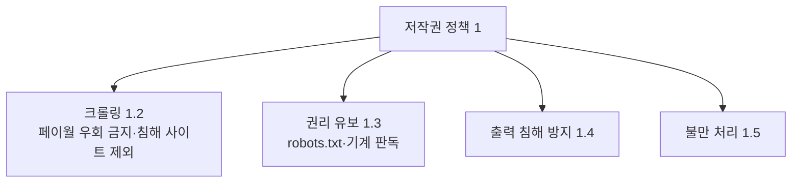
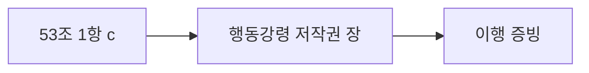

# GPAI 저작권 정책

> EU AI Act 53조 1항 (c)가 범용 AI(GPAI) 모델 제공자에게 요구하는 EU 저작권법 준수 정책. 행동강령(Code of Practice)의 저작권 장이 이를 이행하는 실무 방법(크롤러 규칙, 옵트아웃 준수, 출력 침해 방지, 불만 처리)을 제시한다.

## 쉽게 말하면
도서관에서 책을 복사해 학습 자료를 만드는 회사가 "복사 금지 표시가 붙은 책은 건드리지 않고, 불법 복제본 사이트는 쓰지 않고, 문제가 생기면 받아 줄 창구를 두겠다"는 사내 규정을 만들어 지키는 것이다.

## 자세히
출처는 AI Act 53조(열람), GPAI 행동강령 안내 페이지(열람), 행동강령 저작권 장 내용(code-of-practice.ai, 앞부분 열람). 행동강령은 자발적 도구이며 법률 자문이 아니다.
- **법적 근거(53조 1항 c)**: 제공자는 저작권 정책을 채택해, 필요하면 최신 기술로 지침 2019/790 4조 3항의 권리 유보를 식별하고 준수해야 한다([TDM 옵트아웃](#tdm-opt-out)). (d) 학습 콘텐츠의 충분히 상세한 요약도 AI Office 템플릿에 따라 공개한다.
- **행동강령의 지위(집행위 안내 페이지)**: 독립 전문가가 마련한 자발적 도구로, 집행위와 AI Board가 "적절한 자발적 도구"로 확인했다. 투명성·저작권·안전보안 세 장이 있고 저작권 장은 모든 GPAI 제공자에 적용된다. Amazon, Anthropic, Google, IBM, Microsoft, Mistral AI, OpenAI 등이 서명자에 포함되고 xAI는 안전·보안 장만 서명했다고 페이지에 적혀 있다.
- **저작권 장의 약속(code-of-practice.ai, 앞부분만 열람)**
  - 약속 1 저작권 정책: 모든 EU 시장 GPAI 모델에 대해 정책을 작성·갱신·이행하고 한 문서로 기술하며 내부 책임을 지정. 요약 공개 권장.
  - 1.2 웹 크롤링: 구독·페이월 같은 유효한 기술적 보호 조치를 우회하지 않고, EU·EEA 법원이나 공공기관이 상업적 규모로 반복적으로 침해한다고 인정한 사이트를 제외(EU 웹사이트의 공개 목록 활용).
  - 1.3 권리 유보: robots.txt(IETF RFC 9309)를 따르는 크롤러를 쓰고, 다른 적절한 기계 판독 유보 프로토콜도 식별·준수. 크롤러 정보를 공개하고 권리자에게 업데이트를 알린다.
  - 1.4 출력 침해: 학습 콘텐츠를 침해적으로 재현하지 않도록 비례적 기술 안전장치를 두고 이용 정책에서 침해 이용을 금지(오픈소스 모델은 문서에 경고).
  - 1.5 불만: 권리자용 전자 연락처와 전자 불만 처리 절차(집중관리단체 포함)를 두고 성실하고 합리적인 시간 안에 처리(명백히 근거 없거나 이미 답한 동일 불만은 예외).
- **한계**: 페이지 뒷부분(약 6만 자)은 읽지 못해 세부 문구와 추가 조치는 확인하지 못했다. 행동강령 서명이 법적 준수를 자동 보장하는지는 조문의 "준수를 보이는 데 쓸 수 있다"(53조 4항) 수준으로만 읽어야 한다.

## 그림으로 보기

## 예시
- 자사 크롤러가 robots.txt의 AI 학습 금지 표시를 따르는지 점검하고, 정책 문서에 크롤러 이름과 정보 공개 방식을 적는다(조항 구조에 따른 점검 예).
- 교육 실습: 가상 AI 회사의 저작권 정책 한 쪽을 위 네 가지 항목으로 써 본다.

## 헷갈리는 것과 비교
| 개념 | 차이 |
|---|---|
| 저작권 정책 | 제공자 내부 규정, 53조 1항 c |
| 행동강령 | 이행 방법을 보이는 자발적 틀 |
| [TDM 옵트아웃](#tdm-opt-out) | 정책이 준수해야 할 권리 유보 |
| 학습 데이터 요약 | 53조 1항 d, 별도 공개 의무 |

## 더 읽을거리
- [AI Act Article 53](https://artificialintelligenceact.eu/article/53/) — GPAI 의무(열람)
- [Commission: GPAI Code of Practice 안내](https://digital-strategy.ec.europa.eu/en/policies/contents-code-gpai) — 세 장·서명자(열람)
- [Code of Practice 저작권 장](https://code-of-practice.ai/?section=copyright) — 약속 목록(앞부분 열람)
