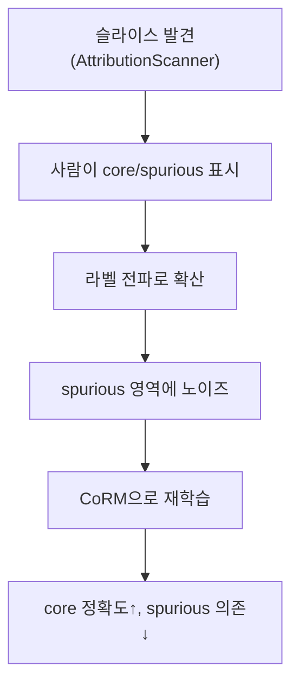
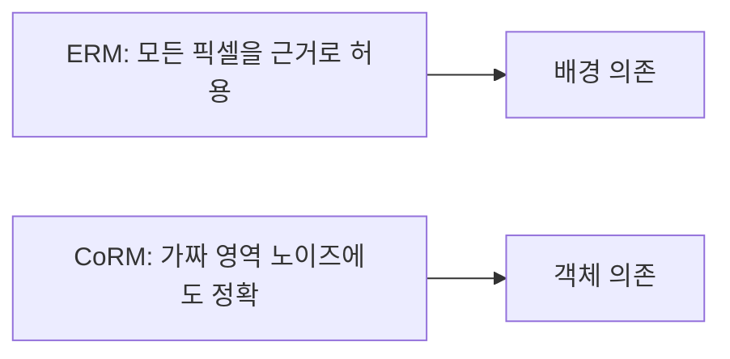

# Core Risk Minimization

> 모델이 이미지를 **정말 그 클래스를 나타내는 영역(core)** 에 근거해 분류하도록, **가짜 단서 영역(spurious)에 노이즈를 넣어도 정확도가 유지되게** 학습하는 방법(CoRM, Singla 외 2022). AttributionScanner는 사람이 표시한 가짜 슬라이스로 이 재학습을 돕는다.

## 쉽게 말하면
고양이 사진에서 고양이 몸통은 "진짜 근거", 소파 배경은 "가짜 근거"다. 시험 때 소파 부분에 지직거리는 노이즈를 끼워 넣어도 맞혀야 한다고 훈련시키면 학생은 배경이 아니라 고양이를 보게 된다.

## 자세히
- **정의(Singla·Moayeri·Feizi, arXiv 2203.15566, 초록 확인)**: 모델이 **core 특징**에 근거해 클래스를 예측하도록 하는 학습 목적(CoRM). core 정확도는 **non-core 영역에 노이즈를 넣어** 측정한다. 이를 위해 Salient ImageNet-1M을 만들었다 — 기존 Salient ImageNet(약 5.2만 샘플·232 클래스)을 확장해 ImageNet 1,000개 클래스 전체에 core·spurious 특징을 가리키는 **100만 개 이상의 소프트 마스크**를 제공한다.
- **보고된 결과(저자 주장)**: 42개 ImageNet 사전학습 모델의 가짜 특징 의존도를 측정해 트랜스포머가 ConvNet보다 가짜 특징에 더 민감했고, 제로샷 CLIP 트랜스포머는 특히 취약했다. CoRM은 일반 경험적 위험 최소화(ERM) 대비 **core 정확도를 약 12% 향상**시켰고 clean 정확도는 떨어지지 않았다.
- **AttributionScanner와의 연결(arXiv 2401.06462 HTML, 열어 확인)**: 전문가가 슬라이스를 spurious로 표시(CelebA 5개, Waterbirds 6개)하고 라벨 전파로 다른 슬라이스에 확산한 뒤 **가짜 슬라이스에 노이즈를 넣어 CoRM으로 재학습**했다.
  | 모델(Waterbirds) | Clean | Core | Spurious | RCS |
  |---|---|---|---|---|
  | Baseline | 85.74 | 82.99 | 82.83 | 0.0049 |
  | AS(표시) | 89.57 | 86.41 | 79.82 | 0.1951 |
  | AS(전파) | 90.41 | 87.41 | 77.90 | 0.2740 |
  Waterbirds에서 clean 85.74→90.41, core 82.99→87.41로 올랐고 spurious 정확도는 82.83→77.90으로 **내려갔다**(가짜 단서를 덜 쓴다는 의미). RCS(상대 core 민감도: core 영역에 대한 의존이 가짜 영역 대비 커진 정도)는 0.0049→0.2740. CelebA도 비슷(clean 98.03→98.08, core 97.21→98.16, spurious 97.62→96.02, RCS 0.0677→0.3685). 비교 대상은 원 기준 모델과 두 변형뿐이며 외부 편향 완화 방법과의 비교는 없다. 이 발췌 구간에는 CoRM의 손실식·노이즈 절차가 없다.
- **핵심 아이디어**: 평가 때 쓰는 "가짜 영역 가리기" 연산을 **학습에도 적용**해 모델이 그 영역에 의존하지 못하게 한다. 마스크(어디가 core/spurious인가)가 필요하다는 점이 비용이다.
- **비교 가능한 접근**: 그룹 DRO는 (라벨×속성) 그룹 라벨이 필요하고, CoRM은 **영역 마스크**가 필요하다. 둘 다 사람의 주석이 병목이다.
- **한계**: 마스크의 품질에 의존, 사람이 "core"로 표시한 것이 진짜 core인지는 사람 판단(도메인 지식)이 필요하다.

## 그림으로 보기



## 예시
```python
# 개념 코드: spurious 마스크 m(1=가짜 영역)에 가우시안 노이즈를 넣어 학습
x_noisy = x * (1 - m) + (x + sigma * torch.randn_like(x)) * m
loss = ce(model(x_noisy), y) + ce(model(x), y)
```
(위는 개념 스케치이며 논문 손실식과 다를 수 있음)
- 제조 불량 분류에서 라벨 스티커·배경 영역을 가짜로 표시해 노이즈를 넣어 재학습.

## 헷갈리는 것과 비교
| 방법 | 필요한 주석 | 아이디어 |
|---|---|---|
| ERM | 없음 | 평균 손실 최소화 |
| 그룹 DRO | 그룹(라벨×속성) | 최악 그룹 최소화 |
| CoRM | core/spurious 영역 마스크 | 가짜 영역 노이즈에도 정확 |
| [가짜 상관](#spurious-correlation) | - | 문제 정의 |

## 더 읽을거리
- [Core Risk Minimization using Salient ImageNet (arXiv 2203.15566)](https://arxiv.org/abs/2203.15566) — CoRM 정의·결과(초록 열어 확인).
- [AttributionScanner (arXiv 2401.06462 HTML)](https://arxiv.org/html/2401.06462v3) — 표 II·III 수치(열어 확인).
