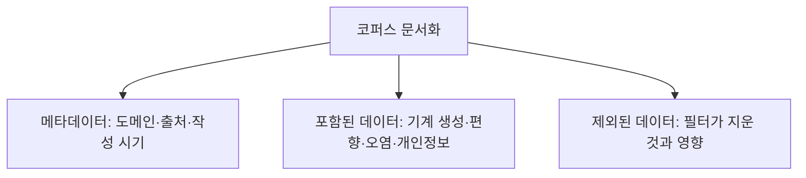
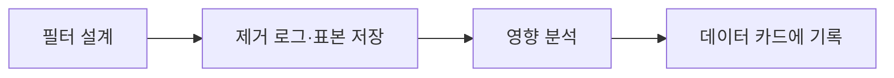

# 코퍼스 문서화 관행

> 웹에서 모은 대규모 코퍼스는 문서가 거의 없이 배포되곤 한다. Dodge 외(2021)는 **메타데이터·포함된 데이터·제외된 데이터** 세 층으로 문서화하자고 제안했다. 특히 **무엇이 빠졌는지**를 기록하는 것이 중요하다.

## 쉽게 말하면
식품 포장의 성분표에 "들어간 재료"뿐 아니라 "일부러 뺀 재료와 그 이유"까지 적는 것이다. 빠진 것을 모르면 그 식품이 누구에게 맞는지 알 수 없다.

## 자세히
(Dodge 외 2021, arXiv 2104.08758 PDF 본문 서론과 Figure 1을 직접 읽음)
- **문제 의식**: 웹 규모 데이터셋은 문서화가 최소한이다. 기존 데이터셋 문서화 제안 중 **샘플 수, 다운로드 링크**는 적용되지만 **저자 정보 보고**처럼 웹 텍스트에서는 얻을 수 없는 항목도 많다.
- **세 가지 문서화 층**:
  1. **메타데이터(Metadata)**: 데이터가 수집된 인터넷 도메인. 예: 최상위 도메인 `.edu`와 `.mil`의 텍스트는 서로 크게 다르지만 C4에는 둘 다 있다. 출처(provenance), 작성 시기(utterance date) 등.
  2. **포함된 데이터(Included data)**: 텍스트 자체의 특성 — 기계 생성 여부, 사회적 편향, 오염(다른 데이터셋의 테스트 예제 존재), 의료·건강 데이터, 인구통계 정체성 언급.
  3. **제외된 데이터(Excluded data)**: 필터가 무엇을 지웠는지. 단순한 필터(lorem ipsum 제거)도 있지만, **금칙어 필터는 소수 집단 정체성과 연관된 영어 방언·주제 문서를 불균형하게 제거**했다([금칙어 필터 부작용](#bad-words-list-filter)).
- **C4 사례**: 논문 그림 1의 예로 출처·작성 시기·기계 생성/인간 작성·사회적 편향·오염·의료/건강 데이터·인구통계 정체성이 문서화 항목으로 제시됐다. 이 연구의 문서화 자료를 `allenai/c4documentation` 저장소에 공개했다고 밝힌다.
- 적용(제안): 자체 코퍼스 데이터 카드에 ① 수집 시점·원천(도메인·국가 분포) ② 필터 목록과 각 필터가 제거한 비율·샘플 ③ 개인정보 처리 범위([FineWeb 개인정보](#fineweb-pii-removal)) ④ 평가 데이터 겹침 측정([오염](#benchmark-contamination-in-corpus)) ⑤ 라이선스·약관([ODC-By](#odc-by-vs-cc-by-odbl))을 적는다.
- 주의: 문서화는 한 번의 문서가 아니라 데이터가 갱신될 때마다 따라 고쳐야 한다. 항목이 많으면 읽히지 않으므로 핵심 위험 항목을 위로 둔다(제안).

## 그림으로 보기

## 예시
- 데이터 카드 표에 "필터 이름 / 제거 문서 비율 / 제거된 표본 링크" 열을 둔다.
- 교육: 데이터 카드는 모델 카드와 짝이라는 설명, 문서화 체크리스트 만들기 실습.

## 헷갈리는 것과 비교
| 개념 | 차이 |
|---|---|
| 데이터 카드·데이터시트 | 데이터셋의 구성·용도·한계 문서 |
| 모델 카드 | 모델의 성능·한계 문서 |
| 제외 데이터 문서화 | 필터가 지운 것의 영향까지 기록 |
| [제외 문서 저장](#exclusion-writer) | 제외 문서 기록을 위한 기능 |

## 더 읽을거리
- [Documenting Large Webtext Corpora (arXiv 2104.08758)](https://arxiv.org/abs/2104.08758) — 세 층 문서화 제안(PDF 본문 읽음).
