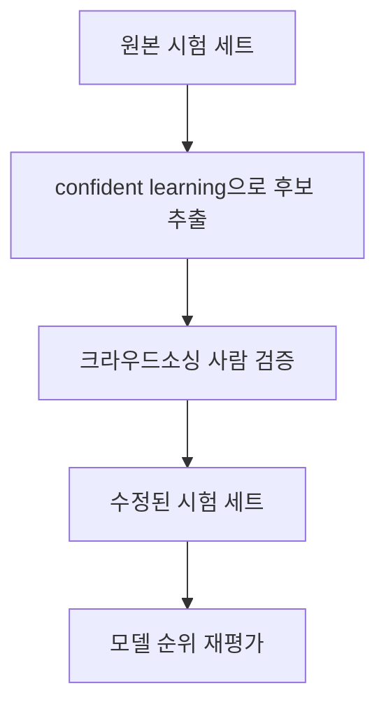
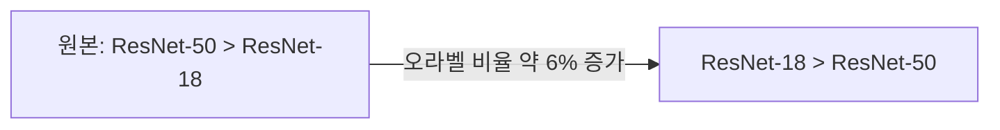

# 수정된 시험 라벨 세트

> 널리 쓰이는 벤치마크의 **시험(테스트) 세트에도 라벨 오류가 있고**, 이를 신뢰도 학습으로 찾아 크라우드소싱으로 사람이 확인한 뒤 고친 버전이 공개돼 있다. 순위 비교와 모델 선택은 이런 수정 세트로 다시 확인해 볼 만하다.

## 쉽게 말하면
정답지가 틀려 있는 시험으로 학생을 평가하면 가장 정직한 학생이 오히려 손해를 본다. 정답지를 바로잡은 시험지로 다시 채점하면 실제 실력 순위가 보인다.

## 자세히
(논문 "Pervasive Label Errors in Test Sets Destabilize Machine Learning Benchmarks", Northcutt·Athalye·Mueller, NeurIPS 2021 Datasets & Benchmarks, arXiv 2103.14749 초록 확인)
- **발견**: 컴퓨터 비전·자연어·오디오에서 가장 많이 쓰는 10개 데이터셋의 시험 세트에서 평균 **최소 3.3%**의 라벨 오류를 추정했다(검색 요약상 v2 초록은 3.4%로 판본에 따라 다름). ImageNet 검증 세트는 **최소 6%**.
- **방법**: 신뢰도 학습(confident learning)으로 후보를 뽑고 **크라우드소싱으로 사람이 검증**. 초록 요약에서는 후보의 평균 51%가 실제 오류였고, 검색 요약에서는 54%로 적혀 있어 확인한 판본마다 숫자가 다르다. 후보의 절반 정도만 진짜 오류라는 점이 핵심이므로 [자동 삭제는 위험](#auto-delete-risk)하다.
- **순위가 뒤집힌다**: 수정된 ImageNet에서 오라벨 시험 샘플 비율이 약 6%만 늘어도 ResNet-18이 ResNet-50보다 나은 것으로 바뀐다. CIFAR-10에서는 약 5% 늘면 VGG-11이 VGG-19를 앞선다. 저자들은 **용량이 큰 모델이 체계적 라벨 오류에 더 민감**하다고 주장하며, 노이즈가 많은 시험 세트에서는 작은 모델이 실용적일 수 있다고 한다(저자 주장).
- **공개 자료**: 수정된 시험 세트와 오류 갤러리는 labelerrors.com, 재현 코드는 cleanlab 쪽 GitHub에 있다(검색 요약, 사이트 미열람).
- **활용법**
  1. 모델 비교 시 원본과 수정 세트 두 점수를 함께 본다.
  2. 점수 차이가 작으면([점수 차이와 노이즈](#cv-score-difference-vs-noise)) 라벨 오류 비율이 순위를 흔들 수 있음을 감안한다.
  3. 자체 평가셋에도 같은 절차(후보 추출 → 사람 검증)를 적용한다([검수 순서](#human-relabel-triage)).
  4. 시험 세트를 고친 뒤 결과를 보고할 때 "원본 기준/수정 기준"을 명시한다.
- 주의: 수정 세트도 사람이 고친 라벨이라 완벽한 정답은 아니다. 라벨이 모호한 샘플은 사람마다 판단이 다르다.

## 그림으로 보기

## 예시
- 사내 분류 모델 두 개의 정확도가 0.5%p 차이일 때, 평가셋의 의심 라벨 300개를 사람이 확인해 고친 뒤 순위가 바뀌는지 확인.
- 교육: "점수가 높다고 좋은 모델이 아닐 수 있다" — 정답지 품질도 평가의 일부.

## 헷갈리는 것과 비교
| 개념 | 차이 |
|---|---|
| 학습 라벨 오류 | 모델이 노이즈를 외움 |
| 시험 라벨 오류 | 모델 순위·선택이 틀어짐 |
| [벤치마크 오염](#benchmark-contamination) | 평가셋이 학습에 들어감 |
| 수정 세트 | 사람이 검증해 고친 버전 |

## 더 읽을거리
- [Pervasive Label Errors in Test Sets (arXiv 2103.14749)](https://arxiv.org/abs/2103.14749) — 10개 데이터셋 오류율과 순위 뒤집힘(초록 확인).
- [Confident Learning (arXiv 1911.00068)](https://arxiv.org/abs/1911.00068) — 후보 추출에 쓴 방법론.
