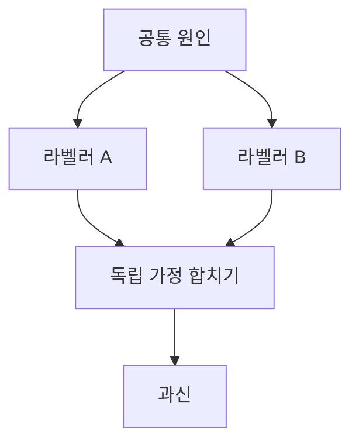
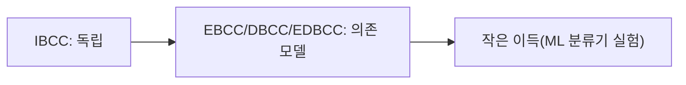

# 상관된 라벨러 문제

> 라벨러들의 실수가 서로 비슷하면(같은 지침 오해·같은 편향) 독립을 가정한 합치기(Dawid-Skene, 다수결)가 오류를 과소평가한다. 의존성을 모델링하는 방법이 제안됐지만 이득은 크지 않았다.

## 쉽게 말하면
같은 교재로 공부한 학생들이 같은 곳에서 틀리면, 학생 수가 많아도 정보는 많지 않다. 이를 알면 비슷하게 틀리는 학생들의 의견을 더 낮게 쳐 줄 수 있다.

## 자세히
(Kim & Ghahramani, "Bayesian Classifier Combination", AISTATS 2012와 Moreno 외, JMLR 2015를 하위 에이전트가 원문으로 읽은 노트 기준.)
- **Kim & Ghahramani**: 결합 대상 모델·"사람 평가자까지" 오류가 독립이 아니어도 되는 틀을 제시. **IBCC**는 독립을 가정한 베이즈판 Dawid-Skene(깁스 샘플링). 독립 가정은 "비슷하게 틀리는 형편없는 분류기 여럿과 좋은 분류기 하나"인 경우 다수결 쪽으로 치우치게 하고, 의존성을 반영하면 나쁜 분류기들을 상관 정도만큼 낮게 평가할 수 있다고 주장.
- **의존 모델 3종**: EBCC(항목별 숨은 난이도 변수), DBCC(마르코프 네트워크로 쌍별 의존), EDBCC(둘 다).
- **결과(표 2, 오류율)**: Satellite 실험 1에서 다수결 0.1505, IBCC 0.1510, EBCC 0.1490, EDBCC 0.1410. DNA는 다수결 0.0780, IBCC 0.0758, DBCC 0.0904(다수결보다 나쁨). 저자는 "최고 방법은 항상 BCC 계열"이라 결론 내리지만 다수결 대비 이득이 작고 의존 모델이 IBCC보다 일관되게 낫지는 않았다. **실험은 사람 크라우드가 아닌 머신러닝 분류기 조합**이다.
- **Moreno 외 2015**: 비슷하게 행동하는 라벨러를 군집화(CRP 사전분포)해 정답 추정을 개선한다고 주장 — 상관 오류를 직접 모델링하는 것은 아니라는 점에 주의(초록과 관련 연구 절만 읽음).
- **실무(제안)**: 상관이 의심되면 라벨러 그룹(출신·지침 버전)별로 표를 따로 세어 보고 골드 세트에서 그룹 공통 오류를 점검한다.

## 그림으로 보기

## 예시
- 같은 외주사 라벨러 10명이 같은 가이드 해석 오류를 공유 → 외주사 단위로 묶어 한 표처럼 취급.
- 교육 활용: "독립적 의견인가"를 묻는 비판적 사고 연습.

## 헷갈리는 것과 비교
| 개념 | 차이 |
|---|---|
| 상관된 라벨러 | 오류가 서로 닮음 |
| [라벨러 독립 가정](#annotator-independence-assumption) | 다수결 이득의 전제 |
| [Dawid-Skene](#dawid-skene) | 독립 가정 모델 |

## 더 읽을거리
- [Bayesian Classifier Combination (PMLR 22)](http://proceedings.mlr.press/v22/kim12/kim12.pdf) — IBCC·의존 모델.
- [Bayesian Nonparametric Crowdsourcing (JMLR 16)](https://jmlr.org/papers/volume16/moreno15a/moreno15a.pdf) — 라벨러 군집.
