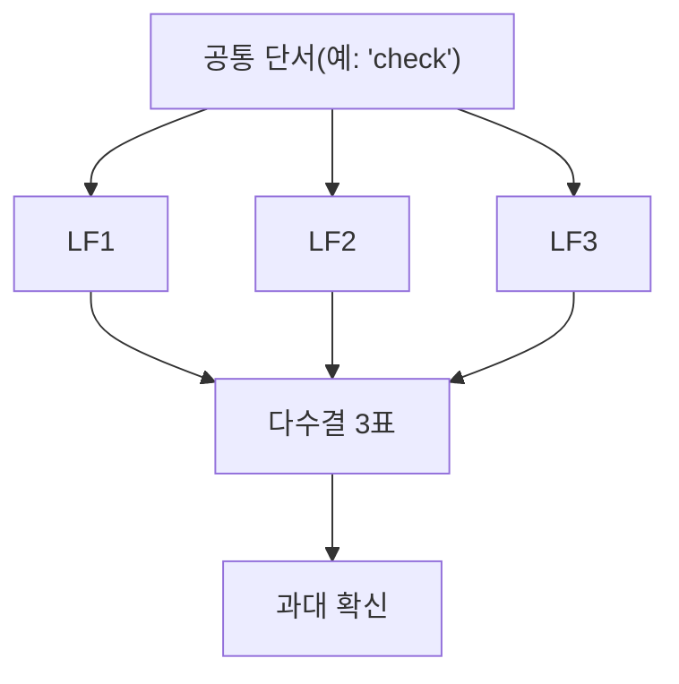
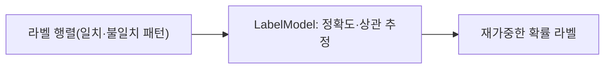

# 상관된 LF의 위험

> 같은 단서에 기대어 같은 방식으로 틀리는 라벨링 함수(LF)들은 서로 "동의"해서 자신감 있게 보이지만 실제로는 한 표를 여러 번 던지는 셈이다. 다수결이 이를 과대평가한다.

## 쉽게 말하면
같은 신문 기사를 읽은 심사위원 다섯 명이 같은 결론을 내렸다면 의견이 다섯 개가 아니라 사실상 하나다. 다수결로 세면 그 하나가 과대 대표된다.

## 자세히
(Snorkel 튜토리얼 소스와 링크된 논문 초록 수준을 직접 읽고 확인.)
- 튜토리얼 설명: LF는 **정확도·커버리지가 다르고 서로 상관될 수 있어**, 다수결에서는 **특정 신호가 과대 대표**된다. 그래서 단순 다수결 대신 `LabelModel`을 쓴다.
- **LabelModel**: 정답 라벨 없이 **LF들의 일치·불일치만** 보고 LF의 정확도와 상관을 추정해 출력을 재가중, 확률 라벨(신뢰도 가중 라벨)을 만든다(NeurIPS 2016 논문 arXiv 1605.07723을 근거로 소개).
- **예시(튜토리얼)**: `check`·`check out`·`regex_check_out`처럼 같은 문구에 기대는 LF 3개, 키워드 `my`·`subscribe`·`please` LF 등이 겹친다.
- **한계(제안)**: LabelModel도 상관 구조를 완벽히 알아낼 수 없다. 같은 제3자 모델(TextBlob)에서 온 LF 두 개 같은 "숨은 공통 원인"은 사람이 구조를 정리해 주는 편이 안전하다. 서로 다른 종류의 근거(패턴·모델·외부 지식)로 LF를 다양화한다.
- **진단 팁(제안)**: Overlaps는 높은데 오류 샘플이 같은 LF 묶음에서 반복되면 상관을 의심. 개발 세트에서 LF 묶음의 오류를 같이 본다.

## 그림으로 보기

## 예시
- 스팸 규칙 4개가 모두 "http" 문자열을 쓴다면 사실상 한 LF. 서로 다른 근거(발신자 이력·문장 길이)를 가진 LF를 추가.
- 교육 활용: "여러 AI에게 물어봐도 같은 데이터로 학습했다면 같은 실수를 한다"는 비유.

## 헷갈리는 것과 비교
| 개념 | 차이 |
|---|---|
| 상관된 LF | 서로 독립이 아닌 규칙들 |
| 충돌 | 서로 다른 라벨을 냄 |
| [LF 요약표](#lf-summary-table) | 중복·충돌 지표는 보이나 상관 자체는 직접 안 보임 |

## 더 읽을거리
- [Snorkel 튜토리얼 소스(spam)](https://github.com/snorkel-team/snorkel-tutorials/blob/master/spam/01_spam_tutorial.py) — LabelModel·다수결 비교 설명.
- [Data Programming (arXiv 1605.07723)](https://arxiv.org/abs/1605.07723) — LabelModel의 이론적 기반(튜토리얼이 인용).
