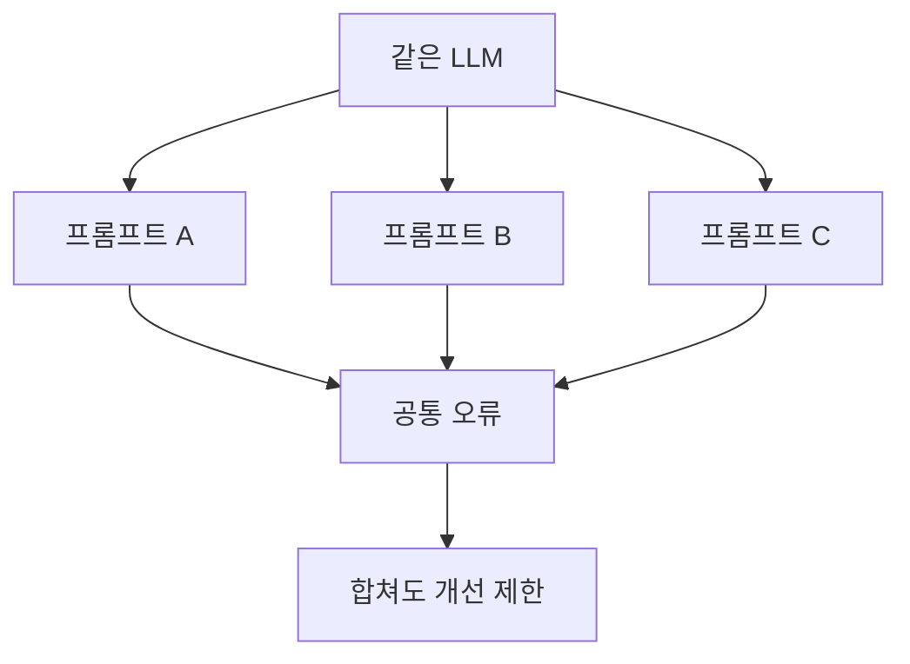

# 같은 LLM의 상관된 오류

> 같은 언어모델에 프롬프트만 바꿔 여러 LF를 만들면 오류가 서로 닮아, 합쳐도 기대만큼 오류가 줄지 않는다. 다양한 프롬프트·모델·근거를 섞어야 한다.

## 쉽게 말하면
같은 선생님에게 배운 학생 다섯이 같은 오개념을 갖고 있으면 다섯 명이 모여도 같은 오답이 나온다. 질문 방식만 바꿔도 같은 두뇌가 답하는 것이다.

## 자세히
(Arora 외 AMA arXiv 2210.02441과 Smith 외 arXiv 2205.02318을 직접 읽고 확인.)
- **측정(AMA)**: 프롬프트 체인들의 오류가 독립이라면 기대되는 값보다 **오류의 자카드 지수가 69% 더 높았다**. 즉 프롬프트 간 오류가 상관되어 단순 다수결은 정확도 차이와 의존성을 무시해 손해를 본다.
- **대응(AMA)**: 약한 지도(Snorkel 계열 라벨 모델)로 프롬프트별 정확도와 의존 구조를 추정해 합쳐 다수결보다 최대 8.7점, 9개 과제에서 의존성 복원으로 최대 9.6점 추가 이득.
- **Smith 외**: 서로 다른 **휴리스틱을 묻는** 프롬프트가 "약하게 상관된 상보적 오류"를 낸다는 것이 핵심 주장이다. 단순히 문구만 바꾼 프롬프트보다 관점이 다른 프롬프트가 낫다는 해석이다(제안).
- **실무 지침(제안)**: ① 관점이 다른 프롬프트 ② 다른 모델 계열 혼합 ③ 규칙·외부 지식 LF 병행 ④ 개발 세트에서 LF 쌍별 오류 겹침 측정 ⑤ 같은 모델 호출이 많을수록 비용과 지연도 커진다.
- 이 노드의 수치는 논문의 설정에서 나온 것이며 모델·과제에 따라 다르다.

## 그림으로 보기

## 예시
- 같은 GPT 모델로 만든 프롬프트 LF 5개와 규칙 LF 2개를 섞어 오류 겹침 행렬을 확인.
- 교육 활용: "여러 번 물어봐도 같은 AI면 같은 실수를 한다"를 실험.

## 헷갈리는 것과 비교
| 개념 | 차이 |
|---|---|
| 상관된 LLM 오류 | 같은 모델의 공통 실수 |
| [상관된 LF](#correlated-lf-risk) | LF 일반의 상관 |
| [프롬프트 다양화](#prompt-diversity-for-lf) | 이를 줄이는 방법 |

## 더 읽을거리
- [Ask Me Anything (arXiv 2210.02441)](https://arxiv.org/abs/2210.02441) — 오류 자카드 69%.
- [Language Models in the Loop (arXiv 2205.02318)](https://arxiv.org/abs/2205.02318) — 상보적 오류 주장.
