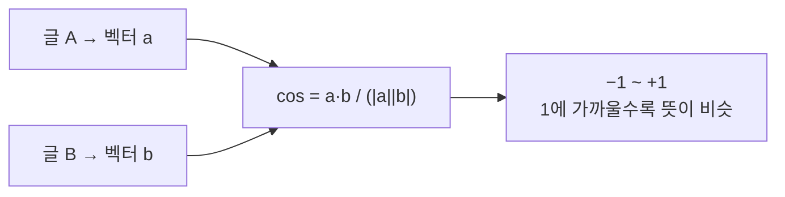
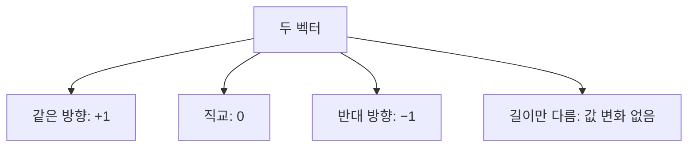

# 코사인 유사도

> 두 벡터가 가리키는 **방향**이 얼마나 같은지를 −1~1 사이 값으로 재는 지표. 임베딩 검색에서 "두 글의 뜻이 얼마나 가까운가"를 숫자로 만드는 가장 흔한 방법이다.

## 쉽게 말하면
두 사람이 같은 방향을 가리키고 있는지 본다. 얼마나 멀리 가리키는지(팔 길이)는 상관없다. 한 사람이 "북쪽", 다른 사람이 "북쪽"이면 거리와 관계없이 일치한다. 긴 글과 짧은 글이 같은 주제를 말하면 벡터의 크기는 달라도 방향이 비슷해 유사도가 높게 나온다.

## 자세히
- **정의(Wikipedia)**: 두 0이 아닌 벡터의 내적을 두 벡터 크기의 곱으로 나눈 값. 각도의 코사인이다.
- **범위**: −1(정반대 방향), 0(직교, 무관), +1(같은 방향). 단어 빈도처럼 성분이 음수가 될 수 없으면 0~1.
- **크기 무관**: 벡터를 몇 배로 늘려도 값이 같다. 상대적 비율이 중요한 데이터(문서 길이가 다른 글)에 맞다.
- **직접 계산해 본 결과**: a=[1,2,0], b=[2,4,0] → 1.0(같은 방향, 크기만 다름), a와 c=[0,0,3] → 0.0(직교), a와 e=[−1,−2,0] → −1.0(반대). [3,4]와 [6,8]은 코사인이 1.0이지만 유클리드 거리는 5.0이다 — **방향이 같아도 거리는 멀 수 있다**.
- **내적·유클리드와의 관계**: 벡터를 길이 1로 정규화하면 코사인 유사도는 내적과 같고, 코사인 거리(1−유사도)는 유클리드 거리 제곱의 절반이 되어 순서가 같다(Wikipedia). 직접 확인: a=[1,2,0]과 [1,2,1]에서 코사인 0.9129, 정규화 후 유클리드 거리 제곱 0.1743 = 2−2×0.9129. 그래서 벡터 DB는 정규화된 임베딩에 내적을 쓰기도 한다.
- **주의**:
  - 코사인 거리(1−유사도)는 엄밀한 거리 함수가 아니다(삼각 부등식 위반). 각도 거리(arccos)는 엄밀하지만 계산이 느리다.
  - 평균을 빼서 중심화하면 피어슨 상관계수가 된다.
  - 값의 절대 크기 해석 주의: 모델마다 분포가 달라 "0.8이면 비슷하다" 같은 고정 기준이 없다. 자체 데이터로 임계값을 정한다.
- **쓰임**: 문서 임베딩 검색, 추천, 중복 탐지, 군집 응집도 평가. [하이브리드 검색](#hybrid-search)에서 벡터 쪽 점수로 쓰인다.

## 그림으로 보기




## 예시
```python
import math
def cos(a, b):
    d = sum(x*y for x, y in zip(a, b))
    return d / (math.sqrt(sum(x*x for x in a)) * math.sqrt(sum(y*y for y in b)))

cos([1,2,0], [2,4,0])   # 1.0  (같은 방향)
cos([1,2,0], [0,0,3])   # 0.0  (무관)
```
업무 예: "환불 규정"을 임베딩해 사내 문서 조각 임베딩들과 코사인 유사도를 계산해 상위 5개를 가져온다(RAG 검색).

## 헷갈리는 것과 비교
| 개념 | 차이 |
|---|---|
| 코사인 유사도 | 방향만 비교(−1~1) |
| 유클리드 거리 | 점 사이의 직선 거리. 길이 차이에 민감 |
| 내적 | 길이도 반영. 정규화하면 코사인과 같음 |
| [BM25](#bm25) | 단어 일치 점수. 코사인은 임베딩 방향 유사도 |

## 더 읽을거리
- [Cosine similarity (Wikipedia)](https://en.wikipedia.org/wiki/Cosine_similarity) — 정의·범위·유클리드와 관계·주의점
