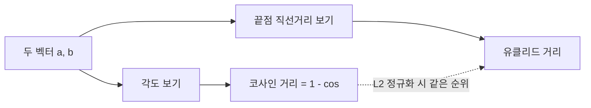
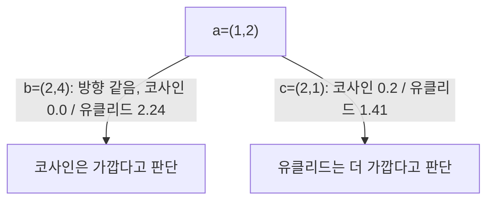

# 코사인 vs 유클리드 거리

> 코사인 거리는 두 벡터가 가리키는 방향의 차이만 보고, 유클리드 거리는 벡터 끝점 사이의 직선거리를 본다. 길이가 1로 정규화된 벡터에서는 둘의 순서가 같아진다.

## 쉽게 말하면
지도에서 두 사람이 서 있는 위치를 비교할 때, 유클리드는 두 사람 사이의 직선거리를 재고, 코사인은 원점(출발점)에서 둘이 같은 방향을 바라보는지만 본다. 한 사람이 같은 방향으로 두 배 멀리 서 있어도 코사인은 "같은 방향"이라고 말한다.

## 자세히
- **정의(Wikipedia)**: 코사인 유사도 S = (A·B)/(‖A‖‖B‖)로 −1~+1 범위이고 크기와 무관하다. 코사인 거리는 1 − S이며 엄밀한 거리 척도(metric)는 아니다. 삼각부등식이 성립하는 진짜 거리가 필요하면 각도 거리 arccos(S)/π를 쓴다.
- **정규화하면 같은 순서**: 길이 1인 벡터에서 ‖A−B‖² = 2(1−S)이므로 코사인 거리 = 유클리드 거리²/2다. 그래서 L2 정규화한 뒤의 유클리드 거리는 코사인 거리와 같은 이웃 순위를 만든다. 딥러닝 임베딩에서 정규화 유클리드가 흔한 이유다.
- **직접 계산한 예**: a=(1,2), b=(2,4), c=(2,1). 코사인 거리는 a–b 0.0(같은 방향), a–c 0.2이고, 유클리드 거리는 a–b 2.236, a–c 1.414다. 즉 유클리드로는 c가 더 가깝고, 코사인으로는 b가 더 가깝다. 어느 쪽이 "비슷함"인지는 벡터의 크기에 의미가 있는지에 달렸다.
- **언제 무엇을(해석)**: 텍스트 임베딩·TF-IDF처럼 길이(문서 길이·단어 수)가 의미와 무관하면 코사인. 값의 크기가 정보인 수치 특징(키·무게·매출)은 유클리드(표준화 후). cleanlab 이상치 점수는 특징이 3개 초과면 코사인, 아니면 유클리드가 기본이다([kNN 이상치 점수](#knn-outlier-score)).
- **주의(해석)**: 영벡터는 코사인이 정의되지 않는다. 임베딩 모델 문서가 권장하는 지표를 따르는 것이 안전하다.

## 그림으로 보기

## 예시
- 검색(RAG)에서 질문 임베딩과 문서 임베딩 비교: 길이 정규화된 임베딩이라 코사인이 표준.
- 고객 지표(구매액·방문수) 클러스터링: 크기가 의미라서 표준화 후 유클리드.
- 교육 활용: 위 세 점을 종이에 그려 두 거리의 순위가 다른 이유를 설명하게 한다.

## 헷갈리는 것과 비교
| 개념 | 차이 |
| --- | --- |
| 코사인 거리 | 방향 차이, 크기 무시, 엄밀한 metric 아님 |
| 유클리드 거리 | 직선거리, 크기 반영 |
| 각도 거리 | 코사인에서 arccos, 진짜 metric |
| [kNN 이상치 점수](#knn-outlier-score) | 위 거리로 이웃 거리를 평균 |

## 더 읽을거리
- [Cosine similarity (Wikipedia)](https://en.wikipedia.org/wiki/Cosine_similarity) — 정의, 정규화 시 유클리드와의 관계
- [cleanlab outlier 문서](https://docs.cleanlab.ai/stable/cleanlab/outlier.html) — 거리 지표 기본값
