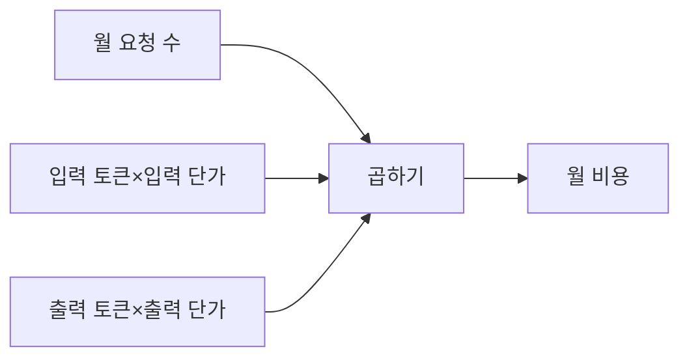
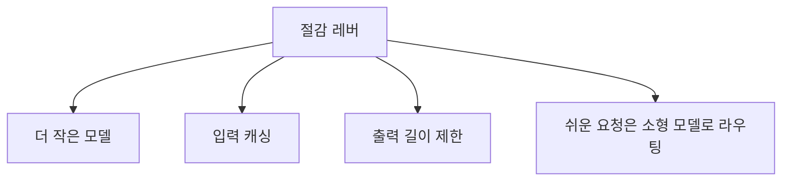

# 비용 추산표

> **요청 수 × (입력 토큰 × 입력 단가 + 출력 토큰 × 출력 단가)**로 월 API 비용을 미리 계산하는 표. 도입 전에 모델별로 비교해 예산을 잡는다.

## 쉽게 말하면
가계부처럼 "하루 몇 번 쓰고, 한 번에 얼마나 쓰고, 단가가 얼마인가"를 곱해 월 지출을 미리 보는 것이다.

## 자세히
- 공식: `월 비용 = 월 요청 수 × (평균 입력 토큰 × 입력 단가 + 평균 출력 토큰 × 출력 단가) ÷ 1,000,000`. 단가는 백만 토큰(MTok) 기준.
- 단가(Claude 가격표 열람 2026-11-28, 백만 토큰당 입력/출력): Sonnet 5.5 $2/$10, Haiku 5.5 $0.10/$0.50(100K 이하 프롬프트), Opus 5 $5/$25. 가격은 바뀔 수 있다.
- 직접 계산 예(월 3만 요청, 입력 1,500토큰, 출력 300토큰, 캐시·배치 할인 없음):
  | 모델 | 월 비용 |
  |---|---|
  | Haiku 5.5 | **$9.00** |
  | Sonnet 5.5 | **$180.00** |
  | Opus 5 | **$450.00** |
  Haiku 5.5와 Opus 5는 50배 차이다.
- 추가 항목(내 정리): ① 생각 토큰은 출력으로 과금([출력 토큰 비용](#output-token-cost)) ② 캐시 쓰기·읽기([캐시 TTL](#cache-ttl)) ③ 재시도·실패 요청 ④ 한국어 토큰 증가([언어별 토큰 수](#tokenizer-language)) ⑤ 도구·검색 등 부가 비용(이 글에서는 가격을 확인하지 않음).
- 사용법: 실제 요청 50~100개로 평균 토큰을 측정한 뒤 곱한다. 사용량 변동에 대비해 여유 20~30%를 두는 식의 경험칙은 내 제안이며 출처가 있는 값이 아니다.
- 한계: 위 표는 단순화한 모델이다. 실제 청구서는 캐시 적중률·요청 분포에 따라 다르다.

## 그림으로 보기



## 예시
```python
cost = req * (inp*p_in + out*p_out) / 1e6
```
- 교육: 수강생 회사의 AI 도입 후보 업무 3개를 위 표로 모델별 비용 비교.

## 헷갈리는 것과 비교
| 개념 | 차이 |
|---|---|
| 비용 추산표 | API 월 사용료 계산 |
| 총소유비용(TCO) | 인력·전력·운영 등 전체 비용 |
| [호스팅 결정](#hosting-decision-checklist) | 자체 호스팅과 API 중 선택 |

## 더 읽을거리
- [Prompt caching — Pricing](https://platform.claude.com/docs/en/build-with-claude/prompt-caching#pricing) — 단가표(읽음).
