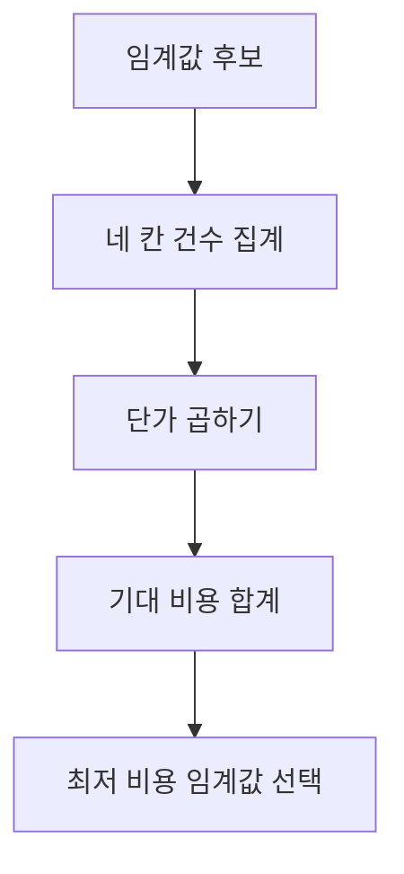
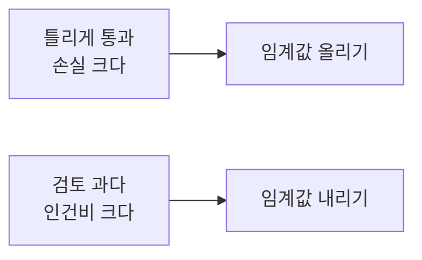

# 비용 행렬

> 모델의 판단 결과 네 칸(맞게 통과, 틀리게 통과, 맞는데 검토, 틀려서 검토)에 각각 금액을 매겨 기대 비용을 계산하는 표. "정확도가 몇 %냐"가 아니라 "이 기준이면 돈이 얼마나 드나"로 임계값을 고르게 한다.

## 쉽게 말하면
공항 검색대에서 위험물을 놓치는 비용과 멀쩡한 승객을 불필요하게 검색하는 비용은 크게 다르다. 오탐과 미탐의 가격표를 먼저 정하면 "얼마나 엄격하게 볼지"가 숫자로 정해진다.

## 자세히
- **혼동 행렬 기본(Google ML 단기 과정, 열람)**: 예측과 실제를 교차 집계해 TP·FP·FN·TN을 얻는다. 임계값을 올리면 표시되는 건이 줄어 TP와 FP가 함께 줄고 FN과 TN이 늘며, 내리면 반대가 된다. 0.5는 기본값일 뿐이고 클래스가 불균형하거나 한쪽 오류가 더 비쌀 때는 부적절할 수 있다. 어느 오류가 더 비싼지에 따라 임계값을 고른다.
- **비용을 목적함수로(scikit-learn 문서, 열람)**: `TunedThresholdClassifierCV`는 지정한 `scoring`을 최대화하는 결정 임계값을 고른다(기본은 balanced accuracy). 문서의 보험 예시는 비즈니스가 정의한 효용·이득 함수를 최적화해 임계값이 0.5가 아니라 약 0.02로 나왔다고 한다. 비용 행렬 자체는 문서가 정의하지 않으며 보통 사용자 정의 스코어러(`make_scorer`)로 구현한다. 또 `predict_proba`·ROC·PR 곡선은 튜닝 전후 동일하고 예측 라벨만 바뀐다. 튜닝은 분류기 학습 데이터가 아닌 별도 데이터로 해야 한다.
- **비용 행렬 쓰는 법(이 글의 정리)**: ① 네 칸의 단가를 정한다(검토 시간×인건비, 오류 1건 손실 등) ② 후보 임계값마다 네 칸의 건수를 센다 ③ 건수×단가를 합해 기대 비용을 구하고 가장 낮은 임계값을 고른다. 단가는 추정이므로 [민감도 분석](#sensitivity-analysis-ai-roi)으로 단가가 바뀌어도 결론이 같은지 본다.

## 가상 예시(이 글에서 직접 계산한 숫자)
송장 1,000건 중 오류 송장 50건(5%). 단가 가정: 틀린 송장을 통과시키면 건당 20만 원 손실, 검토는 건당 3,000원, 맞는 송장을 그냥 통과시키면 0원.

| 기준 | 맞게 통과 | 틀리게 통과 | 맞는데 검토 | 틀려서 검토 | 기대 비용 |
|---|---|---|---|---|---|
| A(느슨) | 900 | 15 | 50 | 35 | 325만 5천 원 |
| B(엄격) | 800 | 3 | 150 | 47 | 119만 1천 원 |

계산: A = 15×200,000 + (50+35)×3,000 = 3,255,000원, B = 3×200,000 + (150+47)×3,000 = 1,191,000원. 엄격한 B가 검토가 늘어도 총비용이 낮다. 단가가 달라지면 결론이 뒤집힐 수 있다.

## 그림으로 보기

## 예시
- 위 표를 스프레드시트에 넣고 오류 손실 단가를 10만·20만·40만 원으로 바꿔 어느 기준이 최저인지 본다.
- 교육 실습: 자기 업무의 오류 1건 비용과 검토 1건 비용을 추정해 네 칸 표를 채운다.

## 헷갈리는 것과 비교
| 개념 | 차이 |
|---|---|
| 혼동 행렬 | 건수 |
| 비용 행렬 | 칸별 금액 |
| 정확도 | 비용을 반영하지 않음 |
| [건당 처리 비용 추정](#handling-time-cost) | 검토 칸의 단가를 구하는 법 |

## 더 읽을거리
- [Google ML Crash Course: Thresholding](https://developers.google.com/machine-learning/crash-course/classification/thresholding) — 임계값과 혼동 행렬(열람)
- [scikit-learn: Decision threshold tuning](https://scikit-learn.org/stable/modules/classification_threshold.html) — 사용자 정의 스코어러(열람)
