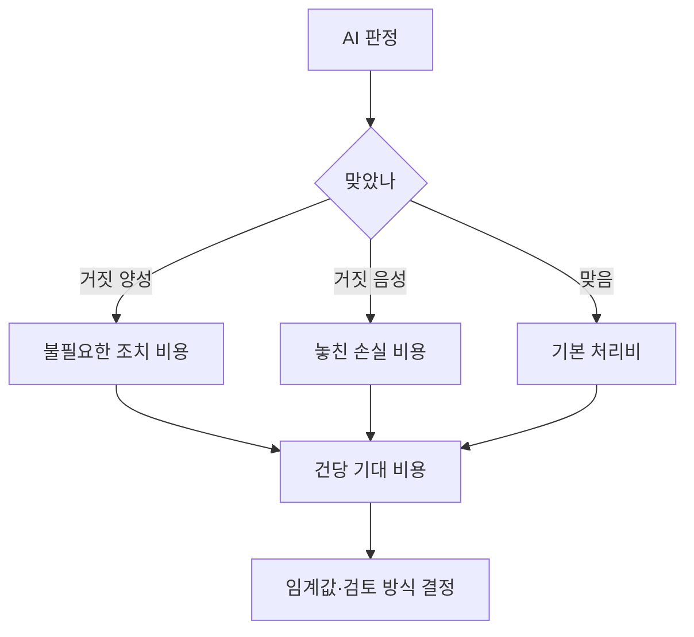

# 오류 유형별 비용

> AI가 틀렸을 때 드는 비용은 오류 종류마다 다르다. 거짓 양성·거짓 음성, 재작업, 사람 이관, 고객 이탈 같은 비용을 따로 적어야 정확도 숫자를 돈으로 바꿀 수 있다.

## 쉽게 말하면
화재경보기가 오작동(소방차 출동 비용)하는 것과, 진짜 불에 안 울리는 것(건물 전소)은 같은 "오류 1건"이 아니다. 하나로 뭉쳐 "정확도 95%"라고 하면 어느 쪽 5%인지가 가려진다.

## 자세히
- **기본 도구: 비용 행렬(cost matrix)**. 참양성·참음성·거짓양성·거짓음성 각 결과에 비용을 매긴다. AWS 블로그는 사업이 예측으로 취하는 행동에 따라 이 행렬을 명시해야 한다고 한다. 기본 가정(두 오류 비용이 같다)은 현실에서 드물다.
- **AWS 예시(유방암 선별, QALY 환산)**: 참음성 0, 거짓양성 -0.01288, 참양성 -0.3528, 거짓음성 -2.52 QALY. 1 QALY를 $100,000로 두면 거짓음성이 거짓양성의 약 200배. 이 비를 학습 손실의 가중치(1배/5배/200배)에도 썼다. 의료 사례 한정이며 업무 AI에 그대로 쓸 수 없다.
- **업무용 비용 분류(실무 정리, 항목은 검색 요약 기반)**:
  - 거짓양성: 불필요한 출동·검수·할인 쿠폰 발송, 멀쩡한 부품 폐기.
  - 거짓음성: 결함 유출, 사기 통과, 이탈 고객을 놓침.
  - 이관·재작업: 사람이 다시 처리하는 시간(건당 처리 시간 × 인건비).
  - 이탈·신뢰 손실: 고객 생애가치 감소.
  - 위험 비용: 규제·소송.
- 인터넷에 도는 "거짓음성이 10~100배 비싸다" 같은 일반 비율은 근거 없는 블로그 주장이다. 자사 데이터로 추정한다.
- **쓰는 법**: 비용 행렬 + 오류율 → 건당 기대 비용 → 임계값 선택과 손익분기 계산([정확도 경제학](#accuracy-economics), [사람 개입 라우팅](#human-in-the-loop-routing)).

## 그림으로 보기

## 예시
- 이탈 예측: 거짓양성 = 쿠폰 5,000원, 거짓음성 = 고객 1명 연 가치 12만 원이면 비는 24배(가상 수치) → 확신 낮아도 쿠폰을 보내는 편이 이득인 구간이 생긴다.
- 불량 검사: 양품을 불량으로 판정하면 폐기 비용만, 불량 유출은 리콜 비용.

## 헷갈리는 것과 비교
| 개념 | 차이 |
|---|---|
| 정확도 | 맞힌 비율, 비용 무시 |
| 정밀도·재현율 | 오류 종류별 비율 |
| 비용 행렬 | 오류 종류별 금액 |
| [신뢰도 보정](#confidence-calibration) | 확신 값의 정확성 |

## 더 읽을거리
- [AWS: Training models with unequal economic error costs](https://aws.amazon.com/blogs/machine-learning/training-models-with-unequal-economic-error-costs-using-amazon-sagemaker) — 비용 행렬과 손실 가중치 예시(본문 일부만 확인)
