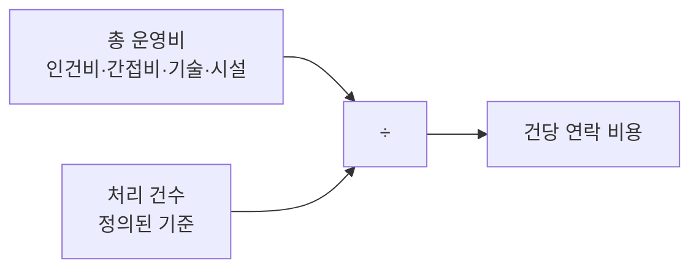
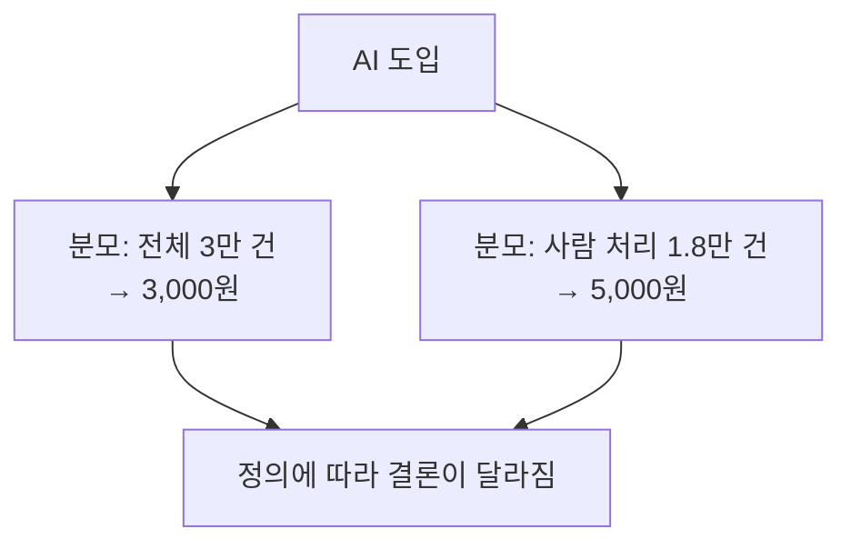

# 건당 연락 비용

> 건당 연락 비용(cost per contact)은 상담센터의 한 기간 총 운영비를 같은 기간에 처리한 연락 건수로 나눈 값이다. 센터 전체의 효율을 한 숫자로 보여 주지만, 분자(무슨 비용을 넣나)와 분모(무엇을 한 건으로 세나)의 정의에 따라 값이 크게 달라진다.

## 쉽게 말하면
식당의 한 달 총비용(재료·인건비·월세)을 그달 받은 손님 수로 나누면 "손님 한 명당 드는 돈"이 나온다. 이 값이 낮다고 좋은 식당은 아니다. 음식 질을 깎거나 손님을 빨리 내쫓아도 낮아지기 때문이다.

## 자세히
- **공식(ICMI, Klipfolio, 열람)**: ICMI는 월 총 운영비 ÷ 월 인바운드 연락 건수로 정의한다. Klipfolio는 기간 총 운영비 ÷ 같은 기간 처리 건수이며 보고 전에 분자·분모·기간을 정의하라고 한다.
- **분자에 넣는 비용(ICMI)**: 상담사 급여·복리후생, 간접 인력(팀장·감독자·일정 관리·품질·교육·관리자)의 급여, 기술·통신(컴퓨터·소프트웨어 라이선스·ACD·헤드셋), 시설(사무 공간·공과금·보험), 출장·교육·사무용품. Klipfolio는 일회성 프로젝트와 이례 항목을 제외하라고 안내한다.
- **분모의 정의(Klipfolio)**: 채널별 기록 시스템에서 완료된 상호작용을 세고, 이관(transfer)을 이중으로 세지 않으며, 내부 통화를 셀지 정하라고 한다. 검색 결과 요약에서는 포기 호를 뺀 처리 건수를 쓰는 방식(CX Today)처럼 정의가 갈린다고 나왔다(요약만 확인).
- **해석 주의(ICMI)**: 평균보다 높아도 만족도·서비스 수준이 높으면 나쁘지 않고, 낮아도 서비스 질을 희생한 결과면 좋지 않다. 센터 간 비용 차이는 임금 수준·처리 시간·활용률 때문에 최대 약 10배에 이른다고 한다. 채널 구성도 영향을 준다(ICMI 글: 채팅은 음성의 약 76%, 이메일·웹은 약 81% 수준).
- **벤치마크**: Klipfolio는 숫자 기준을 제시하지 않고 외부 값은 방향성으로만 보며, 내부 목표는 최근 6~12개월 평균을 채널별로 쓰라고 한다. 그 글의 4.50달러(전체)·6.00달러(전화)·2.67달러(채팅)·4.00달러(이메일)는 예시 수치다.
- **AI 도입 시 계산(가상, 직접)**: 월 운영비 1.2억 원, 인바운드 3만 건이면 건당 4,000원이다. AI가 1.2만 건을 처리해 사람 비용이 30% 줄고 AI 비용 600만 원이 추가되면 총 9,000만 원이다. 분모를 전체 3만 건으로 세면 3,000원, 사람이 처리한 1.8만 건으로 세면 5,000원이다. 어느 분모를 쓰는지에 따라 개선처럼도 악화처럼도 보이므로 정의를 고정해 도입 전후를 비교한다. 이 수치는 설명용 가정이다.
- **함께 볼 지표**: 고객 만족도, 재접촉률, 해결률. 낮은 건당 비용이 재접촉으로 늘어난 건수를 숨길 수 있다(해석).

## 그림으로 보기

## 예시
- 상담센터 AI 도입 보고서: "건당 연락 비용 4,000원 → 3,000원"을 주장하려면 분모에 AI가 처리한 건이 포함된다는 점과 재접촉률을 함께 적는다.
- 교육 활용: 같은 숫자 표에서 분모를 바꾸면 결론이 어떻게 달라지는지 비교하는 실습.

## 헷갈리는 것과 비교
| 개념 | 차이 |
| --- | --- |
| [건당 처리 비용](#handling-time-cost) | 상위 주제. 한 건에 걸린 시간 × 시간당 비용 |
| 건당 연락 비용 | 총 운영비 ÷ 건수. 간접비·기술비 포함 |
| 해결당 비용(cost per resolution) | 해결된 건수로 나눈 값. 재접촉을 반영(이번 조사에서는 공식 미확인) |
| [완전 부담 시간당 비용](#fully-loaded-hourly-cost) | 건당 비용의 인건비 구성 요소 |

## 더 읽을거리
- [ICMI: The Metric of Cost Per Contact](https://www.icmi.com/resources/2021/contact-center-metric-cost-per-contact) — 정의·포함 비용·해석 주의
- [Klipfolio: Cost per Contact](https://www.klipfolio.com/kpis/call-center/cost-per-contact) — 분자·분모 정의와 벤치마크 주의
