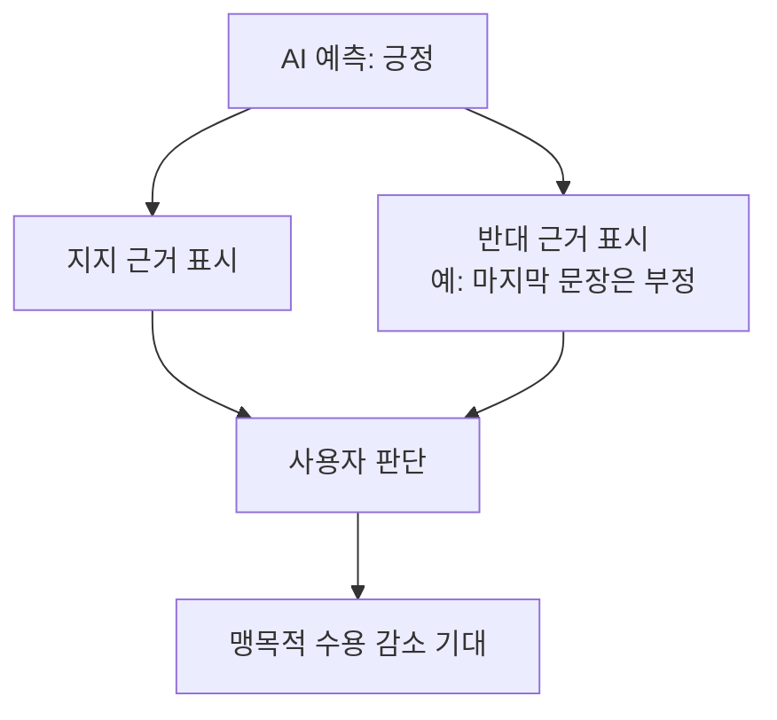
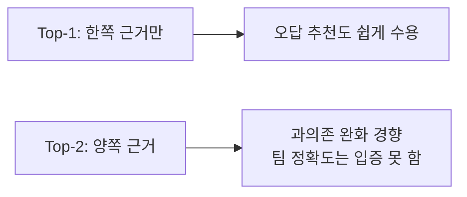

# 반대 근거 함께 보이기

> AI가 자기 추천을 뒷받침하는 근거만 보여 주지 않고, 다른 선택지나 반대 방향의 근거도 함께 보여 주는 설명 설계. 사용자가 추천을 맹목적으로 따르는 것을 줄이려는 시도이며, 연구에서는 과의존은 줄였지만 팀 정확도 개선까지는 입증되지 않았다.

## 쉽게 말하면
상품 후기에서 "좋다"는 후기만 형광펜으로 칠해 두면 첫 문장에서 읽기를 멈추고 구매하기 쉽다. 끝에 있는 "하지만 배송이 한 달 걸렸다"는 반대 의견까지 같이 칠해 주면 한 번 더 생각하게 된다. AI 설명도 마찬가지로 "이래서 맞다"와 "이런 면에서는 아닐 수도"를 함께 보여 주면 사용자가 판단을 맡기지 않고 따져 보게 된다.

## 자세히
출처: Bansal 외 CHI 2021(arXiv 2006.14779) §3.2–3.3, §5, §6(본문 직접 읽음). 텍스트 감성 분류(Beer, Amzbook)와 LSAT 논리 문제 실험이며 일반 업무로의 확장은 검증되지 않았다.
- **설계**: 파일럿(Beer 리뷰 50건, 조건당 50명)에서 로지스틱 회귀 분류기의 주요 단어를 문장에 형광펜으로 표시. **Explain-Top-1**은 예측 클래스를 지지하는 단어만, **Explain-Top-2**는 두 번째 클래스를 지지하는 단어(반대 근거)도 다른 색으로 함께 표시. Top-2는 "여러 결과를 설명하라"는 제안(Wang 외)에 대응.
- **파일럿 관찰**: ① 어느 쪽 설명도 집계된 팀 정확도를 유의하게 바꾸지 못함. ② 그래도 Top-1이 Top-2보다 낫다. ③ 설명은 AI가 틀린 추천까지 더 따르게 했다 — AI가 맞으면 신뢰도만 볼 때보다 정확도가 조금 올랐지만 틀리면 내려갔다. ④ **이 효과는 Top-2에서 덜했다**: 대안을 고려하게 해 과의존을 막은 듯하다. 예로 리뷰의 마지막에 부정 문장이 있는데 반대 근거 표시가 없으면, 사용자가 첫 긍정 문장에서 멈추고 끝의 부정을 놓친다. ⑤ 참가자들은 설명 품질이 더 좋기를 원했다(설명이 모델 행동과 맞지 않으면 혼란).
- **적응형 설명**: 확신도가 임계값 미만일 때만 Top-2(반대 근거 포함)를 보여 준다. 일치율 분석에서 AI가 불확실할 때 사용자가 AI에 덜 동의하게 했다. 하지만 최종 팀 정확도는 유의하게 오르지 않았다. 확신이 높지만 틀리는 사례를 사람이 찾기 어렵기 때문이라고 저자들은 추측한다.
- **미래 제안(논문)**: ① 설득이 아니라 **알려 주는** 설명 — 일반화 가법 모델(GAM)의 전역 설명이 폐렴·천식 모델의 가짜 상관(천식 환자가 폐렴 사망 위험이 낮다고 학습)을 의사가 의심하게 한 사례. ② **악마의 변호인** 역할 — AI가 사람과 의견이 같을 때도 자신의 의심과 대안(상위 K개)을 요약해 보여 주고 사용자가 더 파고들게 하는 대화형 설계.
- **한계**: 반대 근거를 보여 주면 인지 부하가 늘고 읽는 시간이 길어진다. 근거 품질이 낮으면 오히려 혼란을 준다.
- **적용 팁(제안)**: 신용·의료처럼 틀렸을 때 비용이 큰 결정에서 AI의 최상위 후보 외 2위 후보와 그 근거, "이 판단을 뒤집을 수 있는 요인"을 함께 제시하고, 오답 사례 수용률([정답·오답별 수용률](#acceptance-by-correctness))로 효과를 측정한다.

## 그림으로 보기

## 예시
- 감성 분류: 긍정 예측의 근거 문장은 초록, 부정 문장은 빨강으로 함께 표시.
- 심사 보조: "승인 권고" 옆에 "거절 쪽으로 기운 요인 3개"를 같은 크기로 보여 준다(제안).

## 헷갈리는 것과 비교
| 개념 | 차이 |
|---|---|
| 반대 근거 표시 | 추천에 반하는 근거도 같이 보임 |
| Top-1 설명 | 예측을 지지하는 근거만 |
| [반사실 설명](#counterfactual-explanation) | 무엇을 바꾸면 결과가 달라지는지 |
| [설명이 과신을 부르는 문제](#explanations-overreliance) | 반대 근거가 막으려는 현상 |

## 더 읽을거리
- [Does the Whole Exceed its Parts? (arXiv 2006.14779)](https://arxiv.org/abs/2006.14779) — 파일럿·적응형 설명·논의(본문 직접 읽음)
