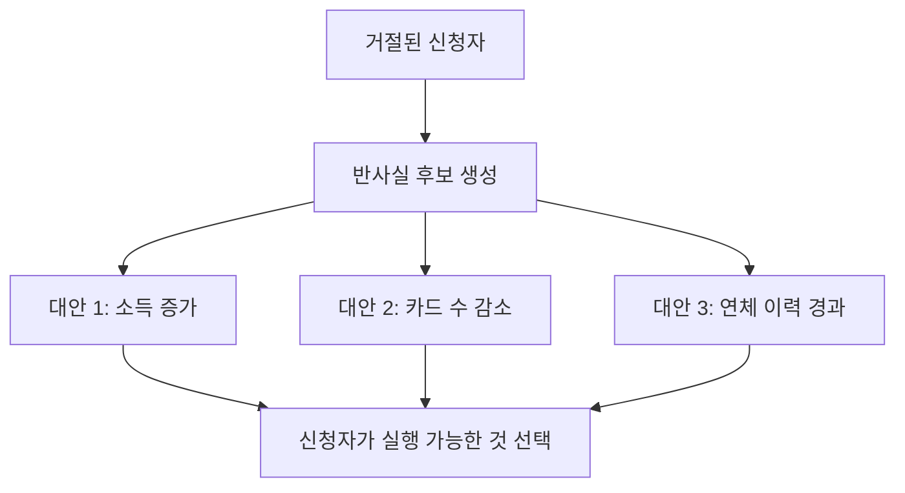

# 반사실의 다양성

> 반사실 설명을 **하나만** 주지 않고 서로 다른 여러 대안을 함께 주는 방식. 같은 결과를 얻는 길이 여러 개 있고(Rashomon 효과), 사람마다 바꿀 수 있는 것이 달라서 여러 경로가 필요하다.

## 쉽게 말하면
길 안내에서 "고속도로로 가세요" 하나만 주면 공사 중일 때 막힌다. "고속도로, 국도, 지하철" 세 경로를 주면 사정에 맞게 고를 수 있다. 대출도 소득을 올릴 수도, 카드 수를 줄일 수도 있다.

## 자세히
출처: Molnar "Interpretable Machine Learning" 반사실 설명 장(열어서 읽음).
- **바람직한 성질 다섯**: 타당성(목표 예측을 만듦), 근접성(원 사례와 가까움), 희소성(바뀌는 특성이 적음), 그럴듯함(현실적 값), **다양성(여러 대안 생성)**.
- **다양성이 필요한 이유**: 유효한 반사실이 보통 여러 개 존재하고 서로 모순될 수도 있다(Rashomon 효과). 책은 모두를 보고하거나 선택 기준을 적용해야 한다고 쓴다.
- **책의 예**: 대출 거절 시 "연소득 10,000 증가" 또는 "신용카드 수 감소와 5년 전 대출 연체 없음" 같은 서로 다른 반사실.
- **생성법**: Wachter 외는 예측 오차와 MAD 가중 거리의 손실을 최소화하며 희소성·그럴듯함을 고려하지 않고 범주형 특성에 약하다. Dandl 외는 예측 목표·Gower 거리·변경 특성 수·관측 데이터와의 근접성 네 목적을 NSGA-II 유전 알고리즘으로 동시에 최적화해 서로 다른 해 집합을 얻는다.
- **주의**: 기본적으로 반사실은 현실 세계의 인과 주장을 지지하지 않고(인과 모델이 필요), 개별 예측 설명이라 모델이나 데이터 전체에 대한 통찰은 제한적이다.
- **구제와의 연결**: 여러 대안 중 사용자가 실제로 바꿀 수 있는 것을 고를 수 있어야 한다([실행 가능한 구제](#actionable-recourse)).

## 그림으로 보기

## 예시
- 통지서에 3가지 경로를 제시하되, 변경 불가한 항목은 제외하고 변경 폭이 작은 순으로 정렬.
- 점검: 제시한 대안들이 서로 충분히 다른가(같은 변수만 조금씩 바꾼 것이 아닌가), 모순되는 조언은 없는가.

## 헷갈리는 것과 비교
| 개념 | 차이 |
|---|---|
| 반사실의 다양성 | 여러 대안 경로 제공 |
| 희소성 | 바뀌는 특성 수를 줄이는 성질 |
| [실행 가능한 구제](#actionable-recourse) | 바꿀 수 있는 변수만 사용 |
| [반사실 설명](#counterfactual-explanation) | 상위 개념 |

## 더 읽을거리
- [Counterfactual Explanations (Molnar)](https://christophm.github.io/interpretable-ml-book/counterfactual.html) — 성질·생성법·Rashomon 효과(열어서 확인)
