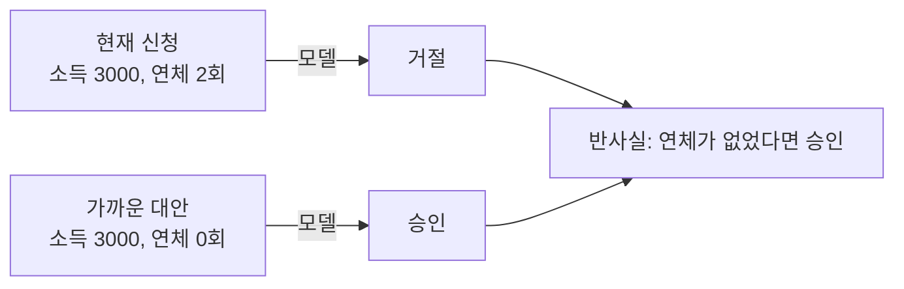

# 반사실 설명

> "무엇이 달랐다면 결과가 달라졌을까"를 알려 주는 설명. 모델 내부를 공개하지 않고도 사용자가 결과를 이해하고 이의를 제기하며 바꿀 방법을 알게 해 준다.

## 쉽게 말하면
"대출이 거절됐습니다. 연소득이 400만 원 더 많았거나 카드 연체가 없었다면 승인됐을 겁니다." 이유 설명보다 "어떻게 하면 되나"에 초점을 둔다.

## 자세히
- **Wachter·Mittelstadt·Russell(arXiv 1711.00399, 초록 확인)**: GDPR의 "설명받을 권리" 논쟁에서, 복잡한 시스템의 내부 논리를 공개하지 않고도 설명을 줄 수 있다고 주장. 설명의 세 목적: ① 결정이 왜 나왔는지 이해 ② 원치 않는 결과에 이의 제기 근거 ③ 원하는 결과를 위해 무엇을 바꿔야 하는지. 제안은 "가장 작은 변화로 원하는 결과를 얻는 상황"을 제시하는 **조건 없는 반사실 설명**.
- **구성**: 현재 입력 x와 결과 y → 가까운 입력 x'에서 다른 결과 y'. "가깝다"는 변경 변수 수·변경 크기로 정의.
- **좋은 반사실의 조건(일반론)**: 현실적으로 바꿀 수 있는 변수만(나이·성별 같은 변경 불가 변수 제외), 변경이 작음, 여러 대안 제시, 모델이 실제로 그 결과를 낸다는 사실이어야 함.
- **한계**: 대안이 여러 개일 수 있고, 모델이 바뀌면 달라지며, 변수 간 상관을 무시하면 비현실적인 조합이 나온다. 인과적 약속이 아니다("이렇게 하면 반드시 승인"이라고 보장하지 않음).
- 대출 통지에서 이유 설명과 병행하는 것이 일반적이다([불리한 조치 통지](#adverse-action-notice)). 기여도 기반 설명은 [Shapley 값](#shapley-values).

## 그림으로 보기

## 예시
- 채용 스크리닝 거절 통지: "관련 경력이 2년에서 3년이었다면 통과" (변경 가능한 항목만).
- 의료 위험 점수: "수축기 혈압이 15 낮았다면 고위험 구간을 벗어남".

## 헷갈리는 것과 비교
| 개념 | 차이 |
|---|---|
| 반사실 설명 | 무엇을 바꾸면 되는가 |
| 특성 기여(SHAP) | 현재 결과에 각 변수가 얼마나 기여 |
| 규칙 기반 설명 | 모델 전체 로직 공개 |

## 더 읽을거리
- [Counterfactual Explanations without Opening the Black Box](https://arxiv.org/abs/1711.00399) — 원논문(초록 확인)
