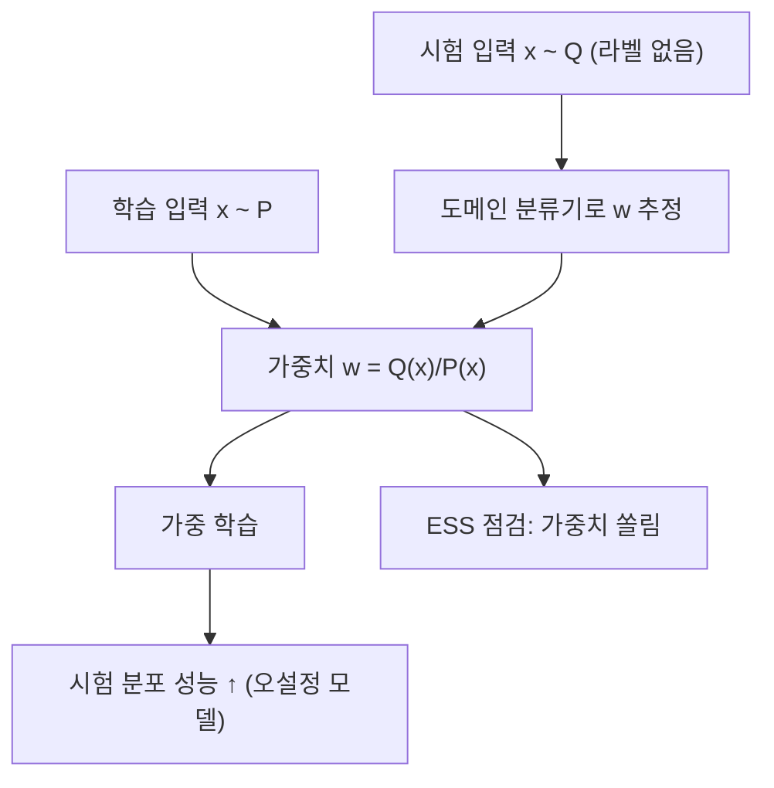

# 공변량 변화와 재가중

> 입력 분포만 달라지고(공변량 변화) 입력→정답 관계는 같을 때, **학습 샘플마다 "시험 분포에서 얼마나 자주 나올 입력인가"를 가중치로 곱해** 학습하면 시험 분포에서의 성능을 높일 수 있다는 방법이다(중요도 가중). 특히 모델이 실제 관계를 정확히 표현하지 못할 때 효과가 크다.

## 쉽게 말하면
학교에서 연습 문제를 풀 때 시험에 자주 나올 유형에 더 많은 비중을 두는 것과 같다. 시험이 2차 방정식 위주라면 2차 방정식 문제의 점수에 가중을 더해 공부 효과를 높이는 식이다. 단, 가중치가 한쪽에 지나치게 쏠리면 몇 문제에 기대는 공부가 된다.

## 자세히
(Shimodaira 2000 논문은 검색 요약으로만 확인했고 본문은 열지 못했다. 효과와 부작용은 직접 시뮬레이션했다.)
- **아이디어(Shimodaira 2000, J. Stat. Planning and Inference 90:227–244, 검색 요약)**: 관측 샘플을 로그우도 최대화에서 **가중**해 예측 밀도를 만든다. 표준 가중치는 시험 입력 밀도 ÷ 학습 입력 밀도다. 후속 문헌은 **모델이 잘못 설정(misspecified)된 경우에만** 공변량 변화가 파라미터 학습에 문제가 되며, 모델이 옳거나 더 풍부하면 일반 최대우도 추정도 일관된다고 설명한다. 또 중요도 가중 학습(IWERM)이 이론적으로 타당하지만 수치 실험에서 **불안정**하다는 보고와, 가중치를 거듭제곱 λ(0~1)로 완화한 변형이 있다고 요약된다(검색 결과 기준, 원문 미확인).
- **직접 시뮬레이션(학습 입력 N(0,1), 시험 입력 N(1.5,1)로 이동, 진짜 함수 sin(x)+0.3x에 선형 모델을 맞춤=오설정, 학습 500건, 50회 반복 평균)**
  | 방식 | 시험(이동된) 분포 MSE | 원래 분포 MSE |
  |---|---|---|
  | 가중 없음 | 0.667 | **0.105** |
  | 참 밀도비 가중 | **0.288** | 0.573 |
  | 도메인 분류기로 추정한 가중 | **0.285** | 0.562 |
  가중으로 시험 분포 오차가 **0.667에서 약 0.29로 절반 이하**가 되지만 **원래 분포에서는 0.105에서 약 0.57로 크게 나빠진다.** 즉 한쪽 분포에 맞추는 선택이다. 도메인 분류기(학습 입력과 시험 입력을 구별하는 로지스틱 회귀)로 구한 추정 가중치도 참 가중치와 거의 같은 효과를 냈다(비라벨 시험 입력만 있으면 가능).
- **이동 크기에 따른 변화(30회 평균, 가중 없음 → 참 가중 MSE, 유효 표본 크기 ESS)**
  | 입력 이동 | MSE 가중 없음 | MSE 참 가중 | ESS(500건 중) |
  |---|---|---|---|
  | 0.5 | 0.143 | 0.140 | 391 |
  | 1.5 | 0.657 | 0.292 | 78 |
  | 3.0 | 4.594 | 0.333 | **10** |
  이동이 작으면 가중 효과가 거의 없고, 이동이 클수록 이득이 커지지만 **유효 표본 크기(Kish)가 500→10으로 줄어** 몇 개 샘플에 의존하게 된다. 이동 3.0에서 MSE가 낮게 나온 것은 이 설정의 단순함 때문이며 실제 데이터에서는 가중치 분산이 커져 불안정해지는 경향이 있다(ESS 값 자체는 직접 계산).
- **적용 조건(제안)**: ① 공변량 변화 가정(입력→정답 관계는 동일)이 맞는지 검증 ② 시험 분포의 비라벨 입력이 있어야 함 ③ 학습 분포가 시험 분포를 충분히 덮어야(공통 지지) 한다 — 시험에서 나오는 입력이 학습에 없으면 가중치가 무한대 ④ 가중치 상한 클리핑·거듭제곱 완화·정규화로 안정화 ⑤ 가중 후 **ESS**를 보고 ⑥ 모델이 충분히 유연하면(오설정이 아니면) 가중이 필요 없을 수 있다.
- **한계**: 라벨 변화나 개념 변화에는 적용되지 않는다([라벨 변화 추정](#label-shift-estimation)). 시뮬레이션은 1차원 합성 설정이다.

## 그림으로 보기

## 예시
- 신규 지역 고객 데이터(라벨 없음)가 기존 고객보다 젊다면 입력 분포 차이를 도메인 분류기로 추정해 기존 라벨 데이터에 가중을 주고 선형 신용 모델을 학습. 이후 ESS와 신규 지역 소량 라벨 검증으로 확인.
- 교육 소재: "시험 범위가 바뀌면 공부 비중을 바꿔라" — 가중치 시뮬레이션 실습.

## 헷갈리는 것과 비교
| 개념 | 차이 |
|---|---|
| 공변량 변화와 재가중 | 입력 분포가 바뀔 때 가중으로 보정 |
| [라벨 변화 추정](#label-shift-estimation) | 클래스 비율이 바뀔 때 |
| [분포 변화 유형](#distribution-shift-types) | 공변량·라벨·개념 변화 분류 |
| 도메인 적응 | 시험 도메인에 맞추는 더 넓은 방법군(재가중은 그 일부) |

## 더 읽을거리
- [Improving predictive inference under covariate shift by weighting the log-likelihood function (Shimodaira, 2000)](https://doi.org/10.1016/S0378-3758(00)00115-4) — 중요도 가중 원전(검색 요약만 확인, 본문 미확인).
