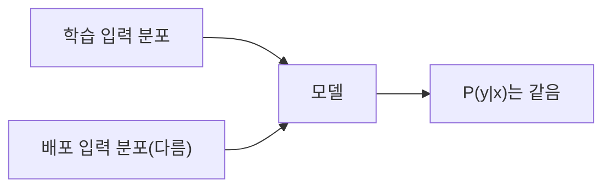
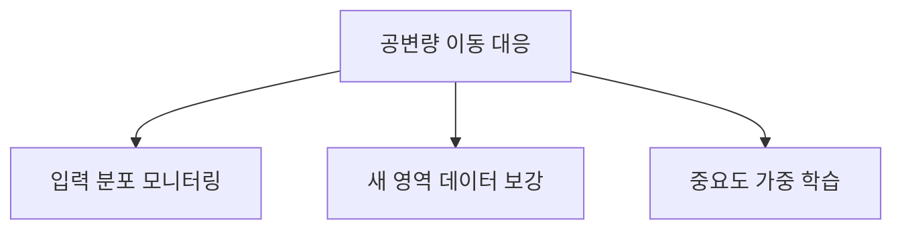

# 공변량 이동

> **입력 분포 P(x)가 바뀌지만 입력이 주어졌을 때의 정답 관계 P(y|x)는 그대로**인 분포 이동. 앞선 [가상 드리프트](#virtual-drift)와 같은 현상을 가리킨다.

## 쉽게 말하면
같은 시험 과목이지만 이번에는 출제 범위가 쉬운 단원에서 어려운 단원으로 몰렸다. 정답 규칙은 그대로인데, 모델이 연습하지 않은 영역의 문제가 많이 나온다.

## 자세히
(검색 요약 기준, 1차 논문 미열람.)
- 정의: 학습 뒤 입력 분포 P(x)가 바뀌지만 조건부 확률 P(y|x)는 같다.
- 탐지: 정답 라벨 없이도 입력만으로 탐지할 수 있다. 두 표본이 같은 분포에서 왔는지 보는 **통계 검정**(Kolmogorov-Smirnov 등)이 대표적이며, 두 표본 검정이 공변량 이동 탐지에 평가되어 왔다. 배포 라벨이 없으면 일반적으로 공변량 이동 탐지에 한정된다는 요약이 있다.
- 대응(내 정리): 새 입력 영역의 데이터를 수집해 보강, 새 분포와 비슷한 학습 표본에 가중치를 주기(중요도 가중), 배포 입력 모니터링.
- 모방 학습과의 연결: 정책이 실행하며 스스로 만든 상태 분포가 시연 분포와 달라지는 것은 공변량 이동의 한 사례로 볼 수 있다([오차 누적](#compounding-error), 내 해석).
- 한계: 입력만 보고 "성능이 떨어질 것"을 항상 예측할 수는 없다. 관계 P(y|x)가 유지된다는 가정이 맞아야 한다.

## 그림으로 보기

## 예시
- 얼굴 인식 모델이 실내 조명 데이터로 학습됐는데 야외 사진이 입력으로 많이 들어옴.
- 교육: 입력 특성 분포 두 그래프(학습 vs 운영)를 비교하는 실습.

## 헷갈리는 것과 비교
| 개념 | 차이 |
|---|---|
| 공변량 이동 | P(x) 변화 |
| [라벨 이동](#label-shift) | P(y) 변화 |
| [개념 이동](#concept-shift) | P(y\|x) 변화 |

## 더 읽을거리
- [Exploring Covariate and Concept Shift](https://arxiv.org/pdf/2110.15231) — 공변량·개념 이동(검색 결과 확인).
