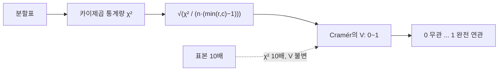

# Cramér의 V

> 분할표(범주형 두 변수의 빈도표)에서 두 변수의 **연관성 크기**를 0~1로 나타내는 효과 크기 지표. 카이제곱 통계량을 표본 크기와 표 크기로 정규화해, 표본이 커져도 값이 부풀지 않는다. 0은 무관, 1은 완전한 연관이다.

## 쉽게 말하면
카이제곱 검정의 p값이 "연관이 있다는 증거가 얼마나 확실한가"라면, Cramér의 V는 "연관이 얼마나 큰가"다. 표본이 많아지면 증거는 확실해지지만 연관의 크기가 커지는 것은 아니다.

## 자세히
출처: SciPy 공식 문서 `scipy.stats.contingency.association`(열어서 읽음) + 이 세션의 직접 계산(scipy 1.17.1).
- **함수**: `association(observed, method='cramer', correction=False, lambda_=None)`는 2차원 분할표에서 두 명목 변수의 연관 정도를 계산한다. 방법은 Cramér의 V(기본), Tschuprow의 T, Pearson 분할 계수. 문서는 V와 T가 phi 계수의 확장이라고 설명한다.
- **해석(문서)**: 1.0은 완전한 연관, 0.0은 연관 없음. 이 함수는 상관이 아니라 독립성에 관한 지표이며, 2×2보다 큰 표에서는 V와 T가 달라질 수 있다. 문서의 예(4×2 표): Pearson ≈ 0.183, Cramér의 V ≈ 0.186, Tschuprow의 T ≈ 0.141. 공식은 문서에 없다.
- **공식(일반 정의, 이번 문서에는 없음)**: V = √(χ² / (n·(min(행, 열) − 1))). 이 세션에서 직접 계산한 결과가 아래와 같이 함수 값과 일치해 공식이 맞음을 확인했다.
- **직접 계산(합성 2×3 표 [[250,300,100],[200,250,300]], 이 세션)**:
  - `association(...)` Cramér의 V = **0.2719**, `correction=True`도 0.2719, 손으로 계산한 √(χ²/(n·1)) = 0.2719.
  - 모든 칸을 10배로 늘려 표본을 10배로 키우면 **V는 0.2719 그대로**이고 χ²는 103.5 → 1,034.9로 10배가 됐다. 효과 크기는 같고 검정 통계량만 커진다.
- **드리프트에서의 쓰임**: 행을 기간(기준·현재), 열을 범주로 둔 분할표의 V를 계산하면 표본 크기에 휘둘리지 않는 변화량 지표가 된다([카이제곱 드리프트 검정](#chi-square-drift)). 앞 노드 실험에서 범주 비율이 1%p만 움직였을 때 V가 작게 유지된 것도 같은 맥락이다.
- **한계**: 표 크기에 따라 해석 기준이 달라지고, "작다/크다"의 절대 기준은 분야 관행이다(이번 문서에서 기준을 확인하지 못함). 편향 보정 옵션(`correction`)의 효과는 이 문서에 설명이 없고 이번 표에서는 값이 같았다.

## 그림으로 보기


## 예시
```python
from scipy.stats.contingency import association
v = association(table, method="cramer")
```
- 점검: 드리프트 경보를 p값이 아닌 V의 임계값(예: 조직이 정한 값)으로 걸면 데이터가 늘어도 경보가 폭주하지 않는다.

## 헷갈리는 것과 비교
| 개념 | 차이 |
|---|---|
| Cramér의 V | 범주형 연관의 효과 크기, 표본 불변 |
| 카이제곱 통계량 | 표본에 비례해 커지는 검정 통계량 |
| p값 | 증거의 강도, 효과 크기와 다름 |
| [카이제곱 드리프트 검정](#chi-square-drift) | V를 보조 지표로 함께 사용 |

## 더 읽을거리
- [scipy.stats.contingency.association (SciPy 문서)](https://docs.scipy.org/doc/scipy/reference/generated/scipy.stats.contingency.association.html) — 방법과 해석(열어서 확인)
