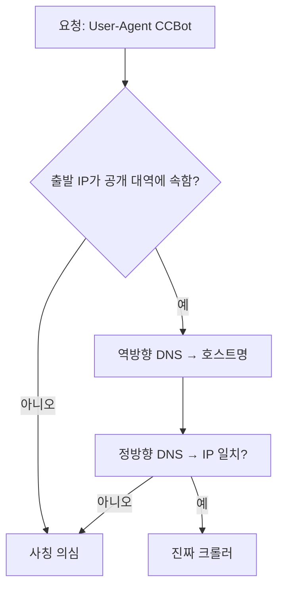
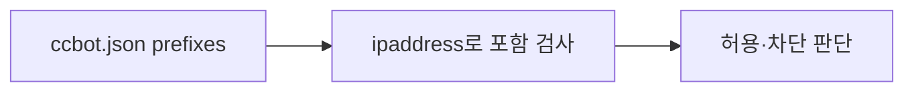

# 크롤러 IP 검증

> 요청의 User-Agent 문자열은 누구나 `CCBot`이라고 **사칭**할 수 있으므로, 진짜 크롤러인지 확인하려면 **출발지 IP가 운영 주체가 공개한 대역에 속하는지**, 그리고 역방향·정방향 DNS가 일치하는지(FCrDNS)를 본다.

## 쉽게 말하면
택배 기사 조끼만 입었다고 믿지 않고, 회사가 알려준 기사 명단(IP 대역)에 있는지 확인하는 일이다. 조끼(User-Agent)는 누구나 살 수 있다.

## 자세히
(Common Crawl이 공개한 `index.commoncrawl.org/ccbot.json`을 직접 내려받아 확인, 2026-11-20)
- 공개 목록: JSON에 `synctoken`, `creationTime`(이 파일은 2026-08-11), `notes`, `prefixes`가 있다. `notes`는 "CCBot이 쓰는 IP 대역. IPv4 검증에는 **FCrDNS도 권장**"이라고 적는다. 내려받은 시점의 대역은 5개: IPv6 `2600:1f28:365:8000::/56`, IPv4 `3.41.188.32/29`, `18.97.9.168/29`, `18.97.14.80/29`, `18.97.14.88/30`.
- 직접 실행(파이썬 `ipaddress`로 대역 포함 여부): `18.97.9.170` → **포함**, `18.97.9.200` → 불포함, `8.8.8.8` → 불포함, `2600:1f28:365:8000::5` → 포함. 같은 User-Agent `CCBot/2.0`으로 `18.97.9.200`이 접속한다면 사칭이다.
- **FCrDNS(전방 확인 역방향 DNS)**: ① IP의 역방향 조회로 호스트 이름을 얻고 ② 그 호스트 이름의 정방향 조회가 **원래 IP로 돌아오는지** 확인. 둘 다 맞아야 통과. (이 샌드박스에서는 역방향 조회가 `herror`로 실패해 직접 시험하지 못했다.)
- 이유: User-Agent는 요청 헤더일 뿐이라 위조가 쉽다. 사이트 운영자는 CCBot 차단·허용 정책을 적용하기 전에 IP 대역으로 진짜인지 확인해 사칭 트래픽을 따로 처리할 수 있다.
- 주의(제안): 대역 목록은 시간에 따라 바뀌므로(`synctoken`·`creationTime`) 주기적으로 갱신한다. 사칭 크롤러는 robots.txt를 지키지 않을 수 있어([robots.txt 기본](#robots-txt-basics)) 정책만 믿지 않고 서버 방화벽·레이트 리밋도 함께 쓴다.

## 그림으로 보기



## 예시
```python
import ipaddress, json
nets=[ipaddress.ip_network(p.get('ipv4Prefix') or p['ipv6Prefix']) for p in json.load(open('ccbot.json'))['prefixes']]
ok = any(ipaddress.ip_address('18.97.9.170') in n for n in nets)
```
- 서버 로그에서 `CCBot` 요청 중 대역 밖 IP를 따로 집계해 사칭 규모 파악.
- 교육: "신분증(UA)이 아니라 출입 명단(IP)로 확인한다."

## 헷갈리는 것과 비교
| 개념 | 차이 |
|---|---|
| User-Agent | 자기 소개(위조 쉬움) |
| IP 대역 검증 | 공개 목록과 대조 |
| FCrDNS | 역·정방향 DNS 일치 확인 |
| [robots.txt](#robots-txt-basics) | 준수 의사를 기대하는 규약 |

## 더 읽을거리
- [CCBot IP 대역 목록](https://index.commoncrawl.org/ccbot.json) — 이 글의 대역과 notes(직접 내려받음).
