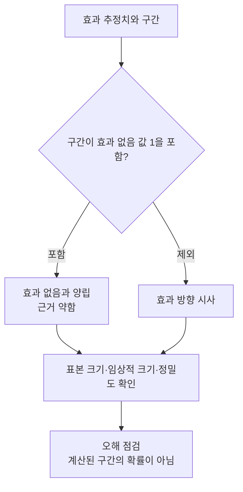

# 신뢰구간 읽기

> 효과 크기(위험비·오즈비 등)에 붙는 구간 추정의 읽는 법. 구간이 "효과 없음" 값(비율이면 1)을 포함하면 그 데이터만으로는 효과가 있다고 말하기 어렵다. 다만 구간의 뜻은 흔히 오해되므로 해석에 주의가 필요하다.

## 쉽게 말하면
"이 약은 위험을 1.26배 높인다, 범위는 1.11~1.44배"라는 말에서, 범위가 1 이상이면 "높이는 쪽"이라 읽는다. 범위가 0.9~1.8처럼 1을 걸치면 "줄일 수도, 늘릴 수도 있다"는 뜻이라 근거가 약하다. 하지만 범위 안의 어느 값이든 같은 확률로 참이라는 뜻은 아니다.

## 자세히
출처: Morey 외, "The fallacy of placing confidence in confidence intervals"(Psychonomic Bulletin & Review, 2016, PMC 원문 앞부분 열어서 읽음), 검색 요약(MPOG 마취과 안내, 블로그 등 2차 자료).
- **1을 포함하는 구간**: 위험비·오즈비·위험비율 구간이 1을 포함하면 "효과 없음"과 양립하므로 통상 통계적으로 유의하지 않다고 읽는다(검색 요약). 구간이 널값을 제외하는 쪽이 더 정밀한 추정이라는 설명도 있으나, 정밀도의 의미는 아래 오해에 주의.
- **신뢰구간의 정확한 뜻(Morey 외)**: 구간을 만드는 **절차**가 장기적으로 참값을 포함하는 비율(신뢰 수준)을 말한다. 이미 계산된 한 구간이 95% 확률로 참값을 포함한다는 말이 아니다.
- **세 가지 오류(논문)**: ① 근본적 신뢰 오류: 계산된 구간이 X%의 확률로 참값을 포함한다고 읽음. ② 정밀도 오류: 좁은 구간 = 정밀한 지식, 넓은 구간 = 부정확한 지식이라고 읽음. ③ 우도 오류: 구간 안의 값이 밖의 값보다 더 그럴듯하다고 읽음. 논문은 신뢰구간이 이런 성질을 갖지 않을 수 있다고 반례를 든다.
- **신뢰구간 대 신뢰할 수 있는 구간(credible interval)**: 베이지안 신뢰할 수 있는 구간은 사전 분포 아래에서 모수에 관한 확률 진술로 쓰도록 설계됐다. 논문도 사후 결론을 내리려면 다른 틀(예: 명시된 사전 분포의 베이지안 구간)의 정당화가 필요하다고 제안한다. 소표본에서 두 구간이 비슷한 실용 결론을 주는 예도 있다(검색 요약, 블로그 수준).
- **소표본 주의(검색 요약)**: Wald 구간은 소표본·극단 비율에서 성능이 나쁘고 Wilson이나 Clopper-Pearson이 대안으로 제시된다.
- **실무 읽기**: 구간의 폭과 위치, 표본 크기, 사전에 정한 임상적 의미 있는 크기를 함께 보고, "유의하다/아니다"로만 판정하지 않는다.

## 그림으로 보기

## 예시
- 리콜 연구: "임상 검증 부재 OR 2.8, 95% CI 1.6~4.7"은 1을 포함하지 않으므로 연관을 시사하지만, 인과나 개별 기기의 위험 확률을 뜻하지는 않는다([임상 검증과 리콜](#clinical-validation-recalls)).
- 구간이 0.8~3.0처럼 1을 걸치면 "차이가 없다"가 아니라 "이 데이터로는 판단 불가"에 가깝다.

## 헷갈리는 것과 비교
| 개념 | 차이 |
|---|---|
| 신뢰구간 | 절차의 장기 포함 비율 |
| 신뢰할 수 있는 구간 | 사전 분포 하에서 모수의 확률 진술, 틀이 다름 |
| p값 | 귀무가설 아래 관찰 이상의 극단 확률, 구간과 서로 보완 |
| [AI 기기 리콜](#ai-device-recalls) | 이 해석이 적용되는 사례 |

## 더 읽을거리
- [The fallacy of placing confidence in confidence intervals (PMC)](https://pmc.ncbi.nlm.nih.gov/articles/PMC4742505/) — 세 오류와 올바른 해석(앞부분 열어서 확인)
- [Credible vs. Confidence Intervals (MeasuringU)](https://measuringu.com/credible-vs-confidence-intervals/) — 두 구간의 비교(검색 결과로만 확인)
